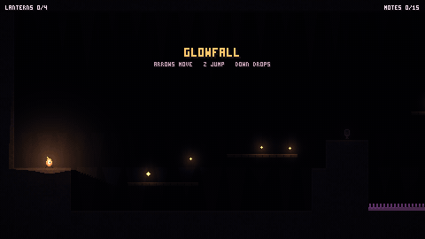
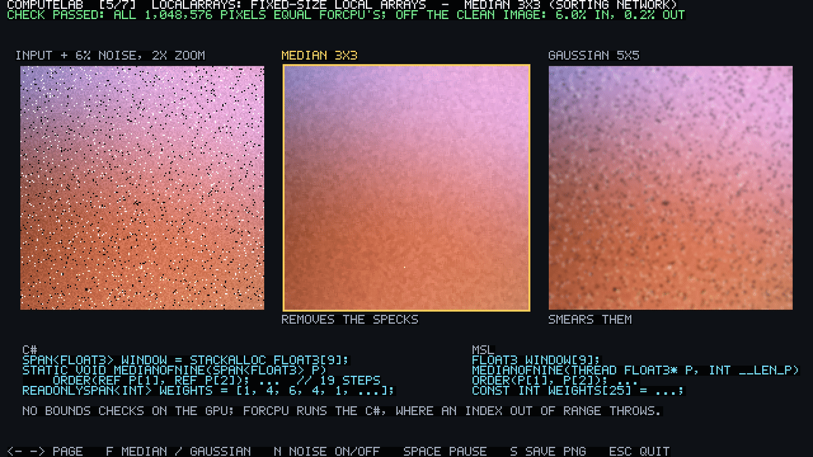

# SharpCompute

**Write GPU compute shaders in C# and run them on Metal, Vulkan and OpenGL.** A Roslyn source
generator translates shader structs to the GPU's shading language at build time; a small,
dependency-free runtime compiles, caches and dispatches them.

[ComputeSharp](https://github.com/Sergio0694/ComputeSharp) pioneered this model for **DirectX 12 on
Windows**. SharpCompute's goal is to bring the same experience to the **other GPU APIs**, so the
same C# shader code can run on macOS, Linux, Android and more:

| Backend | Platforms | Status |
|---|---|---|
| **Metal** | macOS on Apple Silicon (iOS later) | ✅ Available |
| **Vulkan** | Windows, Linux, Android; macOS via MoltenVK | 🛠 Planned, next |
| **OpenGL 4.3** | Windows, Linux | 🛠 Planned |
| DirectX 12 | Windows | Use [ComputeSharp](https://github.com/Sergio0694/ComputeSharp) |


```csharp
using SharpCompute;

[GeneratedComputeShaderDescriptor]
public readonly partial struct MultiplyByTwo(ReadWriteBuffer<float> buffer) : IComputeShader
{
    public void Execute() => buffer[ThreadIds.X] *= 2;
}

GraphicsDevice device = GraphicsDevice.GetDefault();
using ReadWriteBuffer<float> buffer = device.AllocateReadWriteBuffer<float>([1, 2, 3, 4]);
device.For(buffer.Length, new MultiplyByTwo(buffer));
float[] result = buffer.ToArray(); // [2, 4, 6, 8]
```

> **Status: early development.** APIs may change, and there is no NuGet package yet; reference the
> projects directly (see [Using it in your project](#using-it-in-your-project)).

## Games built with it

**Glowfall** (`scripts/demo-glowfall.sh`): an original 2D platformer. Every pixel, per-pixel light
with tile shadows and particle is computed by SharpCompute shaders, and its music and sound effects
are synthesized on the GPU.



**Pulsewake** (`scripts/demo-pulsewake.sh`): an original neon twin-stick arena shooter. GPU
particles, glowing vector shapes, two-level bloom and shockwave distortion all run as SharpCompute
shaders in one submission per frame. It's the same genre as
[MonoGame's NeonShooter sample](https://github.com/MonoGame/MonoGame.Samples/tree/3.8.4/NeonShooter),
here as an original game built on SharpCompute.


## Features

- **Shaders are plain C#.** `Execute()` is translated to Metal Shading Language at build time, with
  binding code generated for you. Unsupported C# is a build error (`SCGxxxx`) pointing at the exact
  construct.
- **Two shader kinds.** `IComputeShader` for general compute over 1D/2D/3D grids
  (`device.For(x, y, z, shader)`), and `IComputeShader<Float4>` pixel shaders that return a color per
  pixel into a texture (`device.ForEach(texture, shader)`).
- **Textures in shaders.** `ReadOnlyTexture2D<T>` is read and sampled (point or bilinear; clamp,
  repeat or mirror), `ReadWriteTexture2D<T>` is read and written, in eight pixel formats from 8-bit
  to float. A texture one pass wrote can be sampled by the next.
- **Threadgroup shared memory and barriers.** `[GroupShared] static readonly float[] tile = new float[256];`
  is memory the threads of a threadgroup share, `Gpu.GroupMemoryBarrierWithGroupSync()` is where they
  meet, and `GroupSize`, `GroupIds.Index` and `ThreadGroupCount` tell a thread where it is: what
  reductions, prefix sums and tiled algorithms are built from. Such shaders run on the CPU too.
- **SIMD-group operations.** HLSL's wave intrinsics on Apple GPUs: `Gpu.WaveActiveSum`,
  `WaveActiveBallot`, `WavePrefixSum`, `WaveShuffleUp` and the rest reduce, vote, scan and exchange
  values across the 32 threads of a SIMD group in one step, with no shared memory and no barrier. Such
  shaders run on the CPU too.
- **Local arrays.** `Span<float> taps = stackalloc float[9];`, `float[] w = new float[9];`,
  `ReadOnlySpan<int> weights = [1, 4, 6, 4, 1];` and `[InlineArray(N)]` structs become fixed-size
  arrays of one GPU thread: filter taps and weights, sorting networks, small stacks and histograms.
  Index them, loop over them with `foreach`, and pass them to helpers. See [Local arrays](#local-arrays).
- **HLSL-like shader library.** `Float2..4`, `Int2..4`, `UInt2..4` with every swizzle,
  `Float2x2`/`Float3x3`/`Float4x4` with `Gpu.Mul`, `Half`, user structs, and about 60 `Gpu.*`
  intrinsics (`MathF.*`, `BitOperations.*` and `BitConverter.*` work too). Static and instance helper
  methods, local functions, `ref`/`out` parameters, all loops and branches, and compile-time-folded
  `static readonly` constants.
- **Atomics.** `Gpu.AtomicAdd(ref counts[bin], 1)` and friends on buffer elements, for histograms,
  counters and stream compaction where many threads write the same element, and on `[GroupShared]`
  elements (`int`, `uint` and the `float` add), where only the threads of one threadgroup contend. They are atomic on the
  CPU too, so `ForCpu` gives the same answer. See the [shader language reference](#shader-language-reference).
- **Zero-copy buffers.** Buffers live in unified memory, so `AsSpan()` and indexers read GPU
  results directly, and data can be produced straight into GPU memory (an image decoder can write
  into `AsSpan()`). `MapReadOnlyBuffer` puts a file on the GPU without reading it into memory first,
  and `WrapReadWriteBuffer` makes a buffer over page-aligned memory you already own.
- **Batched and asynchronous dispatch.** A `ComputeContext` runs many dispatches with one commit and
  one wait; `ForAsync`/`ForEachAsync` return a `Task` so the CPU keeps working while the GPU runs.
- **Buffer views, GPU copies and indirect dispatch.** `buffer.Slice(start, length)` binds part of a
  buffer as a buffer of its own. `Copy`, `Fill` and `Clear` run on the GPU, in order with the
  dispatches of a context. `ForIndirect` takes its thread count from a buffer an earlier pass wrote,
  so the GPU decides how much work the next pass does. `device.Prepare<T>()` compiles a shader
  before its first frame. See [Buffers and dispatch](#buffers-and-dispatch).
- **Interop with existing Metal code.** `GraphicsDevice.FromNative` runs SharpCompute on an app's
  own `MTLDevice` and queue, `WrapNativeReadWriteBuffer`/`WrapNativeReadWriteTexture2D` adopt its
  buffers and textures (private storage included), `NativeHandle` hands SharpCompute's objects to
  other Metal code, and `ComputeContext.EncodeInto` puts compute passes into the app's own command
  buffer, between its render passes. See [Interop with existing Metal code](#interop-with-existing-metal-code).
- **CPU execution and CPU+GPU split.** The same shader also runs as C# on all CPU cores
  (`device.ForCpu`), or split between the CPU and the GPU in one dispatch (`device.ForSplit`).
- **Correct by default.** Shaders compile with IEEE-safe math and precise functions (a shader opts
  into fast math, or out of fused multiply-adds, with `[ShaderOptions]`), and every
  shader that passes structs or constants carries `static_assert` layout guards. The CPU
  implementations of `Gpu.*` were measured against Apple GPU results: bit-for-bit for arithmetic,
  rounding functions, `sqrt` and `fmod`, and within a few ULP for transcendentals.
- **Live presentation.** `MetalWindow` shows GPU output in a native macOS window at display refresh
  rate, with keyboard and mouse input: `KeyDown`/`KeyUp` events, plus `IsKeyDown(key)` and
  `HeldModifiers` to poll what is held each frame (released automatically when the window loses focus).
  `MouseWheel` reports wheel and trackpad scrolling with the pointer position in pixels.
- **No dependencies, AOT-friendly.** The runtime talks to Metal through hand-written
  `LibraryImport` interop.

## Demos

Each script builds in Release, writes to `demo-output/` and opens the result (`NO_OPEN=1` to skip).

| Script | What it shows |
|---|---|
| `scripts/demo-viewer.sh` | **Live window:** every gallery shader, Game of Life and a 16k-body N-body simulation (drag to orbit, wheel to zoom). ←/→ switch, Space pause, S save PNG, Esc quit |
| `scripts/demo-paint.sh` | **Live window:** a GPU paint app with brushes, filters and undo. The scroll wheel (or a two-finger scroll) sets the brush size, Shift+wheel the hardness; the title bar shows both. `--replay` paints a scripted scene |
| `scripts/demo-glowfall.sh` | **Game:** *Glowfall*, an original 2D platformer. A lantern spirit relights three dark caverns; every pixel, per-pixel light with tile shadows and particle is computed by SharpCompute shaders, the music and sound effects are synthesized on the GPU, and the game logic runs at a fixed 120 Hz on the CPU. `--demo` watches a pilot play, `--headless` writes PNG frames, `--check-levels` proves each level can be finished |
| `scripts/demo-gallery.sh` | The shader gallery as PNGs (`--video` for mp4s, `--shader <name>` for one) plus a benchmark |
| `scripts/demo-mandelbrot.sh` | A deep-zoom Mandelbrot video (perturbation theory, down to ~1e-30) |
| `scripts/demo-imgproc.sh [photo] [filter args]` | GPU vs CPU image filters on a 4K test image or your own photo (JPEG/PNG/HEIC) |
| `scripts/demo-helloworld.sh` | MultiplyByTwo, SAXPY over 1M floats and a 1080p Mandelbrot |
| `scripts/demo-pipeline.sh` | A double-buffered pipeline: the GPU renders frame N+1 (`ForAsync`) while the CPU post-processes frame N; sync vs async throughput |
| `scripts/demo-audio.sh` | **Sound:** chiptune sound effects and a short loop synthesized on the GPU (one thread per sample), played through AudioToolbox for ~10 s at half volume. `--wav <dir>` writes WAVs instead |
| `scripts/demo-pulsewake.sh` | **Game:** *Pulsewake*, an original neon twin-stick arena shooter: Drifters that split, Lancers that lock on and dash, Weavers that circle and fire, Pylons that send out rings to dodge, waves, a score multiplier and smart bombs. Vector shapes drawn as signed distances, up to 65,536 GPU particles binned into screen tiles without atomics, multi-pass bloom and shockwave distortion, one long-lived `ComputeContext` executed every frame; the sound is synthesized on the GPU. The same genre as MonoGame's [NeonShooter sample](https://github.com/MonoGame/MonoGame.Samples/tree/3.8.4/NeonShooter), here an original game built on SharpCompute. `--demo` watches an autopilot, `--headless` writes PNG frames and frame times |
| `scripts/demo-textures.sh` | **Live window:** textures in shaders at a glance. One picture magnified through all six samplers side by side (Point/Linear × Clamp/Repeat/Mirror), in any of the eight texture formats, and a reaction-diffusion that ping-pongs between two read-write textures while you paint into it. Tab switches, F cycles formats, the scroll wheel (or a two-finger scroll) zooms around the pointer, +/- zoom, drag pans or paints. `--headless` writes a PNG per format and mode |
| `scripts/demo-computelab.sh` | **Live window:** *ComputeLab*, one page per core compute feature. Each page runs the feature on the GPU, checks the result against the CPU (`ForCpu` of the same shader) and shows GPU ms vs CPU ms. **Histogram:** a 256-bin luminance histogram of an animated image with `Gpu.AtomicAdd`; C folds it into 4 bins to show what contention costs. **Histogram: privatised:** the same histogram counted per threadgroup with atomics on `[GroupShared]` memory and merged with one buffer atomic per bin per group, next to the global-atomics version on the same image, with the GPU time of both. **Compaction:** keeps the passing elements of a million through one atomic counter, and shows why their order is not kept. **Bits:** popcount, bit reversal, clz/ctz, float bit patterns and unorm8 packing as pictures. **LocalArrays:** a 3 × 3 median filter (a nine-element `stackalloc` array and a sorting network) and a 5 × 5 Gaussian (a `ReadOnlySpan<int>` weight table) on the animated image; N toggles salt-and-pepper noise to show what the median removes, F switches the timed filter. **Indirect:** a compaction pass counts its survivors, and the follow-up pass is dispatched over exactly that many with `ForIndirect`, in one execution; D steps through the two full-array alternatives (after the same compaction, and with no compaction) for comparison. **FastMath:** one transcendental-heavy kernel with and without `[ShaderOptions(FastMath = true)]`: GPU ms both ways and the error against the CPU. ←/→ switch page, Space pause, S save PNG. `--headless` writes a PNG per page and a summary<br><a href="docs/screenshots/computelab-local-arrays.png"></a> |
| `scripts/demo-groupshared.sh` | **Live window:** threadgroup shared memory and barriers, one page per algorithm. The sum of 16.7M floats by a tree in shared memory (and why it is more accurate than a loop), a work-efficient prefix sum of 1M flags used for order-preserving stream compaction, a 1024 × 1024 matrix product in 16 × 16 shared-memory tiles against the naive kernel, in GFLOP/s, and a separable blur that loads a tile plus apron into shared memory. Every page checks the GPU against plain C# and shows GPU ms vs CPU ms. ←/→ switch, V variant, Up/Down threshold or radius. `--headless` writes a PNG per page and a summary |
| `scripts/demo-simdgroups.sh` | **Live window:** SIMD-group operations, three pages, each checked against the CPU and timed. A reduction race (the sum of 16M floats three ways), a stream compaction of 32,768 particles built from `WaveActiveBallot` and `WavePrefixSum` with no atomics, and a signal smoothed inside each SIMD group with `WaveShuffleUp`/`Down`, so the group edges show. `--headless` writes a PNG per page and a summary |
| `scripts/demo-nativeinterop.sh`<br> | **Live window:** SharpCompute inside an app that already renders with Metal. A small host renderer written straight against Metal (its own device, queue, particle buffer, textures and render pipeline) draws a textured quad and an instanced particle field; SharpCompute wraps the host's objects and encodes a particle simulation before the host's scene pass and a post-process (ripples, color split, bloom) after it, into the host's own command buffer. 1 and 2 toggle the two passes, click or drag moves the ripples, S save PNG. The title bar shows fps and the frame's GPU time. `--headless` writes the same frames every run: both passes, each one off, and the host alone |
| `scripts/run-benchmarks.sh` | The GPU vs CPU benchmark suite, written to `benchmarks/RESULTS.md` |
| `scripts/run-demos.sh` | Everything that doesn't need a window (`--video`, `--test`) |

The gallery includes ports of the Shadertoy shaders from ComputeSharp's samples. Those ports are
licensed **CC BY-NC-SA 3.0**, not MIT; see [`samples/SharpCompute.Samples.Shaders/NOTICE.md`](samples/SharpCompute.Samples.Shaders/NOTICE.md).

## Performance

Apple M4 Pro, GPU vs the **fastest** CPU variant (multi-threaded and SIMD where it applies). The full
report, including how each number was measured and the machine load, is in
[`benchmarks/RESULTS.md`](benchmarks/RESULTS.md).

| Workload | Size | Fastest CPU | GPU | GPU speedup |
|---|---|---:|---:|---:|
| Mandelbrot (512 iterations) | 1920×1080 | 9.16 ms | 0.54 ms | **17×** |
| Mandelbrot (512 iterations) | 256×256 | 1.00 ms | 0.15 ms | **6.8×** |
| N-body step | 16,384 bodies | 13.8 ms | 3.95 ms | **3.5×** |
| Matrix multiply (naive) | 1024×1024 | 13.7 ms | 4.39 ms | **3.1×** |
| Gaussian blur, radius 8 | 3840×2160 | 2.25 ms | 1.68 ms | **1.3×** |
| SAXPY `y = a·x + y` | 16M floats | 0.85 ms | 1.01 ms | 0.84× (CPU wins) |

How to read this: GPU times are one synchronous dispatch and exclude uploading inputs and reading
results back. Every dispatch has a fixed cost of roughly 0.1 ms, and Apple Silicon's CPU and GPU
share the same memory. Compute-heavy work wins big; memory-bound work like SAXPY doesn't. The
generated SAXPY kernel runs at the same speed as hand-written MSL (ratio 0.99–1.01).

Moving and converting data can cost more than the kernel, and unified memory means it can be
skipped: decode into the GPU buffer, convert and filter on the GPU, encode from the buffer.

| Data path | Size | Before | Zero copy | Speedup |
|---|---|---:|---:|---:|
| RGBA8 image → blur → RGBA8, CPU conversions + Float4 copies (fastest CPU: 21.8 ms) | 3840×2160 | 12.2 ms | 3.10 ms | **3.9×** (7.0× vs CPU) |
| Same kernels, only the copies of the bytes in and out removed | 3840×2160 | 4.28 ms | 3.10 ms | 1.4× |
| File of floats → GPU sum (`MapReadOnlyBuffer`) | 256 MB | 42.0 ms (`ReadAllBytes` + upload) | 4.06 ms | **10.3×** |

### Unified memory: when it helps and when it doesn't

On Apple silicon the CPU and the GPU share the same memory, so there is no upload or download over a
bus. The gains come from not copying at all and from overlapping work. They don't come from extra
bandwidth: both sides use the same memory controller.

| Helps | Measured | Doesn't help | Why |
|---|---|---|---|
| Decode or read straight into GPU memory, convert on the GPU | 4K image pipeline 12.2 → 3.10 ms | Memory-bound kernels (SAXPY) | Same bandwidth; the CPU ties or wins |
| `MapReadOnlyBuffer` instead of reading a file | 256 MB: 42.0 → 4.06 ms | Tiny one-off dispatches | ~0.1 ms floor per dispatch; the CPU finishes first |
| Many small dispatches in one `ComputeContext` | ~99 µs → ~1.9 µs per dispatch | Single heavy kernels | Nothing to copy or batch |
| `ForAsync` double-buffering, CPU and GPU in parallel | 1.38× (7 % above the ideal) | GPU-private buffers | Same speed as shared on Apple silicon |
| | | Splitting one grid between CPU and GPU (`ForSplit`) | 0.97–1.09× of GPU-only: scalar C# on the CPU, and the GPU slows while the CPU is busy |

The full guide, with how to choose an API and the lifetime rules that come with zero copy, is
[`docs/unified-memory.md`](docs/unified-memory.md).

## Using it in your project

Requirements: macOS 15 or later on Apple Silicon, and the .NET 11 SDK.

Reference the runtime, and the generator as an analyzer:

```xml
<ItemGroup>
  <ProjectReference Include="path/to/src/SharpCompute/SharpCompute.csproj" />
  <ProjectReference Include="path/to/src/SharpCompute.SourceGenerators/SharpCompute.SourceGenerators.csproj"
                    OutputItemType="Analyzer" ReferenceOutputAssembly="false" />
</ItemGroup>
```

A pixel shader, rendered into a texture:

```csharp
[GeneratedComputeShaderDescriptor]
public readonly partial struct Gradient(float time) : IComputeShader<Float4>
{
    public Float4 Execute()
    {
        Float2 uv = ThreadIds.Normalized.XY;
        Float3 color = new Float3(0.5f, 0.5f, 0.5f) + (0.5f * Gpu.Cos(new Float3(time + uv.X, time + uv.Y, time + 4f)));
        return new Float4(color, 1f);
    }
}

using ReadWriteTexture2D<Rgba32> texture = device.AllocateReadWriteTexture2D<Rgba32>(1280, 720);
device.ForEach(texture, new Gradient(time: 1.5f));
Rgba32[] pixels = texture.ToArray();
```

Zero-copy data paths (the CPU and the GPU share the same memory, so skip the copies):

```csharp
// Write input straight into GPU memory, e.g. decode or read a file into it.
using ReadWriteBuffer<uint> pixels = device.AllocateReadWriteBuffer<uint>(width * height);
DecodeInto(MemoryMarshal.AsBytes(pixels.AsSpan()));

// A file of raw floats, read by the GPU from the page cache: no ReadAllBytes, no upload.
using ReadOnlyBuffer<float> samples = device.MapReadOnlyBuffer<float>("samples.f32");

// Memory you already own, if it starts on a page boundary (GraphicsDevice.PageSize).
void* memory = NativeMemory.AlignedAlloc(byteCount, (nuint)GraphicsDevice.PageSize);
using ReadWriteBuffer<float> wrapped = device.WrapReadWriteBuffer<float>((nint)memory, count, () => NativeMemory.AlignedFree(memory));
```

### Textures

Shaders capture textures like buffers. A `ReadOnlyTexture2D<T>` is read with `texture[x, y]` (or an
`Int2`) and sampled with `texture.Sample(sampler, uv)`; a `ReadWriteTexture2D<T>` is read and written
with its indexer. Every pixel is a `Float4` in the shader, whatever `T` is; `Width` and `Height`
work too. A thread that writes a pixel and reads it back gets what it wrote, as in C# (the
generator emits the `fence()` Metal needs for that). Textures are zero-copy like buffers:
`CopyFrom`, `CopyTo` and `ToArray` go straight to the shared memory.

| `T` | Metal format | A shader reads | `ReadWriteTexture2D` |
|---|---|---|---|
| `Rgba32` | `RGBA8Unorm` | `(r, g, b, a) / 255` | yes |
| `Rgba32Srgb` | `RGBA8Unorm_sRGB` | linear `r, g, b`; `a / 255` | no |
| `R8` | `R8Unorm` | `(r / 255, 0, 0, 1)` | yes |
| `Rg16` | `RG8Unorm` | `(r / 255, g / 255, 0, 1)` | no |
| `Half` | `R16Float` | `(r, 0, 0, 1)` | yes |
| `Rgba16Float` | `RGBA16Float` | `(r, g, b, a)` | yes |
| `float` | `R32Float` | `(r, 0, 0, 1)` | yes |
| `Float4` | `RGBA32Float` | `(r, g, b, a)` | yes |

Samplers are the six static properties of `Sampler`, passed directly to `Sample`: `PointClamp`,
`PointRepeat`, `PointMirror`, `LinearClamp`, `LinearRepeat` and `LinearMirror`. Coordinates are
normalized, with pixel centers at `(x + 0.5) / Width`. Each one a shader uses is compiled into it,
so there is nothing to allocate or bind.

Metal can't sample a texture that the same shader may write, so a read-write texture has no
`Sample`. To sample what one pass wrote, bind `AsReadOnly()` in the next pass. It is a view of the
same texture, not a copy:

```csharp
[GeneratedComputeShaderDescriptor]
public readonly partial struct Diffuse(ReadWriteTexture2D<float> source, ReadWriteTexture2D<float> target) : IComputeShader
{
    public void Execute()
    {
        int x = ThreadIds.X;
        int y = ThreadIds.Y;
        float sum = source[Gpu.Max(x - 1, 0), y].X + source[Gpu.Min(x + 1, source.Width - 1), y].X
                  + source[x, Gpu.Max(y - 1, 0)].X + source[x, Gpu.Min(y + 1, source.Height - 1)].X;

        target[x, y] = new Float4(sum * 0.25f);
    }
}

[GeneratedComputeShaderDescriptor]
public readonly partial struct ShowHeat(ReadOnlyTexture2D<float> heat) : IComputeShader<Float4>
{
    public Float4 Execute()
    {
        float value = heat.Sample(Sampler.LinearClamp, ThreadIds.Normalized.XY).X;
        return new Float4(value, 0f, 1f - value, 1f);
    }
}

using ReadWriteTexture2D<float> a = device.AllocateReadWriteTexture2D<float>(initialHeat, 256, 256);
using ReadWriteTexture2D<float> b = device.AllocateReadWriteTexture2D<float>(256, 256);
using ReadOnlyTexture2D<float> result = a.AsReadOnly();
using ReadWriteTexture2D<Rgba32> frame = device.AllocateReadWriteTexture2D<Rgba32>(1280, 720);

using (ComputeContext context = device.CreateComputeContext())
{
    for (int i = 0; i < 16; i++)
    {
        context.For(256, 256, new Diffuse(a, b)); // ping
        context.For(256, 256, new Diffuse(b, a)); // pong
    }

    context.ForEach(frame, new ShowHeat(result)); // samples what the last pass wrote
}
```

`scripts/demo-textures.sh` shows all of this live: the six samplers side by side on any of the eight
formats, and a simulation that ping-pongs between two textures while you paint into it.

Shaders with textures run on the CPU too (`ForCpu`, `ForSplit`), with the same reads, writes and
address modes. The CPU is exact where the GPU (measured on an M4 Pro) is not quite:

- Bilinear filtering: the GPU rounds its weights to 1/256, so a bilinear sample written to an 8-bit
  format can differ by one step between `ForCpu` and the GPU.
- sRGB decoding: the GPU decodes to 12 bits.
- Point sampling picks the same pixel with Clamp, for coordinates in [0, 1) and for power-of-two
  sizes. With Repeat or Mirror outside [0, 1) on other sizes, a coordinate within float rounding of
  a pixel boundary can pick the neighbouring pixel on the GPU.

### Threadgroup shared memory and barriers

The GPU runs a grid in threadgroups (`[ThreadGroupSize]`, 256 threads by default for a 1D grid). A
`[GroupShared]` array is memory that the threads of one group share, and a barrier is the point
where they all wait for each other, so that what one thread wrote before it another can read after
it. Together they turn independent threads into a team, here summing 256 values in eight steps:

```csharp
[ThreadGroupSize(256)]
[GeneratedComputeShaderDescriptor]
public readonly partial struct SumBlocks(ReadOnlyBuffer<float> input, ReadWriteBuffer<float> sums, int count) : IComputeShader
{
    [GroupShared]
    private static readonly float[] tile = new float[256];

    public void Execute()
    {
        int i = ThreadIds.X;
        int local = GroupIds.X;

        tile[local] = i < count ? input[i] : 0f;       // every thread loads one value
        Gpu.GroupMemoryBarrierWithGroupSync();

        for (int half = 128; half > 0; half >>= 1)
        {
            if (local < half)
            {
                tile[local] += tile[local + half];     // the lower half adds the upper half
            }

            Gpu.GroupMemoryBarrierWithGroupSync();     // outside the if: every thread calls it
        }

        if (local == 0)
        {
            sums[ThreadGroupIds.X] = tile[0];
        }
    }
}

device.For((count + 255) / 256 * 256, new SumBlocks(input, sums, count)); // whole threadgroups
```

| C# | MSL |
|---|---|
| `[GroupShared] static readonly T[] name = new T[N];` | `threadgroup T name[N];` in the kernel; helpers that use it receive `threadgroup T* name` |
| `name[i]`, `name.Length` | `name[i]`, the constant `N` |
| `Gpu.GroupMemoryBarrierWithGroupSync()` | `threadgroup_barrier(mem_flags::mem_threadgroup)` |
| `Gpu.DeviceMemoryBarrierWithGroupSync()` | `threadgroup_barrier(mem_flags::mem_device)` (plus `mem_texture` when the shader has a read-write texture) |
| `Gpu.AllMemoryBarrierWithGroupSync()` | `threadgroup_barrier` with all of those flags |
| `GroupSize.X/Y/Z/XY/XYZ`, `GroupSize.Count` | `threads_per_threadgroup`, and the product of its components |
| `GroupIds.Index` | `thread_index_in_threadgroup` |
| `ThreadGroupCount.X/Y/Z/XY/XYZ` | `threadgroups_per_grid` |

- `T` is anything a buffer can hold (scalars, vectors, `Float4x4`, your own structs), `N` a
  compile-time constant, and the field belongs to the shader struct that uses it. The arrays a
  shader uses may total 32,768 bytes, the threadgroup memory of an Apple GPU (`SCG0043` beyond that).
- Give the shader an explicit `[ThreadGroupSize]`: its arrays are sized for it. Without one the
  runtime picks the size per dispatch, and an array too short for that size is indexed out of bounds
  silently on the GPU, so using an array of fewer than 1,024 elements in such a shader is warning
  `SCG0044`.
- **Threadgroup memory starts out undefined**, on the GPU and on the CPU: a thread may only read what
  a thread of its own group wrote, with a barrier in between.
- Threads of a group can also update one `int` or `uint` element at the same time, without a barrier
  between them, with `Gpu.Atomic*(ref tile[i], ...)`: see
  [atomics on threadgroup memory](#shader-language-reference).
- **Every thread of a group must call the same barriers.** A barrier inside an `if` or a loop that
  only some threads of the group enter, or after a `return` only some take, is undefined on the GPU,
  and the generator cannot detect it. Put conditions around the work, as above.
- A grid that is not a multiple of the threadgroup size ends in partial groups, where `GroupSize`
  reports the threads the group really has. The simple way out is the one above: dispatch whole
  groups and let the threads past the end of the data load a neutral value.
- **On the CPU** (`ForCpu`, `ForSplit`) such a shader runs with one dedicated thread per thread of a
  threadgroup (at most 1,024), meeting at every barrier, one group after another. That computes what
  the GPU computes and is good for checking and debugging a shader, but it costs microseconds per
  thread per barrier: thousands of times slower than the GPU. Shaders without shared memory or
  barriers are not affected.

`scripts/demo-groupshared.sh` runs a reduction, a prefix sum, a tiled matrix product and a tiled blur
built this way, each checked against plain C#.

### SIMD-group operations

An Apple GPU executes a threadgroup 32 threads at a time, in *SIMD groups* whose threads ("lanes")
run together. The `Gpu.Wave*` methods let the lanes of one group combine or exchange values in a
single step, without threadgroup memory, barriers or atomics; the `Gpu.Quad*` methods do the same
among the four lanes of a quad. The names and meanings are those of HLSL's wave and quad
intrinsics; they map to Metal's `simd_*` and `quad_*` functions.

```csharp
[GeneratedComputeShaderDescriptor]
public readonly partial struct SumGroups(ReadOnlyBuffer<float> input, ReadWriteBuffer<float> partials) : IComputeShader
{
    public void Execute()
    {
        int i = ThreadIds.X;

        if (i >= input.Length)
        {
            return;                              // a lane that returned takes no part in what follows
        }

        float sum = Gpu.WaveActiveSum(input[i]); // the sum over the group's lanes, in every lane

        if (Gpu.WaveIsFirstLane())
        {
            partials[i / 32] = sum;              // one lane stores it: nothing to synchronize
        }
    }
}

device.For(count, new SumGroups(input, partials)); // 32 elements become one; repeat on the partials
```

| | Methods of `Gpu` | Metal |
|---|---|---|
| Lanes | `WaveGetLaneIndex()`, `WaveGetLaneCount()`, `WaveIsFirstLane()`, and the built-ins `SimdGroupIds.Index`, `SimdGroupIds.Count` | `thread_index_in_simdgroup`, `threads_per_simdgroup`, `simd_is_first`, `simdgroup_index_in_threadgroup`, `simdgroups_per_threadgroup` |
| Votes | `WaveActiveAnyTrue(b)`, `WaveActiveAllTrue(b)`, `WaveActiveBallot(b)` (a `uint`, bit *i* = lane *i*), `WaveActiveCountBits(b)`, `WavePrefixCountBits(b)`, `WaveActiveAllEqual(v)` | `simd_any`, `simd_all`, `simd_ballot`, `simd_sum` and `simd_prefix_exclusive_sum` of 0/1, `simd_all(v == simd_broadcast_first(v))` |
| Reductions | `WaveActiveSum`, `WaveActiveProduct`, `WaveActiveMin`, `WaveActiveMax`; for integers also `WaveActiveBitAnd`, `WaveActiveBitOr`, `WaveActiveBitXor` | `simd_sum`, `simd_product`, `simd_min`, `simd_max`, `simd_and`, `simd_or`, `simd_xor` |
| Scans | `WavePrefixSum`, `WavePrefixProduct` (exclusive, as in HLSL), `WaveInclusivePrefixSum`, `WaveInclusivePrefixProduct` | `simd_prefix_exclusive_sum`/`_product`, `simd_prefix_inclusive_sum`/`_product` |
| Exchange | `WaveReadLaneAt(v, lane)`, `WaveReadLaneFirst(v)`, `WaveShuffleUp(v, delta)`, `WaveShuffleDown(v, delta)`, `WaveShuffleXor(v, mask)`, `WaveRotateUp(v, delta)`, `WaveRotateDown(v, delta)`, `WaveShuffleUpAndFill(v, fill, delta)`, `WaveShuffleDownAndFill(v, fill, delta)` | `simd_shuffle`, `simd_broadcast_first`, `simd_shuffle_up`/`_down`/`_xor`, `simd_shuffle_rotate_up`/`_down`, `simd_shuffle_and_fill_up`/`_down` |
| Quads | `QuadActiveAnyTrue(b)`, `QuadActiveAllTrue(b)`, `QuadActiveBallot(b)`; `QuadActiveSum`, `Product`, `Min`, `Max`, `BitAnd`, `BitOr`, `BitXor`; `QuadPrefixSum`, `QuadPrefixProduct`, `QuadInclusivePrefixSum`, `QuadInclusivePrefixProduct`; `QuadReadAcrossX(v)`, `QuadReadAcrossY(v)`, `QuadReadAcrossDiagonal(v)`, `QuadReadLaneAt(v, lane)` | `quad_any`, `quad_all`, `quad_ballot`; `quad_sum` … `quad_xor`; `quad_prefix_*`; `quad_shuffle_xor` with 1, 2, 3; `quad_shuffle` |

Values are `float`, `int`, `uint` and their 2- to 4-component vectors (componentwise). They work in
compute and pixel shaders and in helper methods. What they mean, measured on an Apple M4 Pro and
pinned by the tests:

- **How groups are formed.** The threads of a threadgroup are numbered row by row (`GroupIds.Index`:
  `(z * sizeY + y) * sizeX + x`, with the real size of a threadgroup cut off at the edge of the
  grid); lane `index % 32` of SIMD group `index / 32` is thread `index`. A threadgroup of 256 has 8
  groups; in a 16 × 16 one each group is two rows; 12 × 12 gives four full groups and one of 16 lanes.
  Metal does not document this layout.
- **Which lanes take part.** Only *active* lanes: the ones executing this very call. A lane that
  returned earlier, a lane in the other branch of an `if`, and the lanes a partial group does not
  have (a grid or threadgroup that is not a multiple of 32) contribute nothing. A scan numbers the
  active lanes without gaps, and `WaveIsFirstLane` is the lowest active lane.
- **Shuffles at the edges.** `WaveShuffleUp(v, delta)` gives lane *i* the value of lane *i − delta*;
  the lowest `delta` lanes get their own value back. `WaveShuffleDown` mirrors that at the top of a
  full group. The `...AndFill` forms hand those lanes a fill instead, the `fill` argument of the lane
  32 further on (so pass the same fill everywhere to shift in a constant), and the rotations wrap
  around the 32 lanes.
- **Reading a lane that is not active** (the shuffles and rotations, `WaveReadLaneAt`, the quad reads)
  is undefined in Metal; Apple GPUs return 0. That includes the top of a partial group for
  `WaveShuffleDown`, so guard it: `lane + delta < Gpu.WaveActiveCountBits(true) ? shuffled : own`.
- **`WaveActiveBallot` returns a `uint`**, not HLSL's `uint4`: a SIMD group has 32 lanes on every
  Apple GPU. A dispatch checks the compiled kernel's width and refuses a wider GPU rather than drop votes.
- **`WaveActiveAllEqual` answers for the whole value**, also for a vector (HLSL answers per component).
- **Quads** are four consecutive lanes (`x = lane & 1`, `y = (lane >> 1) & 1`): 2 × 2 blocks of the
  grid in a threadgroup that is 2 threads wide, four threads in a row otherwise.
- **Float reductions** combine the lanes in an order of the GPU's choosing; compare with a tolerance.
  Integer results are exact and wrap.

**On the CPU** (`ForCpu`, `ForIndirectCpu`, `ForSplit`) the lanes of a SIMD group run on threads of
their own, 32 at a
time, and meet at every operation: a lane waits until every lane of its group that has not returned
from `Execute` is at the same call, and the result is computed from what they brought, in lane
order (where reading a lane that takes no part gives 0, as on Apple GPUs). A shader that also uses
threadgroup memory or barriers runs whole threadgroups instead, and `ForSplit` cuts between
threadgroups, so a SIMD group is never divided between the devices. This reproduces the GPU when the
lanes that are still running make the same SIMD-group calls in the same order: calls at the top
level of `Execute` after any early returns, and calls in loops and branches that every lane takes
alike. It costs about a quarter of a millisecond per operation and SIMD group, so it is for
checking and debugging a shader, not for bulk work.

- **Divergent control flow that shows is refused.** If the lanes of a group arrive at different
  calls (one branch of an `if` calls an operation and the other does not, or calls another), or some
  wait at an operation while others wait at a barrier, the dispatch throws `NotSupportedException`
  ("SIMD-group operation in divergent control flow is not supported on the CPU; it is supported on
  the GPU"). It does not hang, and it does not guess.
- **Limitation: divergence that does not show.** Lanes that reach the *same* call site along
  different paths meet as if control flow were uniform, and the result then includes lanes the GPU
  would have kept apart. That is the case for a call in a loop when lanes are in different
  iterations (a lane skipped an iteration, or its loop ran longer), and for a helper method that
  contains the call and is called from both branches of an `if`. `ForCpu` cannot detect this; such
  shaders are right on the GPU and should be checked there.
- Every operation ends in two parameters the compiler fills in, `callerFile` and `callerLine` (leave
  them out). With the operation they are the call site the lanes have to agree on, so keep two calls
  of the same operation on separate lines (SCG0035 warns otherwise).

`scripts/demo-simdgroups.sh` shows three uses live: a reduction race over 16M floats, a stream
compaction built from ballots and prefix sums, and a signal smoothed with shuffles.

### Local arrays

A thread can have small arrays of its own: the taps of a filter, its weights, the values a sorting
network orders, a stack, a small histogram. Write them the C# way; each becomes a fixed-size array of
that thread, which the GPU keeps in registers. A 3 × 3 median filter, from ComputeLab's LocalArrays page:

```csharp
[GeneratedComputeShaderDescriptor]
public readonly partial struct MedianFilter(ReadWriteBuffer<uint> source, ReadWriteBuffer<uint> destination, int size) : IComputeShader
{
    private static void Order(ref Float3 a, ref Float3 b)  // one compare-and-swap, on three channels at once
    {
        Float3 low = Gpu.Min(a, b);
        b = Gpu.Max(a, b);
        a = low;
    }

    private static void MedianOfNine(Span<Float3> p)       // MSL: (thread float3* p, int __len_p)
    {
        Order(ref p[1], ref p[2]); Order(ref p[4], ref p[5]); Order(ref p[7], ref p[8]);
        Order(ref p[0], ref p[1]); Order(ref p[3], ref p[4]); Order(ref p[6], ref p[7]);
        // ... 19 steps in all leave the median in p[4]
    }

    public void Execute()
    {
        int x = ThreadIds.X, y = ThreadIds.Y;
        Span<Float3> window = stackalloc Float3[9];        // MSL: float3 window[9] = {};
        int n = 0;

        for (int dy = -1; dy <= 1; dy++)
        {
            for (int dx = -1; dx <= 1; dx++)
            {
                int i = (Gpu.Clamp(y + dy, 0, size - 1) * size) + Gpu.Clamp(x + dx, 0, size - 1);
                window[n] = Gpu.UnpackUnorm4x8(source[i]).XYZ;
                n++;
            }
        }

        MedianOfNine(window);
        destination[(y * size) + x] = Gpu.PackUnorm4x8(new Float4(window[4], 1f));
    }
}
```

The page's 5 × 5 Gaussian reads its weights from a constant table:

```csharp
ReadOnlySpan<int> weights =                                // MSL: const int weights[25] = { 1, 4, ... };
[
    1, 4, 6, 4, 1,
    4, 16, 24, 16, 4,
    6, 24, 36, 24, 6,
    4, 16, 24, 16, 4,
    1, 4, 6, 4, 1,
];

int w = weights[((dy + 2) * 5) + dx + 2];
```

| C# | MSL |
|---|---|
| `Span<T> a = stackalloc T[N];`, `T[] a = new T[N];` | `T a[N] = {};`, zeroed as in C# |
| `stackalloc T[] { x, y, z }`, `new T[] { x, y, z }`, `T[] a = [x, y, z];`, `Span<T> a = [x, y, z];` | `T a[3] = { x, y, z };` |
| `ReadOnlySpan<T> a = [x, y, z];` | `const T a[3] = { x, y, z };` |
| `a[i]`, `a[i] += v`, `a[i]++`, `ref a[i]` | the same |
| `a.Length` | the constant `N` |
| `foreach (T v in a)`, `foreach (ref T v in a)` | `for (int __i_v = 0; __i_v < N; __i_v++) { T v = a[__i_v]; ... }`, with `thread T&` for `ref` |
| a helper's `Span<T>`, `T[]` or `ReadOnlySpan<T>` parameter | `thread T* a, int __len_a` (`thread const T*` for `ReadOnlySpan<T>`) |
| `[InlineArray(8)] struct Float8 { float _e; }`, `f[i]` | `struct Float8 { float _e[8]; };`, `f._e[i]` |

- `T` is anything a local can be: scalars, vectors, matrices (`Float3x3` too), `bool`, `Half` and your
  own structs. `N` is a compile-time constant of at least 1 (`SCG0037`); a length only known at run
  time has no equivalent, because a thread's arrays are sized when the shader is compiled.
- A C# array or span is a reference to its elements; a thread's array is the elements. The two agree
  as long as each array has one name, so a local array can be indexed, looped over and passed to a
  helper method, but not copied to another variable, reassigned, compared, returned or sliced
  (`Slice`, ranges, `^`), and the methods of `Span<T>` and arrays are not available (`SCG0039`).
  Multi-dimensional and jagged arrays are `SCG0036`: index a one-dimensional array as `[y * width + x]`.
- A helper that takes a span or an array is compiled once for every length: it receives a pointer to
  the caller's elements and the length, so what it writes reaches the caller's array, as in C#.
- An `[InlineArray(N)]` struct is a value type in C# too, so it is copied, passed and returned by
  value, has no `Length`, and crosses the CPU/GPU boundary (a captured constant, a buffer element, a
  struct field) whenever its element type can, with the same layout asserts as any struct. One of
  `bool` or `Float3x3` elements is for locals only.
- **Keep them small.** A thread keeps small arrays in registers and spills larger ones to memory. On an
  M4 Pro, a kernel that fills its array and reads it back costs about 0.09 ns per element at 1 KB per
  thread and 0.55 ns at 16 KB, and Metal refuses to create the pipeline once a thread needs 256 KB of
  stack. Above 16 KB a local array is warning `SCG0038`; use `[GroupShared]` memory or a buffer for
  data that large.
- **No bounds checks on the GPU:** an index outside the array reads or writes whatever lies there.
  `ForCpu` runs the C#, where the same index throws `IndexOutOfRangeException`, so running a shader on
  the CPU is the way to find such a bug.
- **On the CPU**, `new T[N]` allocates on the heap every time a thread runs: correct, but slow.
  `stackalloc`, `ReadOnlySpan<T>` tables of constants (which C# stores as static data) and inline
  arrays allocate nothing, so prefer them for `ForCpu`. A `stackalloc` inside a loop is warning
  CA2014 in C#; declare the array before the loop and reuse it, which compiles to the same MSL.

### Batching and async dispatch

Every `device.For` call is its own command buffer, commit and wait, which costs about 0.1 ms even for
a tiny kernel. A `ComputeContext` records several dispatches into one command buffer and runs them
together when it is disposed (or on `Execute()`), so the fixed cost is paid once:

```csharp
using (ComputeContext context = device.CreateComputeContext())
{
    context.For(width, height, new BlurHorizontal(source, temp, weights, width, radius));
    context.For(width, height, new BlurVertical(temp, output, weights, width, height, radius));
} // one commit, one wait; the vertical pass sees everything the horizontal pass wrote
```

Dispatches in a context run in recording order and each sees the writes of the ones before it (no
barriers needed), constants are captured when a dispatch is recorded, and every bound buffer and
texture stays alive until the GPU is done, even if it is disposed first. A context is for one thread
at a time; use one per thread. `ExecuteAsync()` and `await using` submit without blocking.

A renderer can keep one context and call `Execute()` every frame: the context reuses its command
lists and constants storage, so after the first frames recording a frame allocates nothing.

`ForAsync` and `ForEachAsync` commit one dispatch and return a `Task` that completes when the GPU
has finished (or faults with `MetalException`), so the CPU can work on the previous result meanwhile:

```csharp
Task rendering = device.ForAsync(width, height, new RenderFrame(frames[0], 0));

for (int k = 0; k < frameCount; k++)
{
    await rendering; // frame k is ready in frames[k % 2]

    if (k + 1 < frameCount)
    {
        rendering = device.ForAsync(width, height, new RenderFrame(frames[(k + 1) % 2], k + 1));
    }

    Consume(frames[k % 2]); // CPU work on frame k overlaps the GPU rendering frame k + 1
}
```

Work on one device runs in submission order, so dependent `ForAsync` calls can also be issued back
to back and awaited once. Measurements are in the "Batching and async" section of
[`benchmarks/RESULTS.md`](benchmarks/RESULTS.md).

### Buffers and dispatch

**Views.** `Slice` makes a buffer over part of another one. Nothing is copied: it is the same
`MTLBuffer` bound at an offset, and it can go wherever a buffer can (a shader on the GPU, the CPU or
both, `AsSpan`, `Copy`). Index 0 is the view's first element and `Length` is its own length, in C#
and inside the shader:

```csharp
using ReadWriteBuffer<float> particles = device.AllocateReadWriteBuffer<float>(1_000_000);

device.For(250_000, new Integrate(particles.Slice(500_000, 250_000), dt)); // touches only that quarter
```

A view owns no memory: it is disposed with the buffer it came from, and a dispatch that binds it
keeps that buffer's memory alive until the GPU is done.

**Copy, fill, clear.** `Copy`, `Fill` and `Clear` run on the GPU as blits. On the device they are
one command buffer each; in a `ComputeContext` they run in recorded order with the dispatches, which
is the point: a copy sees what the pass before it wrote, without the CPU waiting in between.

```csharp
using (ComputeContext context = device.CreateComputeContext())
{
    context.Clear(counter);                        // reset an accumulator between passes
    context.For(count, new Step(current, next));
    context.Copy(next, current);                   // whole buffer; ranges and views work too
    context.Copy(next, 0, history, frame * count, count);
}

device.Copy(simulation, texture); // buffer -> texture, texture -> buffer and texture -> texture too
```

Offsets and counts are in elements; source and destination must not overlap. `Fill` takes a byte,
so only 0 is the same element for every type. Buffers are unified memory, so when nothing on the GPU
is pending a span copy is faster than `device.Copy` (0.02 ms against about 0.13 ms for 1 MB on an
M4 Pro; at 64 MB the GPU is ahead, about 0.8 ms against 1.05 ms).

**Indirect dispatch.** `ForIndirect` reads its threadgroup counts from a buffer when the dispatch
runs, so a pass recorded just before it can produce them. A compaction pass counts its survivors,
`WriteDispatchArguments` turns the count into threadgroups, and the follow-up pass runs over exactly
that many, all in one execution with nothing read back:

```csharp
using ReadWriteBuffer<DispatchArguments> arguments = device.AllocateReadWriteBuffer<DispatchArguments>(1);

using (ComputeContext context = device.CreateComputeContext())
{
    context.Clear(counter);
    context.For(count, new CompactAbove(source, survivors, counter, cutoff)); // Gpu.AtomicAdd on counter[0]
    context.WriteDispatchArguments<Shade>(counter, arguments);                // count -> threadgroups, on the GPU
    context.ForIndirect(arguments, new Shade(survivors, counter, output));
}

[ThreadGroupSize(256)]
[GeneratedComputeShaderDescriptor]
public readonly partial struct Shade(ReadWriteBuffer<uint> survivors, ReadWriteBuffer<int> counter, ReadWriteBuffer<float> output) : IComputeShader
{
    public void Execute()
    {
        if (ThreadIds.X < counter[0]) // required: see below
        {
            output[(int)survivors[ThreadIds.X]] = 1f;
        }
    }
}
```

The counts are threadgroups, not threads: Metal has no indirect dispatch of an exact grid. The
dispatch runs up to one threadgroup more than the count, and `DispatchSize` is groups × threadgroup
size, so **the shader must check its index against the count itself**, as above. A shader can also
write `DispatchArguments` like any struct (for a 2D or 3D grid, for example), and
`device.ForIndirectCpu` runs the same dispatch on the CPU. Whole threadgroups are what a shader with
`[GroupShared]` memory wants anyway, so those dispatch indirectly without a second thought.

ComputeLab's Indirect page does one job three ways on a million elements, a quarter of which survive:

| | GPU time |
|---|---|
| Compact, then `ForIndirect` over the survivors | 0.42 ms |
| Compact, then dispatch the full array (each thread checks the count) | 0.42 ms |
| No compaction: one pass in which every thread tests its own element | 0.55 ms |

The speed-up comes from compaction; indirect dispatch's gain is no CPU read-back. Threads that stop
at their bounds check cost almost nothing, so a full-array dispatch over the compacted list is as
fast, but it has to be sized for the whole array; the indirect one follows the count the GPU just
produced.

**Compile options.** Every shader is compiled with IEEE-safe math, precise math functions and
Metal's default contraction. `[ShaderOptions]` changes that for one shader:

```csharp
[ShaderOptions(FastMath = true)]     // MTLMathModeFast: faster sin/exp/pow, no NaN or infinity
[GeneratedComputeShaderDescriptor]
public readonly partial struct Glow(...) : IComputeShader { ... }

[ShaderOptions(FpContract = false)]  // a * b + c is a multiply and an add, as in C#: no fused multiply-add
[GeneratedComputeShaderDescriptor]
public readonly partial struct Orbit(...) : IComputeShader { ... }
```

Fast math makes a kernel that is mostly `sin`, `cos`, `exp` and `pow` about three times faster
(ComputeLab's FastMath page: 0.39 ms against 1.2 ms, with a 3.6e-6 error against the CPU where safe
math has 3.3e-6), but a comparison such as `x != x` is compiled away. With `FpContract = false`, arithmetic that uses only `+ - * /`
and `Gpu.Sqrt` gives the same bits on the GPU as on the CPU (subnormal results aside, which the GPU
flushes to zero); the unfused Mandelbrot kernel is 12 % slower, and saxpy is unchanged.

**Warm-up.** A shader is compiled the first time it is dispatched. `Prepare` does it ahead of time,
so the first frame doesn't stall:

```csharp
device.Prepare<Blur>();                                                  // now
await device.PrepareAsync(ShaderReference.Of<Blur>(), ShaderReference.Of<Sharpen>()); // in parallel, off this thread
device.Prepare<Blur>(PrepareOptions.IncludeSplit);                       // also the pipeline ForSplit runs on the GPU
```

For a large shader macOS has not seen before (a raymarched scene of about 300 lines), the compile is
about 80 ms: the first frame takes 88 ms without `Prepare` and 12 ms with it. Once the system shader
cache has the shader, the compile is 2 to 3 ms.

### On the CPU, or on both

The C# of a shader is real code: `ForCpu` runs it on all CPU cores, with `ThreadIds`,
`DispatchSize` and friends returning per-thread values, and buffers read and written in place.
`ForSplit` runs the leading rows of the grid on the CPU while the GPU runs the rest, on the same
shared buffers, and returns when both are done:

```csharp
device.ForCpu(width, height, new Blur(source, destination));       // CPU only
device.ForSplit(width, height, new Blur(source, destination));     // adaptive CPU share
device.ForSplit(width, height, new Blur(source, destination), 0.25); // a quarter of the rows on the CPU
device.ForEachSplit(texture, new Gradient(time: 1.5f));            // pixel shaders too
```

Both parts see the whole grid (`ThreadIds`, `DispatchSize`, `ThreadIds.Normalized`). Results match
the GPU up to floating-point rounding. Only split shaders whose threads write their own elements;
a shader that uses `Gpu.Atomic*` on buffer elements is never divided, while atomics on `[GroupShared]`
elements stay within one threadgroup and do not prevent a split (see [Atomics](#shader-language-reference)).
Don't expect much from the split: the CPU runs the shader's scalar C#, and the GPU slows down while
every CPU core is busy. The adaptive mode therefore only splits while that measures faster than the
GPU alone, and on the benchmarked workloads it lands between 3 % slower and 9 % faster than GPU-only
([`benchmarks/RESULTS.md`](benchmarks/RESULTS.md#cpu-execution-and-cpugpu-split)). `ForCpu` is a
correct fallback and a debugging aid rather than a fast CPU path.

### Interop with existing Metal code

An app that already renders with Metal can run SharpCompute kernels on its own resources (particles,
lighting, post-processing) without handing its renderer over. Wrap its device, and its queue so that
SharpCompute's work is ordered with the app's:

```csharp
GraphicsDevice device = GraphicsDevice.FromNative(mtlDevice, mtlCommandQueue); // both retained; Dispose releases them
```

Resources belong to the `MTLDevice`, not to a wrapper: every "same device" check compares the
underlying object. `MTLCreateSystemDefaultDevice` returns the same object every time, so when the
app renders on the default device, `GraphicsDevice.GetDefault()` is that device as well.

**Buffers and textures.** Wrapping retains the object and never copies it; it is then an ordinary
SharpCompute buffer or texture (bindable, sliceable, copyable, kept alive by pending work). The
length is `buffer.length / sizeof(T)`, and a texture must be single-sample 2D in the pixel format of
`T` with `ShaderRead` (and `ShaderWrite` for read-write) usage. Only mip level 0 is used.

```csharp
ReadWriteBuffer<Particle> particles = device.WrapNativeReadWriteBuffer<Particle>(mtlBuffer);
ReadWriteTexture2D<Rgba32> frame = device.WrapNativeReadWriteTexture2D<Rgba32>(mtlTexture);
ReadOnlyTexture2D<Rgba32> image = device.WrapNativeReadOnlyTexture2D<Rgba32>(mtlImage);
```

| Wrapped object | Shaders, `Copy`, `Fill` | CPU access (`AsSpan`, indexers, `ForCpu`) | `CopyTo`/`CopyFrom` |
|---|---|---|---|
| Buffer, shared storage | yes | yes, in place | yes |
| Buffer, private storage | yes | `NotSupportedException` (`IsCpuAccessible` is false) | `NotSupportedException` |
| Texture that is a linear view of a shared buffer | yes | yes, in place | yes |
| Other texture, shared storage | yes | `NotSupportedException` | yes, through `getBytes`/`replaceRegion` |
| Texture, private storage | yes | `NotSupportedException` | `NotSupportedException` |

Untracked resources (`MTLHazardTrackingModeUntracked`, the default inside an `MTLHeap`) are rejected:
SharpCompute orders its passes through Metal's hazard tracking.

**Into the app's command buffer.** `EncodeInto` encodes what a context recorded into a command buffer
the app created, without committing it, so SharpCompute's passes run in order with the app's own
passes in one submission. What the recorded work uses stays alive until that command buffer completes:

```csharp
nint commandBuffer = app.BeginFrame();                // the app's [queue commandBuffer]
context.For(count, new SimulateParticles(particles, time, dt));
context.EncodeInto(commandBuffer);                    // before the app's scene pass, which draws the particles
app.EncodeScene(commandBuffer);                       // the app's render pass
context.For(width, height, new Ripple(scene, frame, center, time));
Task done = context.EncodeInto(commandBuffer);        // after it; completes with the command buffer
app.EncodeOverlayAndCommit(commandBuffer);            // the app's last pass, present and commit
```

The app must end its own encoder before calling `EncodeInto` (Metal terminates the process when two
encoders are open on one command buffer); a command buffer that is already committed is rejected.
SharpCompute does not keep the command buffer alive: if the app drops it without committing it (an
error path, a skipped frame), the work never runs, everything it pinned is released when the command
buffer is deallocated, and the task faults with "The command buffer was released without being
committed".

**Native handles.** `device.NativeHandle`, `device.NativeCommandQueueHandle`, `buffer.NativeHandle`
(with `buffer.NativeByteOffset` for a view) and `texture.NativeHandle` give other Metal code
SharpCompute's objects. They are not owned by the caller: they are valid while the SharpCompute
object is alive, and code that keeps one longer retains it.

```csharp
nint mtlBuffer = view.NativeHandle;       // a view's MTLBuffer is the one that owns the memory...
nuint offset = view.NativeByteOffset;     // ...and the view starts this many bytes into it
nint mtlTexture = texture.NativeHandle;   // e.g. [renderEncoder setFragmentTexture:mtlTexture atIndex:0]
```

[`samples/SharpCompute.Samples.NativeInterop`](samples/SharpCompute.Samples.NativeInterop) is a
complete example: a host renderer written straight against Metal, with SharpCompute's particle
simulation and post-process in its command buffer. The whole frame, host passes and both
SharpCompute passes, takes about 0.5 ms of GPU time at 1280 × 720 on an Apple M4 Pro (median of five
headless runs).


### Shader language reference

What is described here is checked against the GPU by the test suite; the full list of `Gpu.*`
methods, with the MSL each maps to, is in their doc comments.

**Atomics.** When many threads write the same buffer element, a plain `counts[bin] += 1` loses
updates. The `Gpu.Atomic*` methods take the element by `ref` and return the value it had *before*
the operation:

```csharp
[GeneratedComputeShaderDescriptor]
public readonly partial struct LuminanceHistogram(ReadWriteBuffer<uint> image, ReadWriteBuffer<int> counts) : IComputeShader
{
    public void Execute()
    {
        uint pixel = image[ThreadIds.X]; // packed RGBA, see PackUnorm4x8 below
        uint luminance = (((pixel & 255u) * 54u) + (((pixel >> 8) & 255u) * 183u) + (((pixel >> 16) & 255u) * 19u)) >> 8;

        Gpu.AtomicAdd(ref counts[(int)luminance], 1);
    }
}

using ReadWriteBuffer<int> counts = device.AllocateReadWriteBuffer<int>(256); // zeroed
device.For(image.Length, new LuminanceHistogram(image, counts));
```

| C# (`int` and `uint`) | MSL |
|---|---|
| `AtomicAdd`, `AtomicSub`, `AtomicMin`, `AtomicMax`, `AtomicAnd`, `AtomicOr`, `AtomicXor` | `metal::atomic_fetch_*_explicit` |
| `AtomicExchange(ref location, value)` | `metal::atomic_exchange_explicit` |
| `AtomicCompareExchange(ref location, comparand, value)` | a strong compare-and-swap (a loop over MSL's weak one); returns the original, so it succeeded when that equals `comparand` |
| `AtomicAdd(ref float, float)` | `metal::atomic_fetch_add_explicit` on `atomic<float>` for a buffer element; a compare-and-swap loop over the element's bits for a `[GroupShared]` element |

- The location must be an element of a `ReadWriteBuffer<int>`, `<uint>` or `<float>` captured by
  the shader (`ref buffer[i]`), or an element of a `[GroupShared]` array of `int`, `uint` or `float`
  (`ref tile[i]`, see below). A local, a `ReadOnlyBuffer` element or a field of a struct element is
  build error `SCG0034`. A texture pixel has no address, so it cannot be a location either; a
  shader that captures textures can use atomics on its buffers as usual.
- The only ordering is relaxed (all MSL has): each operation is atomic by itself, nothing more. Don't
  also read or write the same element non-atomically in the same dispatch; read the results on the
  CPU afterwards, or in a later dispatch.
- On the CPU the same methods are `Interlocked` operations (compare-and-swap loops for min, max, xor
  and the float add), because `ForCpu` runs shader threads on every core. Final values match the
  GPU's. The values *returned* to individual threads depend on scheduling on both: n adds of 1
  return a permutation of 0..n-1, not a fixed assignment. That is why compacting with
  `output[Gpu.AtomicAdd(ref counter[0], 1)] = i` gives the right elements in an unspecified order.
  The float add applies every add exactly once, but float addition is not associative, so its sum
  can depend on the order unless the partial sums are exact.
- The guarantee holds among the threads of one dispatch on one device, not between a GPU dispatch
  and CPU code running at the same time: the GPU's atomics and the CPU's `Interlocked` operations
  do not exclude each other on shared memory, so `ForAsync` next to `ForCpu` on the same buffer
  loses updates. For the same reason `ForSplit` never divides a shader that uses atomics on buffer
  elements: a `cpuFraction` strictly between 0 and 1 throws `NotSupportedException`, and the
  adaptive mode runs the whole grid on the GPU and reports it in `SplitDispatchInfo.SingleDeviceOnly`.
  A shader whose only atomics are on `[GroupShared]` elements is split like any other: a threadgroup
  runs entirely on one device, so its atomics never meet the other device's.

**Atomics on threadgroup memory.** The same methods take an element of a `[GroupShared]` array of
`int`, `uint` or `float` (`threadgroup metal::atomic_int*` in MSL, also inside helpers). Only the threads of
one threadgroup can reach such an element, so the contention is a threadgroup's worth of threads
instead of the whole dispatch. A privatised histogram counts per group and merges once per bin per
group:

```csharp
[ThreadGroupSize(256)]
[GeneratedComputeShaderDescriptor]
public readonly partial struct PrivatisedHistogram(ReadWriteBuffer<uint> image, ReadWriteBuffer<int> counts) : IComputeShader
{
    [GroupShared]
    private static readonly int[] local = new int[256];

    public void Execute()
    {
        int bin = GroupIds.Index;       // thread n of a group clears and merges bin n

        local[bin] = 0;                 // threadgroup memory starts out undefined
        Gpu.GroupMemoryBarrierWithGroupSync();

        uint pixel = image[ThreadIds.X];
        uint luminance = (((pixel & 255u) * 54u) + (((pixel >> 8) & 255u) * 183u) + (((pixel >> 16) & 255u) * 19u)) >> 8;
        Gpu.AtomicAdd(ref local[(int)luminance], 1);   // 256 threads contend, not a million

        Gpu.GroupMemoryBarrierWithGroupSync();
        Gpu.AtomicAdd(ref counts[bin], local[bin]);    // one buffer atomic per bin per group
    }
}

device.For(image.Length / 256 * 256, new PrivatisedHistogram(image, counts)); // whole threadgroups
```

- Keep plain reads and writes of an element apart from the atomics on it with a barrier, as above:
  clear, barrier, atomics, barrier, read.
- `Gpu.AtomicAdd(ref float, float)` works on a `[GroupShared] float[]` element as it does on a
  buffer. MSL 3.2 has no atomic `float` in threadgroup memory, so there it is a compare-and-swap
  loop over the element's bits (a prelude helper): every add is applied exactly once and returns
  the value before it, and as everywhere the sum of floats that do not add exactly depends on the
  order the threads ran in.
- On the CPU the threads of a threadgroup run concurrently, so these are real `Interlocked`
  operations there as well, and the results match the GPU's.
- They combine with SIMD-group operations: each SIMD group can reduce its lanes with
  `Gpu.WaveActiveSum` and then make one atomic add per SIMD group to a `[GroupShared]` total,
  instead of one per thread.
- The shader above also has an atomic on a buffer (the merge), so `ForSplit` keeps it on one device.
  One that only writes each group's result to that group's own elements can be split.
- On an M4 Pro, for a 1024 × 1024 image, the privatised version takes about half the GPU time of
  the global one with 256 bins and between a quarter and a fifth with 4 bins;
  `scripts/demo-computelab.sh` shows both live:


**Bits.** All bit-exact between the GPU and the CPU, including NaN payloads, signed zeros and
subnormals.

| C# | MSL | Notes |
|---|---|---|
| `Gpu.AsFloat(int/uint)`, `Gpu.AsInt(float)`, `Gpu.AsUInt(float)`, and `Float2..4`/`Int2..4`/`UInt2..4` overloads | `as_type<T>` | Reinterprets the 32 bits. Also `BitConverter.SingleToInt32Bits`, `Int32BitsToSingle`, `SingleToUInt32Bits`, `UInt32BitsToSingle` |
| `Gpu.CountBits` | `metal::popcount` | `int`, `uint` and their vectors; the result has the argument's type |
| `Gpu.LeadingZeroCount`, `Gpu.TrailingZeroCount` | `metal::clz`, `metal::ctz` | 32 for a zero argument |
| `Gpu.ReverseBits` | `metal::reverse_bits` | Bit 0 becomes bit 31 |
| `BitOperations.PopCount`, `LeadingZeroCount`, `TrailingZeroCount` | the same, cast to `int` | The `uint` (and `int` for `TrailingZeroCount`) overloads |
| `BitOperations.RotateLeft`, `RotateRight` | `metal::rotate` | The count is taken modulo 32, as in C# |

**Float helpers.** `Gpu.Fma` (also `MathF.FusedMultiplyAdd`) and `Gpu.CopySign` are bit-exact;
`Gpu.IsNaN`, `Gpu.IsInfinity` and `Gpu.IsFinite` take a `float` and return a `bool`; `Gpu.Log10` and
`Gpu.Exp10` agree within a few ULP, like the other transcendentals. `Fma`, `CopySign`, `Log10` and
`Exp10` have `Float2..4` overloads.

**unorm8 packing.** Buffers cannot hold bytes (textures can: see [Textures](#textures)), so keep
8-bit colors in a buffer as one `uint` per pixel:
`Gpu.PackUnorm4x8(Float4)` (`metal::pack_float_to_unorm4x8`) and `Gpu.UnpackUnorm4x8(uint)`
(`metal::unpack_unorm4x8_to_float`). `X` goes to the low byte, which is the layout of an `Rgba32` in
memory. Packing clamps to [0, 1] (NaN gives 0) and rounds the exact product with 255 to the nearest
integer, exactly what writing a float to an `RGBA8Unorm` texture does; unpacking is `byte / 255f`.
Both match the GPU bit for bit, at every rounding midpoint.

**Matrices.** `Float2x2`, `Float3x3` and `Float4x4` are built from **rows**, as in HLSL and
`System.Numerics`: `Gpu.Mul(v, m)` is a row vector times a matrix (`Vector4.Transform(v, m)`),
`Gpu.Mul(m, v)` a matrix times a column vector, `Gpu.Mul(a, b)` the matrix product (`a * b` for
`Matrix4x4`). MSL matrices are built from columns, so the MSL value is the transpose and `Mul`
swaps its operands to compensate; you never transpose by hand. `Gpu.Transpose` and
`Gpu.Determinant` exist for all three sizes, plus `+`, `-` and `*`, `/` by a scalar.
`Float4x4` can also be captured as a constant, stored in buffers and used as a struct field: it is 16
floats with no padding on both sides, in the memory layout of `Matrix4x4`. `Float2x2` and `Float3x3`
are for locals only, because MSL pads them.

## Building and testing

```sh
dotnet build SharpCompute.slnx
dotnet test SharpCompute.slnx
```

The vector, matrix and intrinsic sources are generated by `tools/gen_vectors.py`
(`python3 -I tools/gen_vectors.py --check` verifies they're up to date).

## Limitations

- Apple Silicon and macOS 15+ only, for now.
- On the CPU, SIMD-group operations need uniform control flow: `ForCpu` refuses lanes that arrive at
  different operations, and cannot tell lanes apart that reach one call site along different paths
  (a loop iteration some lanes skip, a helper called from two branches). The GPU handles both.
- Atomics work on elements of `int`, `uint` and (add only) `float`, in buffers and in
  `[GroupShared]` arrays; not on struct fields.
- Local arrays have a compile-time length and one name: they cannot be sliced, copied to another
  variable or returned (pass them to a helper instead), and multi-dimensional and jagged arrays are
  not supported.
- Textures are 2D with one mip level (a wrapped mipmapped texture uses level 0); samplers are the
  six fixed ones.
- Wrapped Metal resources must use tracked hazard tracking, and `EncodeInto` cannot detect an
  encoder the app left open on its command buffer.
- 8- and 16-bit integer fields aren't supported inside shaders; pack them into `uint`
  (`Gpu.PackUnorm4x8` for colors).
- GPU math follows Apple GPU behaviour, which flushes subnormal floats to zero and fuses
  multiply-adds (`[ShaderOptions(FpContract = false)]` turns the fusing off for one shader).
  Transcendental functions agree with the CPU to within a few ULP.
- An indirect dispatch runs whole threadgroups, so `DispatchSize` is a multiple of the threadgroup
  size and the shader has to check its index against the real count. `Prepare` compiles at run
  time; shaders are not precompiled into a `.metallib` at build time.

## Roadmap

- **Vulkan backend** (Windows, Linux, Android; macOS through MoltenVK), then **OpenGL 4.3**
  (Windows, Linux; macOS caps OpenGL at 4.1, which has no compute shaders). The shader authoring
  API stays the same; each backend adds its own shading-language emitter and runtime.
- NuGet packages.

## License

[MIT](LICENSE), except the Shadertoy shader ports in `samples/SharpCompute.Samples.Shaders`
(CC BY-NC-SA 3.0, see its NOTICE). Inspired by ComputeSharp (MIT, © Sergio Pedri), whose sample
ports the gallery adapts.
