# SharpCompute

**Write GPU compute shaders in C# and run them on Metal today, with Vulkan and OpenGL planned.** A Roslyn source
generator translates shader structs to the GPU's shading language at build time, and a small,
dependency-free runtime compiles, caches and dispatches them. The same C# also runs on the CPU, on
all cores, for checking and debugging.

[ComputeSharp](https://github.com/Sergio0694/ComputeSharp) pioneered this model for **DirectX 12 on
Windows**. SharpCompute's goal is to bring the same experience to the **other GPU APIs**, so the same
C# shader code can run on macOS, Linux, Android and more:

| Backend | Platforms | Status |
|---|---|---|
| **Metal** | macOS on Apple Silicon (iOS later) | Available |
| **Vulkan** | Windows, Linux, Android; macOS via MoltenVK | Planned, next |
| **OpenGL 4.3** | Windows, Linux | Planned |
| DirectX 12 | Windows | Use [ComputeSharp](https://github.com/Sergio0694/ComputeSharp) |


> **Status: early development.** APIs may change, and there is no NuGet package yet; reference the
> projects directly (see [Quick start](#quick-start)).

## Requirements

- macOS 15 or later on Apple Silicon.
- The .NET 11 SDK.
- Optional: the Xcode Metal Toolchain, to [precompile shaders](docs/precompiled-shaders.md) at build
  time. Without it, shaders compile when first used.
- Tested with macOS 27.2.1, Xcode 27.2 and Metal compiler 32023.922. SharpCompute works around bugs
  in Apple's Metal compiler that turn correct shader code into wrong results; other macOS or Xcode
  versions can behave differently. See [Metal compiler bugs](docs/metal-compiler-bugs.md).

## Quick start

Clone, build, and run a demo:

```sh
git clone https://github.com/shanto462/SharpCompute.git
cd SharpCompute
dotnet build SharpCompute.slnx
scripts/demo-helloworld.sh      # MultiplyByTwo, SAXPY and a 1080p Mandelbrot, written to demo-output/
```

To use it in your own project, reference the runtime, and the generator as an analyzer (and
`SharpCompute.Imaging` to [load and save images](docs/imaging.md)):

```xml
<ItemGroup>
  <ProjectReference Include="path/to/src/SharpCompute/SharpCompute.csproj" />
  <ProjectReference Include="path/to/src/SharpCompute.SourceGenerators/SharpCompute.SourceGenerators.csproj"
                    OutputItemType="Analyzer" ReferenceOutputAssembly="false" />
  <ProjectReference Include="path/to/src/SharpCompute.Imaging/SharpCompute.Imaging.csproj" />
</ItemGroup>
```

A shader is a `readonly partial struct`. `Execute()` runs once per thread and is translated to Metal
Shading Language when you build. This is a whole `Program.cs`:

```csharp
using SharpCompute;

GraphicsDevice device = GraphicsDevice.GetDefault();
using ReadWriteBuffer<float> buffer = device.AllocateReadWriteBuffer<float>([1, 2, 3, 4]);
device.For(buffer.Length, new MultiplyByTwo(buffer));        // on the GPU
float[] result = buffer.ToArray();                           // [2, 4, 6, 8]

device.ForCpu(buffer.Length, new MultiplyByTwo(buffer));     // the same shader on the CPU: now [4, 8, 12, 16]

[GeneratedComputeShaderDescriptor]
public readonly partial struct MultiplyByTwo(ReadWriteBuffer<float> buffer) : IComputeShader
{
    public void Execute() => buffer[ThreadIds.X] *= 2;
}
```

[Getting started](docs/getting-started.md) continues with pixel shaders, and what a shader may
contain. All documentation is indexed in [`docs/`](docs/README.md).

## Features

| Feature | In short | Docs | See it |
|---|---|---|---|
| Shaders are plain C# | `Execute()` becomes MSL at build time, with the binding code generated. Unsupported C# is a build error (`SCGxxxx`) at the exact construct | [Getting started](docs/getting-started.md), [Diagnostics](docs/diagnostics.md) | |
| Two shader kinds | `IComputeShader` over 1D/2D/3D grids (`device.For(x, y, z, shader)`), and `IComputeShader<Float4>` pixel shaders that return a color per pixel (`device.ForEach(texture, shader)`) | [Getting started](docs/getting-started.md) | |
| HLSL-like shader library | `Float2..4`, `Half2..4`, `Int2..4`, `UInt2..4` with every swizzle; `Bool2..4` from comparisons; `Float2x2`, `Float3x3`, `Float4x4` with `Gpu.Mul`; about 60 `Gpu.*` intrinsics; `MathF.*`, `BitOperations.*`, `BitConverter.*` | [Shader language](docs/shader-language.md) | [Bits](docs/screenshots/computelab-bits.png) |
| Every integer width | `byte` to `ulong` in locals, buffers, structs and shared memory, with C#'s promotion and shift rules; arithmetic wraps as in C# | [Integers](docs/shader-language.md#integers) | [Integers](docs/screenshots/computelab-small-and-wide-integers.png) |
| Half precision | `Half2..4` vectors, bit-for-bit with the CPU down to the subnormals; up to 1.75× faster on memory-bound passes | [Half precision](docs/half-precision.md) | [Half](docs/screenshots/computelab-half-precision.png) |
| Local arrays | `stackalloc`, `new T[N]`, `ReadOnlySpan<T>` tables and `[InlineArray(N)]` structs as per-thread arrays | [Local arrays](docs/local-arrays.md) | [LocalArrays](docs/screenshots/computelab-localarrays.png) |
| Shared shader code | Static methods of any class, generic methods, and your structs' methods, properties, operators and constructors; the same code runs on the CPU | [Shared code](docs/shared-code.md) | [Shared code](docs/screenshots/computelab-shared-code.png) |
| Buffers and textures | Zero-copy unified-memory buffers, views (`Slice`), GPU `Copy`/`Fill`/`Clear`, files mapped with `MapReadOnlyBuffer`; 2D textures in eight formats with six samplers | [Resources](docs/resources.md), [Unified memory](docs/unified-memory.md) | [Samplers](docs/screenshots/textures-samplers.png), [ping-pong](docs/screenshots/textures-pingpong.gif) |
| Images in and out | `SharpCompute.Imaging` loads PNG, JPEG and HEIC straight into a texture's memory and saves textures | [Imaging](docs/imaging.md) | [Loaded image](docs/screenshots/textures-image.png) |
| Shared memory and barriers | `[GroupShared]` arrays, `Gpu.GroupMemoryBarrierWithGroupSync()`, `GroupSize`, `GroupIds`, `ThreadGroupCount` | [Shared memory](docs/shared-memory.md) | [Reduction](docs/screenshots/computelab-reduction.png) |
| SIMD-group operations | HLSL's wave and quad intrinsics (`Gpu.WaveActiveSum`, `WaveActiveBallot`, `WavePrefixSum`, `WaveShuffleUp`, ...) across the 32 lanes of a SIMD group | [SIMD groups](docs/simd-groups.md) | [SIMD reduction](docs/screenshots/computelab-simd-reduction.png) |
| Matrix units | `WaveMatrix8x8` and `WaveMatrixHalf8x8`: 8 × 8 matrices a SIMD group holds together, multiplied on the GPU's matrix units. A matrix product written in C# runs at 5 TFLOP/s on an M4 Pro, within 2 % of hand-written MSL | [Matrix units](docs/matrix-units.md) | [Matrix units](docs/screenshots/computelab-matrix-units.png) |
| Atomics | `Gpu.AtomicAdd(ref counts[bin], 1)` and friends on buffer and `[GroupShared]` elements, atomic on the CPU too | [Atomics](docs/atomics.md) | [Histogram](docs/screenshots/computelab-histogram.gif), [privatised](docs/screenshots/computelab-histogram-privatised.png) |
| Batched, async and indirect dispatch | `ComputeContext` runs many dispatches with one commit; `ForAsync` returns a `Task`; `ForIndirect` takes its size from a buffer the GPU wrote | [Dispatch](docs/dispatch.md) | [Indirect](docs/screenshots/computelab-indirect.png) |
| GPU time of a dispatch | `device.LastGpuTime` and `context.LastGpuTime`: the GPU's own time for the last dispatch or batch, without the submission and wait a stopwatch adds | [Dispatch](docs/dispatch.md#gpu-time-of-a-dispatch) | |
| CPU execution and CPU+GPU split | `device.ForCpu` runs the shader as C# on all cores; `device.ForSplit` divides one dispatch between the CPU and the GPU | [CPU execution](docs/cpu-execution.md); [Semantics and conformance](docs/cpu-execution.md#semantics-and-conformance) | |
| Interop with existing Metal code | `GraphicsDevice.FromNative`, wrapped native buffers and textures, `NativeHandle`, and `ComputeContext.EncodeInto` the app's own command buffer | [Interop](docs/interop.md) | [NativeInterop](docs/screenshots/nativeinterop.png) |
| Precompiled shaders | One project property compiles the shaders into a `.metallib` at build time, with run-time compilation as the fallback; `Prepare` warms up the rest | [Precompiled shaders](docs/precompiled-shaders.md) | [FastMath](docs/screenshots/computelab-fastmath.png) |
| Correct by default | IEEE-safe math and precise functions unless a shader opts out with `[ShaderOptions]`; `static_assert` layout guards; CPU `Gpu.*` measured bit-for-bit against the GPU for arithmetic | [Getting started](docs/getting-started.md#accuracy-by-default) | |
| Live presentation | `MetalWindow` shows GPU output in a native window at display refresh rate, with keyboard and mouse input | [Getting started](docs/getting-started.md#showing-results-in-a-window) | |
| No dependencies, AOT-friendly | The runtime talks to Metal through hand-written `LibraryImport` interop | | |

## Performance

Apple M4 Pro, GPU against the **fastest** CPU variant (multi-threaded, and SIMD where it applies),
one synchronous dispatch without uploads or read-back:

| Workload | Size | Fastest CPU | GPU | GPU speedup |
|---|---|---:|---:|---:|
| Mandelbrot (512 iterations) | 1920×1080 | 9.16 ms | 0.54 ms | **17×** |
| N-body step | 16,384 bodies | 13.8 ms | 3.95 ms | **3.5×** |
| Matrix multiply (naive) | 1024×1024 | 13.7 ms | 4.39 ms | **3.1×** |
| Gaussian blur, radius 8 | 3840×2160 | 2.25 ms | 1.68 ms | **1.3×** |
| SAXPY `y = a·x + y` | 16M floats | 0.85 ms | 1.01 ms | 0.84× (CPU wins) |

Compute-heavy work wins big; memory-bound work like SAXPY doesn't. The matrix product is the naive
kernel: written with [`WaveMatrix8x8`](docs/matrix-units.md), the same product takes 0.42 ms of GPU
time, within 5 % of Apple's `MPSMatrixMultiplication`, and generated kernels match the same kernels
hand-written in MSL to about 1 %.

Where data has to move, skipping the copies through unified memory matters more: a 4K image
pipeline goes from 12.2 ms to 3.10 ms, and summing a 256 MB file from 42.0 ms to 4.06 ms.
[Performance](docs/performance.md) has the rest of the numbers and how to read them,
[Unified memory](docs/unified-memory.md) explains when sharing memory pays off, and
[`benchmarks/RESULTS.md`](benchmarks/RESULTS.md) is the full report.

## Demos

Each script builds in Release, writes to `demo-output/` and opens the result (`NO_OPEN=1` to skip).
Every picture here is the demo's own deterministic headless output, made by
`scripts/make-screenshots.sh` (and `scripts/make-gifs.sh` for the animations). Click one for the
full size.

<table>
<tr>
<td width="50%" valign="top">
<a href="docs/screenshots/computelab-histogram-privatised.png"></a>
<br><b>ComputeLab</b>: one page per core compute feature, by topic: atomics, threadgroup shared memory, local arrays, SIMD-group operations and matrix units, indirect dispatch, bits, fast math, the 8-, 16- and 64-bit integers and half precision, shared shader code. Each page runs the feature on the GPU, checks it against the CPU and shows GPU ms against CPU ms. <a href="#computelab-pages">All pages below</a>.
<br><code>scripts/demo-computelab.sh [--page &lt;name&gt;] [--headless]</code>
<br><sub>←/→ page · Space pause · S save PNG · Esc quit; each page lists its own keys (C, V, D, F, R, Up/Down)</sub>
</td>
<td width="50%" valign="top">
<a href="docs/screenshots/textures-samplers.png">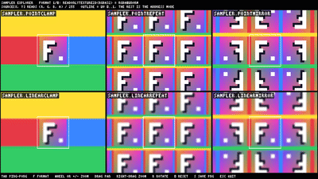</a>
<br><b>Textures</b>: one picture through all six samplers, in any of the eight texture formats (<a href="docs/screenshots/textures-format-rg16.png">Rg16</a>), and a reaction-diffusion that ping-pongs between two read-write textures while you paint into it (<a href="docs/screenshots/textures-pingpong.png">ping-pong</a>). <code>--image</code> explores your own picture instead, loaded into each format with SharpCompute.Imaging (<a href="docs/screenshots/textures-image.png">a photo</a>).
<br><code>scripts/demo-textures.sh [--mode pingpong] [--image photo.jpg] [--headless]</code>
<br><sub>Tab switch · F format · wheel or +/- zoom · drag pans or paints · S save PNG · Esc quit</sub>
</td>
</tr>
<tr>
<td width="50%" valign="top">
<a href="docs/screenshots/viewer-nbody.png">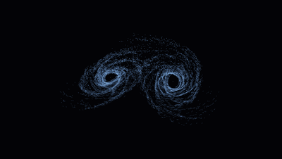</a>
<br><b>Viewer</b>: every gallery shader live in a window, plus Game of Life and a 16k-body N-body simulation.
<br><code>scripts/demo-viewer.sh</code>
<br><sub>←/→ switch · Space pause · S save PNG · F toggle size · Esc quit · N-body: drag to orbit, wheel to zoom · Life: drag draws, R random, C clear</sub>
</td>
<td width="50%" valign="top">
<a href="docs/screenshots/paint.png"></a>
<br><b>Paint</b>: a GPU paint app with soft brushes, filters and undo. The wheel sets the brush size, Shift+wheel the hardness.
<br><code>scripts/demo-paint.sh [--replay]</code>
<br><sub>drag paint · 1–9 colors · [ ] size · E eraser · B blur · K sharpen · D edges · ⌘Z undo · ⌘S save · C clear</sub>
</td>
</tr>
<tr>
<td width="50%" valign="top">
<a href="docs/screenshots/gallery.png">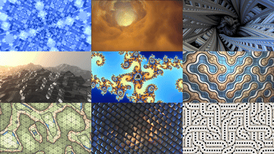</a>
<br><b>Gallery</b>: the shader gallery as PNGs (<code>--video</code> for mp4s, <code>--shader &lt;name&gt;</code> for one) plus a benchmark. <code>scripts/demo-mandelbrot.sh</code> renders its Mandelbrot as a deep-zoom video (perturbation theory, down to about 1e-30).
<br><code>scripts/demo-gallery.sh</code>
<br><sub>no window: writes files</sub>
</td>
<td width="50%" valign="top">
<a href="docs/screenshots/imgproc.png">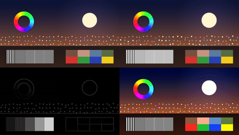</a>
<br><b>ImageProcessing</b>: GPU against CPU image filters on a 4K test image or your own photo (JPEG, PNG, HEIC), loaded into a texture and saved from one with SharpCompute.Imaging, zero copy from decode to encode. <code>lens</code> samples a texture bilinearly. Clockwise from the top left: the input, bokeh 12, lens, edges.
<br><code>scripts/demo-imgproc.sh [photo] [filter args]</code>
<br><sub>no window: writes files and timings</sub>
</td>
</tr>
<tr>
<td width="50%" valign="top">
<a href="docs/glowfall.gif"></a>
<br><b>Glowfall</b>: an original 2D platformer; every pixel, light, shadow and particle is a SharpCompute shader, and the sound is synthesized on the GPU.
<br><code>scripts/demo-glowfall.sh [--demo] [--headless] [--check-levels]</code>
<br><sub>arrows or A D move · Z, Space, Up or W jump · Down drop · R restart · M mute · Esc quit</sub>
</td>
<td width="50%" valign="top">
<a href="docs/pulsewake.gif">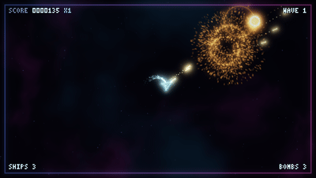</a>
<br><b>Pulsewake</b>: an original neon twin-stick arena shooter: up to 65,536 GPU particles binned without atomics, multi-pass bloom, shockwave distortion, one long-lived <code>ComputeContext</code> a frame.
<br><code>scripts/demo-pulsewake.sh [--demo] [--headless]</code>
<br><sub>WASD move · mouse aims, left button fires (or arrows) · Space bomb · P pause · M mute · R restart · Esc quit</sub>
</td>
</tr>
<tr>
<td width="50%" valign="top">
<a href="docs/screenshots/nativeinterop.png">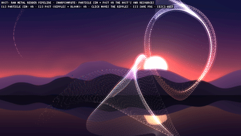</a>
<br><b>NativeInterop</b>: SharpCompute inside an app that already renders with Metal. SharpCompute wraps the host's device, buffer and textures and encodes a particle simulation and a post-process (ripples, color split, bloom) into the host's own command buffer, around its render pass. See <a href="docs/interop.md">Interop with existing Metal code</a>.
<br><code>scripts/demo-nativeinterop.sh [--headless]</code>
<br><sub>1 toggles the particle simulation · 2 toggles the post-process · click or drag moves the ripples · S save PNG · Esc quit</sub>
</td>
<td width="50%" valign="top"></td>
</tr>
</table>

In motion, and two more views of the Textures demo:

<table>
<tr>
<td width="50%" valign="top"><br><b>Glowfall</b>: every pixel, the per-pixel light with tile shadows and every particle are computed by SharpCompute shaders, and the music and sound effects are synthesized on the GPU.</td>
<td width="50%" valign="top">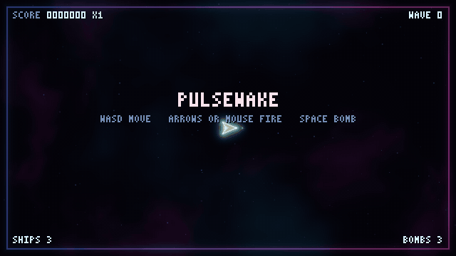<br><b>Pulsewake</b>: GPU particles, glowing vector shapes, two-level bloom and shockwave distortion, all SharpCompute shaders in one submission per frame. The same genre as <a href="https://github.com/MonoGame/MonoGame.Samples/tree/3.8.4/NeonShooter">MonoGame's NeonShooter sample</a>, here as an original game.</td>
</tr>
<tr>
<td width="50%" valign="top"><br><b>Textures</b>: a reaction-diffusion that ping-pongs between two read-write textures while you paint into it.</td>
<td width="50%" valign="top"><br><b>ComputeLab</b>: a 256-bin histogram counted with <code>Gpu.AtomicAdd</code>, checked against the CPU every frame.</td>
</tr>
<tr>
<td width="50%" valign="top">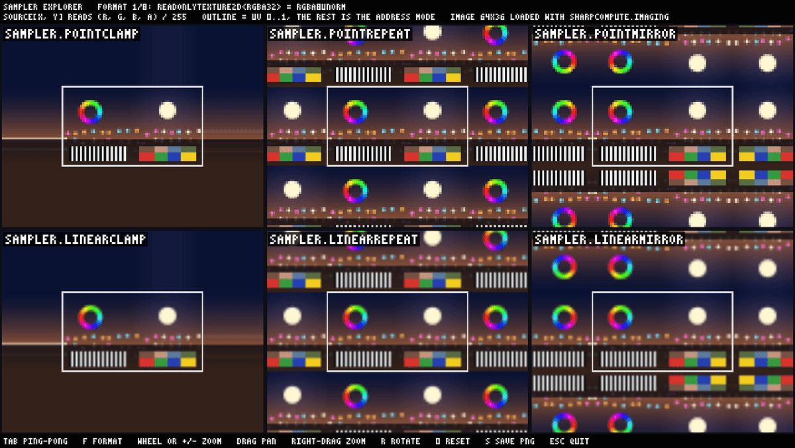<br><b>Textures</b> <code>--image</code>: your own picture, loaded with SharpCompute.Imaging, through the six samplers.</td>
<td width="50%" valign="top">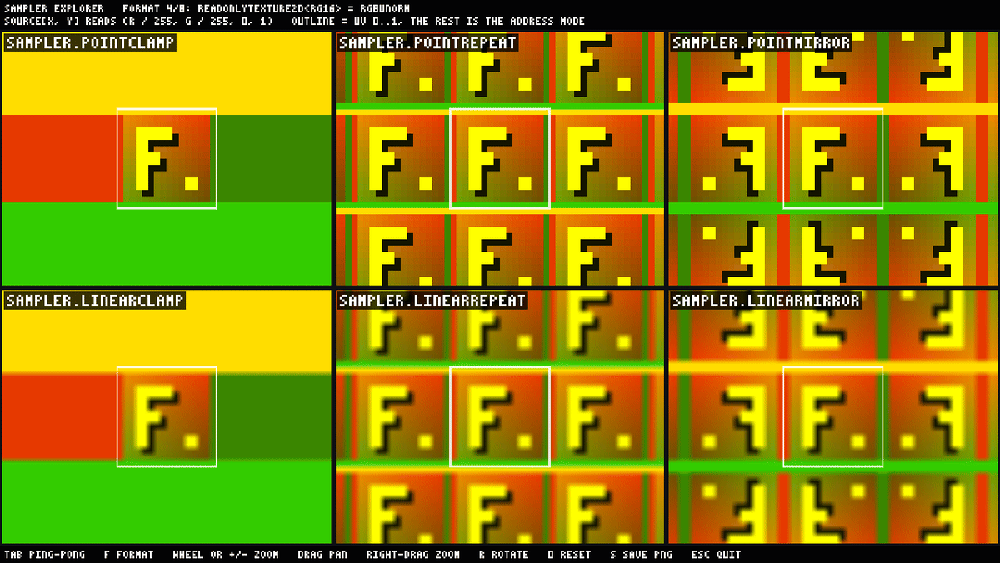<br><b>Textures</b>: the sampler explorer in the <code>Rg16</code> format (<code>F</code> cycles the eight formats).</td>
</tr>
</table>

Without a picture, because they print timings or play sound:

| Script | What it shows |
|---|---|
| `scripts/demo-helloworld.sh` | MultiplyByTwo, SAXPY over 1M floats and a 1080p Mandelbrot |
| `scripts/demo-pipeline.sh` | A double-buffered pipeline: the GPU renders frame N+1 (`ForAsync`) while the CPU post-processes frame N; sync vs async throughput |
| `scripts/demo-audio.sh` | Chiptune sound effects and a short loop synthesized on the GPU (one thread per sample), played through AudioToolbox for ~10 s at half volume. `--wav <dir>` writes WAVs instead |
| `scripts/run-benchmarks.sh` | The GPU vs CPU benchmark suite, written to `benchmarks/RESULTS.md` |
| `scripts/run-demos.sh` | Everything that doesn't need a window (`--video`, `--test`) |

### ComputeLab pages

`scripts/demo-computelab.sh --page <name>` starts on a page; `--list` shows them all.
`scripts/demo-groupshared.sh`, `scripts/demo-simdgroups.sh` and `scripts/demo-matrixunits.sh` open
the lab on its shared-memory, SIMD-group and matrix-unit pages. The Indirect and FastMath pages also
say whether their kernel was [precompiled](docs/precompiled-shaders.md) when the lab was built or compiled
at run time.

<table>
<tr>
<td width="33%" valign="top"><a href="docs/screenshots/computelab-histogram.png"></a><br><b>Atomics</b>: Histogram<br><code>--page histogram</code></td>
<td width="33%" valign="top"><a href="docs/screenshots/computelab-histogram-privatised.png"></a><br><b>Atomics</b>: Histogram: privatised<br><code>--page histogram-privatised</code></td>
<td width="33%" valign="top"><a href="docs/screenshots/computelab-compaction.png">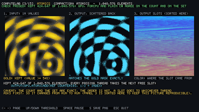</a><br><b>Atomics</b>: Compaction<br><code>--page compaction</code></td>
</tr>
<tr>
<td width="33%" valign="top"><a href="docs/screenshots/computelab-reduction.png"></a><br><b>Shared memory</b>: Reduction<br><code>--page reduction</code></td>
<td width="33%" valign="top"><a href="docs/screenshots/computelab-prefixsum.png"></a><br><b>Shared memory</b>: PrefixSum<br><code>--page prefixsum</code></td>
<td width="33%" valign="top"><a href="docs/screenshots/computelab-matmul.png"></a><br><b>Shared memory</b>: MatMul<br><code>--page matmul</code></td>
</tr>
<tr>
<td width="33%" valign="top"><a href="docs/screenshots/computelab-blur.png">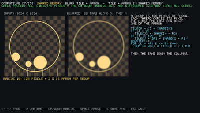</a><br><b>Shared memory</b>: Blur<br><code>--page blur</code></td>
<td width="33%" valign="top"><a href="docs/screenshots/computelab-localarrays.png">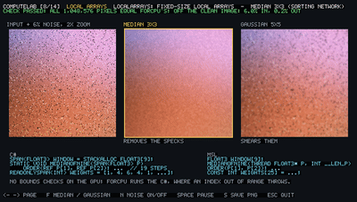</a><br><b>Local arrays</b>: LocalArrays<br><code>--page localarrays</code></td>
<td width="33%" valign="top"><a href="docs/screenshots/computelab-simd-reduction.png">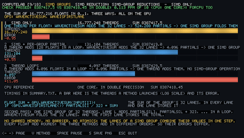</a><br><b>SIMD groups</b>: SIMD reduction<br><code>--page simd-reduction</code></td>
</tr>
<tr>
<td width="33%" valign="top"><a href="docs/screenshots/computelab-simd-compaction.png"></a><br><b>SIMD groups</b>: SIMD compaction<br><code>--page simd-compaction</code></td>
<td width="33%" valign="top"><a href="docs/screenshots/computelab-simd-shuffle.png">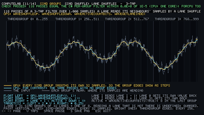</a><br><b>SIMD groups</b>: SIMD shuffle<br><code>--page simd-shuffle</code></td>
<td width="33%" valign="top"><a href="docs/screenshots/computelab-matrix-units.png">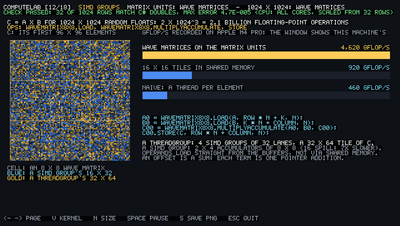</a><br><b>SIMD groups</b>: Matrix units<br><code>--page matrix-units</code><br><sub>V kernel · N size</sub></td>
</tr>
<tr>
<td width="33%" valign="top"><a href="docs/screenshots/computelab-indirect.png"></a><br><b>Dispatch</b>: Indirect<br><code>--page indirect</code></td>
<td width="33%" valign="top"><a href="docs/screenshots/computelab-bits.png"></a><br><b>Math</b>: Bits<br><code>--page bits</code></td>
<td width="33%" valign="top"><a href="docs/screenshots/computelab-fastmath.png"></a><br><b>Math</b>: FastMath<br><code>--page fastmath</code></td>
</tr>
<tr>
<td width="33%" valign="top"><a href="docs/screenshots/computelab-small-and-wide-integers.png">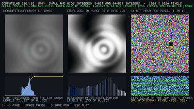</a><br><b>Math</b>: Small and wide integers<br><code>--page small-and-wide-integers</code></td>
<td width="33%" valign="top"><a href="docs/screenshots/computelab-half-precision.png"></a><br><b>Math</b>: Half precision<br><code>--page half-precision</code></td>
<td width="33%" valign="top"><a href="docs/screenshots/computelab-shared-code.png">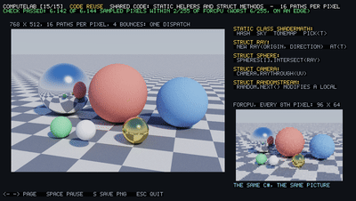</a><br><b>Code reuse</b>: Shared code<br><code>--page shared-code</code></td>
</tr>
</table>

The gallery includes ports of the Shadertoy shaders from ComputeSharp's samples. Those ports are
licensed **CC BY-NC-SA 3.0**, not MIT; see [`samples/SharpCompute.Samples.Shaders/NOTICE.md`](samples/SharpCompute.Samples.Shaders/NOTICE.md).

## Limitations

The main ones, in short. [Limitations](docs/limitations.md) has the full list, each with a link to
the details.

- Apple Silicon and macOS 15+ only, for now.
- The 8-, 16- and 64-bit integers are scalars only. Half-precision math functions take half
  vectors, not a scalar `Half`.
- Atomics work on `int`, `uint`, `float` (add only) and `ulong` (min and max on buffers only)
  elements.
- Local arrays have a compile-time length and cannot be sliced, copied or returned. Shared shader
  code must be C# source in the shader's own project.
- Textures are 2D with one mip level, and samplers are six fixed ones. A dispatch that writes a
  buffer or texture can bind it only once (no aliased or overlapping bindings).
- GPU math flushes subnormal floats to zero and fuses multiply-adds by default. `checked` arithmetic
  is a build error (`SCG0052`).
- Wave matrices are 8 × 8, `float` or `Half`, and need all 32 lanes of a SIMD group.
- Apple's Metal compiler has bugs that turn correct shader code into wrong results (integer vector
  arithmetic, division, bit counts, conversions). The generator works around each known one, at
  little or no cost; [Metal compiler bugs](docs/metal-compiler-bugs.md) lists them, the workarounds,
  the toolchain they were verified on, and what to run after a macOS or Xcode update.
- On the CPU, SIMD-group operations need uniform control flow, and shared memory and SIMD groups are
  far slower than on the GPU: use them for checking, not bulk work.

## Roadmap

- **Vulkan backend** (Windows, Linux, Android; macOS through MoltenVK), then **OpenGL 4.3**
  (Windows, Linux; macOS caps OpenGL at 4.1, which has no compute shaders). The shader authoring
  API stays the same; each backend adds its own shading-language emitter and runtime.
- NuGet packages.

## Contributing and security

Contributions are welcome: see [CONTRIBUTING.md](CONTRIBUTING.md) for the build, test and pull
request workflow, and [SUPPORT.md](SUPPORT.md) for where to ask questions. Everyone taking part
follows the [Code of Conduct](CODE_OF_CONDUCT.md). Report vulnerabilities privately, as described
in [SECURITY.md](SECURITY.md), not in public issues. [Building from source](docs/building.md) covers
building and running the demos without changing anything.

## License

[MIT](LICENSE), except the Shadertoy shader ports in `samples/SharpCompute.Samples.Shaders`
(CC BY-NC-SA 3.0, see its NOTICE). Inspired by ComputeSharp (MIT, © Sergio Pedri), whose sample
ports the gallery adapts.
