# SharpCompute

**Write GPU compute shaders in C# and run them on Metal, Vulkan and OpenGL.** A Roslyn source
generator translates shader structs to the GPU's shading language at build time; a small,
dependency-free runtime compiles, caches and dispatches them.

[ComputeSharp](https://github.com/Sergio0694/ComputeSharp) pioneered this model for **DirectX 12 on
Windows**. SharpCompute's goal is to bring the same experience to the **other GPU APIs**, so the
same C# shader code can run on macOS, Linux, Android and more:

| Backend | Platforms | Status |
|---|---|---|
| **Metal** | macOS on Apple Silicon (iOS later) | ✅ Available |
| **Vulkan** | Windows, Linux, Android; macOS via MoltenVK | 🛠 Planned, next |
| **OpenGL 4.3** | Windows, Linux | 🛠 Planned |
| DirectX 12 | Windows | Use [ComputeSharp](https://github.com/Sergio0694/ComputeSharp) |


```csharp
using SharpCompute;

[GeneratedComputeShaderDescriptor]
public readonly partial struct MultiplyByTwo(ReadWriteBuffer<float> buffer) : IComputeShader
{
    public void Execute() => buffer[ThreadIds.X] *= 2;
}

GraphicsDevice device = GraphicsDevice.GetDefault();
using ReadWriteBuffer<float> buffer = device.AllocateReadWriteBuffer<float>([1, 2, 3, 4]);
device.For(buffer.Length, new MultiplyByTwo(buffer));
float[] result = buffer.ToArray(); // [2, 4, 6, 8]
```

> **Status: early development.** APIs may change, and there is no NuGet package yet; reference the
> projects directly (see [Using it in your project](#using-it-in-your-project)).

## Games built with it

**Glowfall** (`scripts/demo-glowfall.sh`): an original 2D platformer. Every pixel, per-pixel light
with tile shadows and particle is computed by SharpCompute shaders, and its music and sound effects
are synthesized on the GPU.


**Pulsewake** (`scripts/demo-pulsewake.sh`): an original neon twin-stick arena shooter. GPU
particles, glowing vector shapes, two-level bloom and shockwave distortion all run as SharpCompute
shaders in one submission per frame. It's the same genre as
[MonoGame's NeonShooter sample](https://github.com/MonoGame/MonoGame.Samples/tree/3.8.4/NeonShooter),
here as an original game built on SharpCompute.


## Features

- **Shaders are plain C#.** `Execute()` is translated to Metal Shading Language at build time, with
  binding code generated for you. Unsupported C# is a build error (`SCGxxxx`) pointing at the exact
  construct.
- **Two shader kinds.** `IComputeShader` for general compute over 1D/2D/3D grids
  (`device.For(x, y, z, shader)`), and `IComputeShader<Float4>` pixel shaders that return a color per
  pixel into a texture (`device.ForEach(texture, shader)`).
- **Textures in shaders.** `ReadOnlyTexture2D<T>` is read and sampled (point or bilinear; clamp,
  repeat or mirror), `ReadWriteTexture2D<T>` is read and written, in eight pixel formats from 8-bit
  to float. A texture one pass wrote can be sampled by the next.
- **Images in and out.** The `SharpCompute.Imaging` library loads PNG, JPEG, HEIC (anything macOS
  ImageIO reads) straight into a texture's memory, upright and converted to sRGB or linear float,
  and saves textures as PNG, JPEG or HEIC. See [Loading and saving images](#loading-and-saving-images).
- **Threadgroup shared memory and barriers.** `[GroupShared] static readonly float[] tile = new float[256];`
  is memory the threads of a threadgroup share, `Gpu.GroupMemoryBarrierWithGroupSync()` is where they
  meet, and `GroupSize`, `GroupIds.Index` and `ThreadGroupCount` tell a thread where it is: what
  reductions, prefix sums and tiled algorithms are built from. Such shaders run on the CPU too.
- **SIMD-group operations.** HLSL's wave intrinsics on Apple GPUs: `Gpu.WaveActiveSum`,
  `WaveActiveBallot`, `WavePrefixSum`, `WaveShuffleUp` and the rest reduce, vote, scan and exchange
  values across the 32 threads of a SIMD group in one step, with no shared memory and no barrier. Such
  shaders run on the CPU too.
- **Matrix units.** `WaveMatrix8x8` and `WaveMatrixHalf8x8` are 8 × 8 matrices that the lanes of a
  SIMD group hold together, and `MultiplyAccumulate(a, b, c)` multiplies them on the GPU's matrix
  units: a matrix product written in C# runs at 5 TFLOP/s on an M4 Pro, almost five times the best
  scalar kernel and within 2 % of the same kernel in hand-written MSL. See
  [Matrix units](#matrix-units).
- **Local arrays.** `Span<float> taps = stackalloc float[9];`, `float[] w = new float[9];`,
  `ReadOnlySpan<int> weights = [1, 4, 6, 4, 1];` and `[InlineArray(N)]` structs become fixed-size
  arrays of one GPU thread: filter taps and weights, sorting networks, small stacks and histograms.
  Index them, loop over them with `foreach`, and pass them to helpers. See [Local arrays](#local-arrays).
- **Every integer width.** `byte`, `sbyte`, `short`, `ushort`, `int`, `uint`, `long` and `ulong` as
  locals, buffer elements (`ReadWriteBuffer<byte>` is one byte per element), captured constants,
  struct fields, local arrays and `[GroupShared]` arrays, with C#'s promotion and shift rules;
  arithmetic wraps as in C#, signed and unsigned. See [Scalar types](#shader-language-reference).
- **HLSL-like shader library.** `Float2..4`, `Half2..4`, `Int2..4`, `UInt2..4` with every swizzle,
  componentwise comparisons that give `Bool2..4` (`Gpu.Any`, `Gpu.All`, `Gpu.Select`),
  `Float2x2`/`Float3x3`/`Float4x4` with `Gpu.Mul`, `Half`, user structs, and about 60 `Gpu.*`
  intrinsics (`MathF.*`, `BitOperations.*` and `BitConverter.*` work too). Static and instance helper
  methods, local functions, `ref`/`out` parameters, all loops and branches, and compile-time-folded
  `static readonly` constants.
- **Shared shader code.** Shaders call static methods of any class (`ShaderMath.Hash(x)`), generic
  methods, and the methods, properties, operators and constructors of your structs
  (`sphere.Intersect(ray)`, `ray.At(t)`, `new Ray(origin, direction)`), on locals, buffer elements and
  captured state alike. The same code runs on the CPU. See
  [Sharing code between shaders](#sharing-code-between-shaders).
- **Atomics.** `Gpu.AtomicAdd(ref counts[bin], 1)` and friends on buffer elements, for histograms,
  counters and stream compaction where many threads write the same element, and on `[GroupShared]`
  elements (`int`, `uint` and the `float` add), where only the threads of one threadgroup contend. They are atomic on the
  CPU too, so `ForCpu` gives the same answer. See the [shader language reference](#shader-language-reference).
- **Zero-copy buffers.** Buffers live in unified memory, so `AsSpan()` and indexers read GPU
  results directly, and data can be produced straight into GPU memory (an image decoder can write
  into `AsSpan()`). `MapReadOnlyBuffer` puts a file on the GPU without reading it into memory first,
  and `WrapReadWriteBuffer` makes a buffer over page-aligned memory you already own.
- **Batched and asynchronous dispatch.** A `ComputeContext` runs many dispatches with one commit and
  one wait; `ForAsync`/`ForEachAsync` return a `Task` so the CPU keeps working while the GPU runs.
- **GPU time of a dispatch.** `device.LastGpuTime` and `context.LastGpuTime` report how long the GPU
  itself spent on the last dispatch or batch, without the submission and the wait a stopwatch would
  add. See [GPU time of a dispatch](#gpu-time-of-a-dispatch).
- **Buffer views, GPU copies and indirect dispatch.** `buffer.Slice(start, length)` binds part of a
  buffer as a buffer of its own. `Copy`, `Fill` and `Clear` run on the GPU, in order with the
  dispatches of a context. `ForIndirect` takes its thread count from a buffer an earlier pass wrote,
  so the GPU decides how much work the next pass does. `device.Prepare<T>()` compiles a shader
  before its first frame. See [Buffers and dispatch](#buffers-and-dispatch).
- **Interop with existing Metal code.** `GraphicsDevice.FromNative` runs SharpCompute on an app's
  own `MTLDevice` and queue, `WrapNativeReadWriteBuffer`/`WrapNativeReadWriteTexture2D` adopt its
  buffers and textures (private storage included), `NativeHandle` hands SharpCompute's objects to
  other Metal code, and `ComputeContext.EncodeInto` puts compute passes into the app's own command
  buffer, between its render passes. See [Interop with existing Metal code](#interop-with-existing-metal-code).
- **Precompiled shaders.** With one property in the project, the shaders are compiled at build time
  into a Metal library next to the assembly, and the first frame no longer waits for the MSL
  compiler; without the Metal toolchain, or for a shader the library does not hold, the runtime
  compiles from source as before. See [Precompiled shaders](#precompiled-shaders).
- **CPU execution and CPU+GPU split.** The same shader also runs as C# on all CPU cores
  (`device.ForCpu`), or split between the CPU and the GPU in one dispatch (`device.ForSplit`).
- **Correct by default.** Shaders compile with IEEE-safe math and precise functions (a shader opts
  into fast math, or out of fused multiply-adds, with `[ShaderOptions]`), and every
  shader that passes structs or constants carries `static_assert` layout guards. The CPU
  implementations of `Gpu.*` were measured against Apple GPU results: bit-for-bit for arithmetic,
  rounding functions, `sqrt` and `fmod`, and within a few ULP for transcendentals.
  [Half precision](#half-precision) is bit-for-bit as well, down to the subnormals.
- **Live presentation.** `MetalWindow` shows GPU output in a native macOS window at display refresh
  rate, with keyboard and mouse input: `KeyDown`/`KeyUp` events, plus `IsKeyDown(key)` and
  `HeldModifiers` to poll what is held each frame (released automatically when the window loses focus).
  `MouseWheel` reports wheel and trackpad scrolling with the pointer position in pixels.
- **No dependencies, AOT-friendly.** The runtime talks to Metal through hand-written
  `LibraryImport` interop.

## Demos

Each script builds in Release, writes to `demo-output/` and opens the result (`NO_OPEN=1` to skip).
Every picture here is the demo's own deterministic headless output, made by
`scripts/make-screenshots.sh` (and `scripts/make-gifs.sh` for the animations); click one for the
full size.

<table>
<tr>
<td width="50%" valign="top">
<a href="docs/screenshots/computelab-histogram-privatised.png">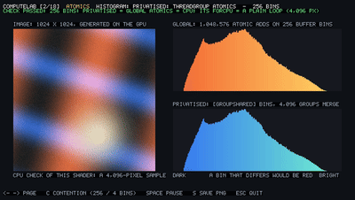</a>
<br><b>ComputeLab</b>: one page per core compute feature, by topic: atomics, threadgroup shared memory, local arrays, SIMD-group operations and matrix units, indirect dispatch, bits, fast math, the 8-, 16- and 64-bit integers and half precision, shared shader code. Each page runs the feature on the GPU, checks it against the CPU and shows GPU ms against CPU ms. <a href="#computelab-pages">All pages below</a>.
<br><code>scripts/demo-computelab.sh [--page &lt;name&gt;] [--headless]</code>
<br><sub>←/→ page · Space pause · S save PNG · Esc quit; each page lists its own keys (C, V, D, F, R, Up/Down)</sub>
</td>
<td width="50%" valign="top">
<a href="docs/screenshots/textures-samplers.png"></a>
<br><b>Textures</b>: one picture through all six samplers, in any of the eight texture formats (<a href="docs/screenshots/textures-format-rg16.png">Rg16</a>), and a reaction-diffusion that ping-pongs between two read-write textures while you paint into it (<a href="docs/screenshots/textures-pingpong.png">ping-pong</a>). <code>--image</code> explores your own picture instead, loaded into each format with SharpCompute.Imaging (<a href="docs/screenshots/textures-image.png">a photo</a>).
<br><code>scripts/demo-textures.sh [--mode pingpong] [--image photo.jpg] [--headless]</code>
<br><sub>Tab switch · F format · wheel or +/- zoom · drag pans or paints · S save PNG · Esc quit</sub>
</td>
</tr>
<tr>
<td width="50%" valign="top">
<a href="docs/screenshots/viewer-nbody.png"></a>
<br><b>Viewer</b>: every gallery shader live in a window, plus Game of Life and a 16k-body N-body simulation.
<br><code>scripts/demo-viewer.sh</code>
<br><sub>←/→ switch · Space pause · S save PNG · F toggle size · Esc quit · N-body: drag to orbit, wheel to zoom · Life: drag draws, R random, C clear</sub>
</td>
<td width="50%" valign="top">
<a href="docs/screenshots/paint.png"></a>
<br><b>Paint</b>: a GPU paint app with soft brushes, filters and undo. The wheel sets the brush size, Shift+wheel the hardness.
<br><code>scripts/demo-paint.sh [--replay]</code>
<br><sub>drag paint · 1–9 colors · [ ] size · E eraser · B blur · K sharpen · D edges · ⌘Z undo · ⌘S save · C clear</sub>
</td>
</tr>
<tr>
<td width="50%" valign="top">
<a href="docs/screenshots/gallery.png"></a>
<br><b>Gallery</b>: the shader gallery as PNGs (<code>--video</code> for mp4s, <code>--shader &lt;name&gt;</code> for one) plus a benchmark. <code>scripts/demo-mandelbrot.sh</code> renders its Mandelbrot as a deep-zoom video (perturbation theory, down to about 1e-30).
<br><code>scripts/demo-gallery.sh</code>
<br><sub>no window: writes files</sub>
</td>
<td width="50%" valign="top">
<a href="docs/screenshots/imgproc.png"></a>
<br><b>ImageProcessing</b>: GPU against CPU image filters on a 4K test image or your own photo (JPEG, PNG, HEIC), loaded into a texture and saved from one with SharpCompute.Imaging, zero copy from decode to encode. <code>lens</code> samples a texture bilinearly. Clockwise from the top left: the input, bokeh 12, lens, edges.
<br><code>scripts/demo-imgproc.sh [photo] [filter args]</code>
<br><sub>no window: writes files and timings</sub>
</td>
</tr>
<tr>
<td width="50%" valign="top">
<a href="docs/glowfall.gif">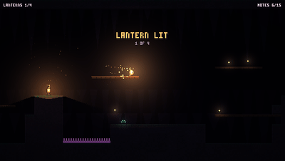</a>
<br><b>Glowfall</b>: an original 2D platformer; every pixel, light, shadow and particle is a SharpCompute shader, and the sound is synthesized on the GPU.
<br><code>scripts/demo-glowfall.sh [--demo] [--headless] [--check-levels]</code>
<br><sub>arrows or A D move · Z, Space, Up or W jump · Down drop · R restart · M mute · Esc quit</sub>
</td>
<td width="50%" valign="top">
<a href="docs/pulsewake.gif"></a>
<br><b>Pulsewake</b>: an original neon twin-stick arena shooter: up to 65,536 GPU particles binned without atomics, multi-pass bloom, shockwave distortion, one long-lived <code>ComputeContext</code> a frame.
<br><code>scripts/demo-pulsewake.sh [--demo] [--headless]</code>
<br><sub>WASD move · mouse aims, left button fires (or arrows) · Space bomb · P pause · M mute · R restart · Esc quit</sub>
</td>
</tr>
<tr>
<td width="50%" valign="top">
<a href="docs/screenshots/nativeinterop.png"></a>
<br><b>NativeInterop</b>: SharpCompute inside an app that already renders with Metal. SharpCompute wraps the host's device, buffer and textures and encodes a particle simulation and a post-process (ripples, color split, bloom) into the host's own command buffer, around its render pass. See <a href="#interop-with-existing-metal-code">Interop with existing Metal code</a>.
<br><code>scripts/demo-nativeinterop.sh [--headless]</code>
<br><sub>1 toggles the particle simulation · 2 toggles the post-process · click or drag moves the ripples · S save PNG · Esc quit</sub>
</td>
<td width="50%" valign="top"></td>
</tr>
</table>

Without a picture, because they print timings or play sound:

| Script | What it shows |
|---|---|
| `scripts/demo-helloworld.sh` | MultiplyByTwo, SAXPY over 1M floats and a 1080p Mandelbrot |
| `scripts/demo-pipeline.sh` | A double-buffered pipeline: the GPU renders frame N+1 (`ForAsync`) while the CPU post-processes frame N; sync vs async throughput |
| `scripts/demo-audio.sh` | Chiptune sound effects and a short loop synthesized on the GPU (one thread per sample), played through AudioToolbox for ~10 s at half volume. `--wav <dir>` writes WAVs instead |
| `scripts/run-benchmarks.sh` | The GPU vs CPU benchmark suite, written to `benchmarks/RESULTS.md` |
| `scripts/run-demos.sh` | Everything that doesn't need a window (`--video`, `--test`) |

### ComputeLab pages

`scripts/demo-computelab.sh --page <name>` starts on a page; `--list` shows them all.
`scripts/demo-groupshared.sh`, `scripts/demo-simdgroups.sh` and `scripts/demo-matrixunits.sh` open
the lab on its shared-memory, SIMD-group and matrix-unit pages. The Indirect and FastMath pages also
say whether their kernel was [precompiled](#precompiled-shaders) when the lab was built or compiled
at run time.

<table>
<tr>
<td width="33%" valign="top"><a href="docs/screenshots/computelab-histogram.png">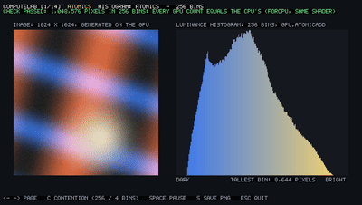</a><br><b>Atomics</b>: Histogram<br><code>--page histogram</code></td>
<td width="33%" valign="top"><a href="docs/screenshots/computelab-histogram-privatised.png"></a><br><b>Atomics</b>: Histogram: privatised<br><code>--page histogram-privatised</code></td>
<td width="33%" valign="top"><a href="docs/screenshots/computelab-compaction.png"></a><br><b>Atomics</b>: Compaction<br><code>--page compaction</code></td>
</tr>
<tr>
<td width="33%" valign="top"><a href="docs/screenshots/computelab-reduction.png">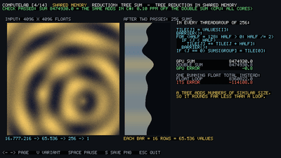</a><br><b>Shared memory</b>: Reduction<br><code>--page reduction</code></td>
<td width="33%" valign="top"><a href="docs/screenshots/computelab-prefixsum.png">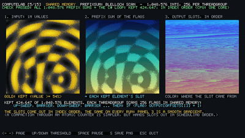</a><br><b>Shared memory</b>: PrefixSum<br><code>--page prefixsum</code></td>
<td width="33%" valign="top"><a href="docs/screenshots/computelab-matmul.png">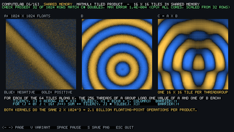</a><br><b>Shared memory</b>: MatMul<br><code>--page matmul</code></td>
</tr>
<tr>
<td width="33%" valign="top"><a href="docs/screenshots/computelab-blur.png"></a><br><b>Shared memory</b>: Blur<br><code>--page blur</code></td>
<td width="33%" valign="top"><a href="docs/screenshots/computelab-localarrays.png"></a><br><b>Local arrays</b>: LocalArrays<br><code>--page localarrays</code></td>
<td width="33%" valign="top"><a href="docs/screenshots/computelab-simd-reduction.png"></a><br><b>SIMD groups</b>: SIMD reduction<br><code>--page simd-reduction</code></td>
</tr>
<tr>
<td width="33%" valign="top"><a href="docs/screenshots/computelab-simd-compaction.png">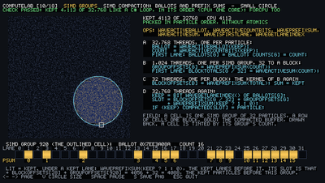</a><br><b>SIMD groups</b>: SIMD compaction<br><code>--page simd-compaction</code></td>
<td width="33%" valign="top"><a href="docs/screenshots/computelab-simd-shuffle.png"></a><br><b>SIMD groups</b>: SIMD shuffle<br><code>--page simd-shuffle</code></td>
<td width="33%" valign="top"><a href="docs/screenshots/computelab-matrix-units.png"></a><br><b>SIMD groups</b>: Matrix units<br><code>--page matrix-units</code><br><sub>V kernel · N size</sub></td>
</tr>
<tr>
<td width="33%" valign="top"><a href="docs/screenshots/computelab-indirect.png"></a><br><b>Dispatch</b>: Indirect<br><code>--page indirect</code></td>
<td width="33%" valign="top"><a href="docs/screenshots/computelab-bits.png">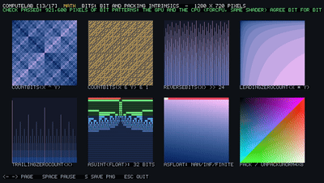</a><br><b>Math</b>: Bits<br><code>--page bits</code></td>
<td width="33%" valign="top"><a href="docs/screenshots/computelab-fastmath.png">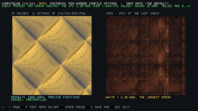</a><br><b>Math</b>: FastMath<br><code>--page fastmath</code></td>
</tr>
<tr>
<td width="33%" valign="top"><a href="docs/screenshots/computelab-small-and-wide-integers.png"></a><br><b>Math</b>: Small and wide integers<br><code>--page small-and-wide-integers</code></td>
<td width="33%" valign="top"><a href="docs/screenshots/computelab-half-precision.png">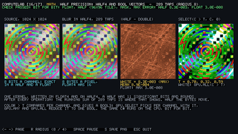</a><br><b>Math</b>: Half precision<br><code>--page half-precision</code></td>
<td width="33%" valign="top"><a href="docs/screenshots/computelab-shared-code.png"></a><br><b>Code reuse</b>: Shared code<br><code>--page shared-code</code></td>
</tr>
</table>

The gallery includes ports of the Shadertoy shaders from ComputeSharp's samples. Those ports are
licensed **CC BY-NC-SA 3.0**, not MIT; see [`samples/SharpCompute.Samples.Shaders/NOTICE.md`](samples/SharpCompute.Samples.Shaders/NOTICE.md).

## Performance

Apple M4 Pro, GPU vs the **fastest** CPU variant (multi-threaded and SIMD where it applies). The full
report, including how each number was measured and the machine load, is in
[`benchmarks/RESULTS.md`](benchmarks/RESULTS.md).

| Workload | Size | Fastest CPU | GPU | GPU speedup |
|---|---|---:|---:|---:|
| Mandelbrot (512 iterations) | 1920×1080 | 9.16 ms | 0.54 ms | **17×** |
| Mandelbrot (512 iterations) | 256×256 | 1.00 ms | 0.15 ms | **6.8×** |
| N-body step | 16,384 bodies | 13.8 ms | 3.95 ms | **3.5×** |
| Matrix multiply (naive) | 1024×1024 | 13.7 ms | 4.39 ms | **3.1×** |
| Gaussian blur, radius 8 | 3840×2160 | 2.25 ms | 1.68 ms | **1.3×** |
| SAXPY `y = a·x + y` | 16M floats | 0.85 ms | 1.01 ms | 0.84× (CPU wins) |

How to read this: GPU times are one synchronous dispatch and exclude uploading inputs and reading
results back. Every dispatch has a fixed cost of roughly 0.1 ms, and Apple Silicon's CPU and GPU
share the same memory. Compute-heavy work wins big; memory-bound work like SAXPY doesn't. The
generated SAXPY kernel runs at the same speed as hand-written MSL (ratio 0.99–1.01). The matrix
product is the naive kernel; written with [`WaveMatrix8x8`](#matrix-units) for the GPU's matrix
units, the same 1024×1024 product takes 0.42 ms of GPU time instead of 4.15 ms (the table below).

Against native Metal on the same GPU, by the GPU's own time for one dispatch
([`LastGpuTime`](#gpu-time-of-a-dispatch); Apple M4 Pro, medians of 5 passes of 25 dispatches):

| Single-precision matrix multiply, 1024×1024 | Written as | GPU time | TFLOP/s |
|---|---|---:|---:|
| `MPSMatrixMultiplication` | Apple's kernel | 0.403 ms | 5.33 |
| `simdgroup_matrix`, 2×4 accumulators | hand-written MSL | 0.417 ms | 5.15 |
| `simdgroup_matrix`, 2×4 accumulators ([`WaveMatrix8x8`](#matrix-units)) | generated from C# | 0.422 ms | 5.08 |
| threadgroup-tiled 16×16 | generated from C# | 2.01 ms | 1.07 |
| naive | generated from C# | 4.15 ms | 0.52 |
| naive | hand-written MSL | 4.11 ms | 0.52 |

A generated kernel takes the same GPU time as the same kernel written by hand in MSL, to about
1 %: the ratio is 1.008 to 1.012 for the naive matrix multiply, 1.013 to 1.014 for the one on the
matrix units, and 1.000 for an N-body step, for SAXPY and for an integer hash. The scalar kernels'
5× and 10× to MPS are not the generator's: MPS and the kernels next to it use Metal's matrix units
(`simdgroup_matrix`), which a C# shader reaches as `WaveMatrix8x8`, and that kernel is within 5 % of
MPS. The same section of the report places every kernel under the machine's measured ceilings:
6.22 TFLOP/s of FP32 arithmetic, of which MPS reaches 86 %, and 249 GB/s of memory bandwidth (244 to
255 across the passes; Apple quotes 273), measured on 1 GiB arrays. SAXPY, on 64 MB arrays, runs at
the memory-bandwidth ceiling (within 2 %): it is bound by memory, and no kernel will make it faster.
See [Native baselines and roofline](benchmarks/RESULTS.md#native-baselines-and-roofline).

Moving and converting data can cost more than the kernel, and unified memory means it can be
skipped: decode into the GPU buffer, convert and filter on the GPU, encode from the buffer.

| Data path | Size | Before | Zero copy | Speedup |
|---|---|---:|---:|---:|
| RGBA8 image → blur → RGBA8, CPU conversions + Float4 copies (fastest CPU: 21.8 ms) | 3840×2160 | 12.2 ms | 3.10 ms | **3.9×** (7.0× vs CPU) |
| Same kernels, only the copies of the bytes in and out removed | 3840×2160 | 4.28 ms | 3.10 ms | 1.4× |
| File of floats → GPU sum (`MapReadOnlyBuffer`) | 256 MB | 42.0 ms (`ReadAllBytes` + upload) | 4.06 ms | **10.3×** |

### Unified memory: when it helps and when it doesn't

On Apple silicon the CPU and the GPU share the same memory, so there is no upload or download over a
bus. The gains come from not copying at all and from overlapping work. They don't come from extra
bandwidth: both sides use the same memory controller.

| Helps | Measured | Doesn't help | Why |
|---|---|---|---|
| Decode or read straight into GPU memory, convert on the GPU | 4K image pipeline 12.2 → 3.10 ms | Memory-bound kernels (SAXPY) | Same bandwidth; the CPU ties or wins |
| `MapReadOnlyBuffer` instead of reading a file | 256 MB: 42.0 → 4.06 ms | Tiny one-off dispatches | ~0.1 ms floor per dispatch; the CPU finishes first |
| Many small dispatches in one `ComputeContext` | ~99 µs → ~1.9 µs per dispatch | Single heavy kernels | Nothing to copy or batch |
| `ForAsync` double-buffering, CPU and GPU in parallel | 1.38× (7 % above the ideal) | GPU-private buffers | Same speed as shared on Apple silicon |
| | | Splitting one grid between CPU and GPU (`ForSplit`) | 0.97–1.09× of GPU-only: scalar C# on the CPU, and the GPU slows while the CPU is busy |

The full guide, with how to choose an API and the lifetime rules that come with zero copy, is
[`docs/unified-memory.md`](docs/unified-memory.md).

## Using it in your project

Requirements: macOS 15 or later on Apple Silicon, and the .NET 11 SDK.

Reference the runtime, and the generator as an analyzer (and `SharpCompute.Imaging` to load and
save images):

```xml
<ItemGroup>
  <ProjectReference Include="path/to/src/SharpCompute/SharpCompute.csproj" />
  <ProjectReference Include="path/to/src/SharpCompute.SourceGenerators/SharpCompute.SourceGenerators.csproj"
                    OutputItemType="Analyzer" ReferenceOutputAssembly="false" />
  <ProjectReference Include="path/to/src/SharpCompute.Imaging/SharpCompute.Imaging.csproj" />
</ItemGroup>
```

To have the shaders compiled when the project is built instead of when they are first used, add
`<SharpComputePrecompileShaders>true</SharpComputePrecompileShaders>` and import
`src/SharpCompute.Build/SharpCompute.Build.targets`: see [Precompiled shaders](#precompiled-shaders).

A pixel shader, rendered into a texture:

```csharp
[GeneratedComputeShaderDescriptor]
public readonly partial struct Gradient(float time) : IComputeShader<Float4>
{
    public Float4 Execute()
    {
        Float2 uv = ThreadIds.Normalized.XY;
        Float3 color = new Float3(0.5f, 0.5f, 0.5f) + (0.5f * Gpu.Cos(new Float3(time + uv.X, time + uv.Y, time + 4f)));
        return new Float4(color, 1f);
    }
}

using ReadWriteTexture2D<Rgba32> texture = device.AllocateReadWriteTexture2D<Rgba32>(1280, 720);
device.ForEach(texture, new Gradient(time: 1.5f));
Rgba32[] pixels = texture.ToArray();
```

Zero-copy data paths (the CPU and the GPU share the same memory, so skip the copies):

```csharp
// Write input straight into GPU memory, e.g. decode or read a file into it.
using ReadWriteBuffer<uint> pixels = device.AllocateReadWriteBuffer<uint>(width * height);
DecodeInto(MemoryMarshal.AsBytes(pixels.AsSpan()));

// A file of raw floats, read by the GPU from the page cache: no ReadAllBytes, no upload.
using ReadOnlyBuffer<float> samples = device.MapReadOnlyBuffer<float>("samples.f32");

// Memory you already own, if it starts on a page boundary (GraphicsDevice.PageSize).
void* memory = NativeMemory.AlignedAlloc(byteCount, (nuint)GraphicsDevice.PageSize);
using ReadWriteBuffer<float> wrapped = device.WrapReadWriteBuffer<float>((nint)memory, count, () => NativeMemory.AlignedFree(memory));
```

### Textures

Shaders capture textures like buffers. A `ReadOnlyTexture2D<T>` is read with `texture[x, y]` (or an
`Int2`) and sampled with `texture.Sample(sampler, uv)`; a `ReadWriteTexture2D<T>` is read and written
with its indexer. Every pixel is a `Float4` in the shader, whatever `T` is; `Width` and `Height`
work too. A thread that writes a pixel and reads it back gets what it wrote, as in C# (the
generator emits the `fence()` Metal needs for that). Textures are zero-copy like buffers:
`CopyFrom`, `CopyTo` and `ToArray` go straight to the shared memory.

| `T` | Metal format | A shader reads | `ReadWriteTexture2D` |
|---|---|---|---|
| `Rgba32` | `RGBA8Unorm` | `(r, g, b, a) / 255` | yes |
| `Rgba32Srgb` | `RGBA8Unorm_sRGB` | linear `r, g, b`; `a / 255` | no |
| `R8` | `R8Unorm` | `(r / 255, 0, 0, 1)` | yes |
| `Rg16` | `RG8Unorm` | `(r / 255, g / 255, 0, 1)` | no |
| `Half` | `R16Float` | `(r, 0, 0, 1)` | yes |
| `Rgba16Float` | `RGBA16Float` | `(r, g, b, a)` | yes |
| `float` | `R32Float` | `(r, 0, 0, 1)` | yes |
| `Float4` | `RGBA32Float` | `(r, g, b, a)` | yes |

An `Rgba16Float` pixel is four halves in the layout of a `Half4`, and converts to and from one
implicitly. Whole arrays reinterpret for free (`MemoryMarshal.Cast<Half4, Rgba16Float>(colors)` for
`CopyFrom`, and back after `ToArray`), and in a shader `(Half4)texture[x, y]` and
`texture[x, y] = (Float4)color` are exact for that format, so a `Half4` goes through such a texture
bit for bit.

Samplers are the six static properties of `Sampler`, passed directly to `Sample`: `PointClamp`,
`PointRepeat`, `PointMirror`, `LinearClamp`, `LinearRepeat` and `LinearMirror`. Coordinates are
normalized, with pixel centers at `(x + 0.5) / Width`. Each one a shader uses is compiled into it,
so there is nothing to allocate or bind.

Metal can't sample a texture that the same shader may write, so a read-write texture has no
`Sample`. To sample what one pass wrote, bind `AsReadOnly()` in the next pass. It is a view of the
same texture, not a copy:

```csharp
[GeneratedComputeShaderDescriptor]
public readonly partial struct Diffuse(ReadWriteTexture2D<float> source, ReadWriteTexture2D<float> target) : IComputeShader
{
    public void Execute()
    {
        int x = ThreadIds.X;
        int y = ThreadIds.Y;
        float sum = source[Gpu.Max(x - 1, 0), y].X + source[Gpu.Min(x + 1, source.Width - 1), y].X
                  + source[x, Gpu.Max(y - 1, 0)].X + source[x, Gpu.Min(y + 1, source.Height - 1)].X;

        target[x, y] = new Float4(sum * 0.25f);
    }
}

[GeneratedComputeShaderDescriptor]
public readonly partial struct ShowHeat(ReadOnlyTexture2D<float> heat) : IComputeShader<Float4>
{
    public Float4 Execute()
    {
        float value = heat.Sample(Sampler.LinearClamp, ThreadIds.Normalized.XY).X;
        return new Float4(value, 0f, 1f - value, 1f);
    }
}

using ReadWriteTexture2D<float> a = device.AllocateReadWriteTexture2D<float>(initialHeat, 256, 256);
using ReadWriteTexture2D<float> b = device.AllocateReadWriteTexture2D<float>(256, 256);
using ReadOnlyTexture2D<float> result = a.AsReadOnly();
using ReadWriteTexture2D<Rgba32> frame = device.AllocateReadWriteTexture2D<Rgba32>(1280, 720);

using (ComputeContext context = device.CreateComputeContext())
{
    for (int i = 0; i < 16; i++)
    {
        context.For(256, 256, new Diffuse(a, b)); // ping
        context.For(256, 256, new Diffuse(b, a)); // pong
    }

    context.ForEach(frame, new ShowHeat(result)); // samples what the last pass wrote
}
```

`scripts/demo-textures.sh` shows all of this live: the six samplers side by side on any of the eight
formats (on your own picture with `--image photo.jpg`), and a simulation that ping-pongs between two
textures while you paint into it:

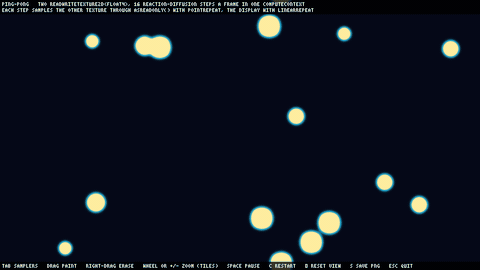

Shaders with textures run on the CPU too (`ForCpu`, `ForSplit`), with the same reads, writes and
address modes. The CPU is exact where the GPU (measured on an M4 Pro) is not quite:

- Bilinear filtering: the GPU rounds its weights to 1/256, so a bilinear sample written to an 8-bit
  format can differ by one step between `ForCpu` and the GPU.
- sRGB decoding: the GPU decodes to 12 bits.
- Point sampling picks the same pixel with Clamp, for coordinates in [0, 1) and for power-of-two
  sizes. With Repeat or Mirror outside [0, 1) on other sizes, a coordinate within float rounding of
  a pixel boundary can pick the neighbouring pixel on the GPU.

### Loading and saving images

`SharpCompute.Imaging` (a separate library, so the runtime itself links nothing but Metal) loads
images into textures through macOS ImageIO: PNG, JPEG, HEIC and the other formats ImageIO reads.
ImageIO decodes, and vImage writes the converted pixels straight into the new texture's shared
memory with its row pitch: no intermediate array, and no upload.

```csharp
using SharpCompute.Imaging;

[GeneratedComputeShaderDescriptor]
public readonly partial struct Vignette(ReadOnlyTexture2D<Rgba32> photo) : IComputeShader<Float4>
{
    public Float4 Execute()
    {
        Float2 uv = ThreadIds.Normalized.XY;
        float edge = Gpu.Length(uv - 0.5f);
        return new Float4(photo.Sample(Sampler.LinearClamp, uv).XYZ * Gpu.Saturate(1.25f - (2f * edge * edge)), 1f);
    }
}

// sRGB bytes, as stored; any T below works, from a path, a byte span or a stream.
using ReadOnlyTexture2D<Rgba32> photo = ImageLoader.LoadTexture2D<Rgba32>(device, "photo.heic");
using ReadWriteTexture2D<Rgba32> result = device.AllocateReadWriteTexture2D<Rgba32>(photo.Width, photo.Height);

device.ForEach(result, new Vignette(photo));              // a pixel shader that samples the photo
ImageSaver.Save(result, "vignette.jpg", jpegQuality: 85); // encoded from the texture's memory

ImageInfo info = ImageLoader.GetInfo("photo.heic");       // size, color model, alpha, orientation: no decoding
```

The element type decides what the pixels are converted to, from whatever color space the file is in:

| `T` | Holds | Shaders read |
|---|---|---|
| `Rgba32` | sRGB bytes | `byte / 255`, still sRGB-encoded |
| `Rgba32Srgb` | the same bytes | linear (the GPU decodes sRGB) |
| `R8` | gray, 2.2 gamma (luminance of a color image) | `(gray / 255, 0, 0, 1)` |
| `Rgba16Float`, `Float4` | linear extended sRGB (wide-gamut and HDR colors outside 0..1); 16-bit files keep their precision | linear light |

Alpha is straight, not premultiplied, in every type, as PNG stores it, so a PNG saved and loaded
again comes back bit for bit, translucent pixels included. The EXIF orientation is applied, so a
camera's portrait photo loads upright. `LoadReadWriteTexture2D` loads into a texture shaders also
write. Saving takes the format from the extension (`.png`, `.jpg`, `.heic`) or an `ImageFormat`; a
float texture is saved as a 16-bit sRGB PNG. A missing file, data ImageIO can't read, and an image
larger than 16384 pixels (the texture limit) each throw a clear exception.

On an Apple M4 Pro, a 3840 × 2160 image decodes into an `Rgba32` texture in 27 ms from a JPEG and
50 ms from a PNG, and saves in 24 ms as a JPEG and 169 ms as a PNG (medians of three runs of the
ImageProcessing sample). The ImageProcessing demo loads its input and saves its output this
way, and `--image` puts your own picture into the Textures demo's sampler explorer:


### Threadgroup shared memory and barriers

The GPU runs a grid in threadgroups (`[ThreadGroupSize]`, 256 threads by default for a 1D grid). A
`[GroupShared]` array is memory that the threads of one group share, and a barrier is the point
where they all wait for each other, so that what one thread wrote before it another can read after
it. Together they turn independent threads into a team, here summing 256 values in eight steps:

```csharp
[ThreadGroupSize(256)]
[GeneratedComputeShaderDescriptor]
public readonly partial struct SumBlocks(ReadOnlyBuffer<float> input, ReadWriteBuffer<float> sums, int count) : IComputeShader
{
    [GroupShared]
    private static readonly float[] tile = new float[256];

    public void Execute()
    {
        int i = ThreadIds.X;
        int local = GroupIds.X;

        tile[local] = i < count ? input[i] : 0f;       // every thread loads one value
        Gpu.GroupMemoryBarrierWithGroupSync();

        for (int half = 128; half > 0; half >>= 1)
        {
            if (local < half)
            {
                tile[local] += tile[local + half];     // the lower half adds the upper half
            }

            Gpu.GroupMemoryBarrierWithGroupSync();     // outside the if: every thread calls it
        }

        if (local == 0)
        {
            sums[ThreadGroupIds.X] = tile[0];
        }
    }
}

device.For((count + 255) / 256 * 256, new SumBlocks(input, sums, count)); // whole threadgroups
```

| C# | MSL |
|---|---|
| `[GroupShared] static readonly T[] name = new T[N];` | `threadgroup T name[N];` in the kernel; helpers that use it receive `threadgroup T* name` |
| `name[i]`, `name.Length` | `name[i]`, the constant `N` |
| `Gpu.GroupMemoryBarrierWithGroupSync()` | `threadgroup_barrier(mem_flags::mem_threadgroup)` |
| `Gpu.DeviceMemoryBarrierWithGroupSync()` | `threadgroup_barrier(mem_flags::mem_device)` (plus `mem_texture` when the shader has a read-write texture) |
| `Gpu.AllMemoryBarrierWithGroupSync()` | `threadgroup_barrier` with all of those flags |
| `GroupSize.X/Y/Z/XY/XYZ`, `GroupSize.Count` | `threads_per_threadgroup`, and the product of its components |
| `GroupIds.Index` | `thread_index_in_threadgroup` |
| `ThreadGroupCount.X/Y/Z/XY/XYZ` | `threadgroups_per_grid` |

- `T` is anything a buffer can hold (scalars, vectors, `Float4x4`, your own structs), `N` a
  compile-time constant, and the field belongs to the shader struct that uses it. The arrays a
  shader uses may total 32,768 bytes, the threadgroup memory of an Apple GPU (`SCG0043` beyond that).
- Give the shader an explicit `[ThreadGroupSize]`: its arrays are sized for it. Without one the
  runtime picks the size per dispatch, and an array too short for that size is indexed out of bounds
  silently on the GPU, so using an array of fewer than 1,024 elements in such a shader is warning
  `SCG0044`.
- **Threadgroup memory starts out undefined**, on the GPU and on the CPU: a thread may only read what
  a thread of its own group wrote, with a barrier in between.
- Threads of a group can also update one `int` or `uint` element at the same time, without a barrier
  between them, with `Gpu.Atomic*(ref tile[i], ...)`: see
  [atomics on threadgroup memory](#shader-language-reference).
- **Every thread of a group must call the same barriers.** A barrier inside an `if` or a loop that
  only some threads of the group enter, or after a `return` only some take, is undefined on the GPU,
  and the generator cannot detect it. Put conditions around the work, as above.
- A grid that is not a multiple of the threadgroup size ends in partial groups, where `GroupSize`
  reports the threads the group really has. The simple way out is the one above: dispatch whole
  groups and let the threads past the end of the data load a neutral value.
- **On the CPU** (`ForCpu`, `ForSplit`) such a shader runs with one dedicated thread per thread of a
  threadgroup (at most 1,024), meeting at every barrier, one group after another. That computes what
  the GPU computes and is good for checking and debugging a shader, but it costs microseconds per
  thread per barrier: thousands of times slower than the GPU. Shaders without shared memory or
  barriers are not affected.

ComputeLab's shared-memory pages run a reduction, a prefix sum, a tiled matrix product and a tiled
blur built this way, each checked against plain C# (`scripts/demo-groupshared.sh` opens the lab on
them). The reduction page, with the kernel above:


### SIMD-group operations

An Apple GPU executes a threadgroup 32 threads at a time, in *SIMD groups* whose threads ("lanes")
run together. The `Gpu.Wave*` methods let the lanes of one group combine or exchange values in a
single step, without threadgroup memory, barriers or atomics; the `Gpu.Quad*` methods do the same
among the four lanes of a quad. The names and meanings are those of HLSL's wave and quad
intrinsics; they map to Metal's `simd_*` and `quad_*` functions.

```csharp
[GeneratedComputeShaderDescriptor]
public readonly partial struct SumGroups(ReadOnlyBuffer<float> input, ReadWriteBuffer<float> partials) : IComputeShader
{
    public void Execute()
    {
        int i = ThreadIds.X;

        if (i >= input.Length)
        {
            return;                              // a lane that returned takes no part in what follows
        }

        float sum = Gpu.WaveActiveSum(input[i]); // the sum over the group's lanes, in every lane

        if (Gpu.WaveIsFirstLane())
        {
            partials[i / 32] = sum;              // one lane stores it: nothing to synchronize
        }
    }
}

device.For(count, new SumGroups(input, partials)); // 32 elements become one; repeat on the partials
```

| | Methods of `Gpu` | Metal |
|---|---|---|
| Lanes | `WaveGetLaneIndex()`, `WaveGetLaneCount()`, `WaveIsFirstLane()`, and the built-ins `SimdGroupIds.Index`, `SimdGroupIds.Count` | `thread_index_in_simdgroup`, `threads_per_simdgroup`, `simd_is_first`, `simdgroup_index_in_threadgroup`, `simdgroups_per_threadgroup` |
| Votes | `WaveActiveAnyTrue(b)`, `WaveActiveAllTrue(b)`, `WaveActiveBallot(b)` (a `uint`, bit *i* = lane *i*), `WaveActiveCountBits(b)`, `WavePrefixCountBits(b)`, `WaveActiveAllEqual(v)` | `simd_any`, `simd_all`, `simd_ballot`, `simd_sum` and `simd_prefix_exclusive_sum` of 0/1, `simd_all(v == simd_broadcast_first(v))` |
| Reductions | `WaveActiveSum`, `WaveActiveProduct`, `WaveActiveMin`, `WaveActiveMax`; for integers also `WaveActiveBitAnd`, `WaveActiveBitOr`, `WaveActiveBitXor` | `simd_sum`, `simd_product`, `simd_min`, `simd_max`, `simd_and`, `simd_or`, `simd_xor` |
| Scans | `WavePrefixSum`, `WavePrefixProduct` (exclusive, as in HLSL), `WaveInclusivePrefixSum`, `WaveInclusivePrefixProduct` | `simd_prefix_exclusive_sum`/`_product`, `simd_prefix_inclusive_sum`/`_product` |
| Exchange | `WaveReadLaneAt(v, lane)`, `WaveReadLaneFirst(v)`, `WaveShuffleUp(v, delta)`, `WaveShuffleDown(v, delta)`, `WaveShuffleXor(v, mask)`, `WaveRotateUp(v, delta)`, `WaveRotateDown(v, delta)`, `WaveShuffleUpAndFill(v, fill, delta)`, `WaveShuffleDownAndFill(v, fill, delta)` | `simd_shuffle`, `simd_broadcast_first`, `simd_shuffle_up`/`_down`/`_xor`, `simd_shuffle_rotate_up`/`_down`, `simd_shuffle_and_fill_up`/`_down` |
| Quads | `QuadActiveAnyTrue(b)`, `QuadActiveAllTrue(b)`, `QuadActiveBallot(b)`; `QuadActiveSum`, `Product`, `Min`, `Max`, `BitAnd`, `BitOr`, `BitXor`; `QuadPrefixSum`, `QuadPrefixProduct`, `QuadInclusivePrefixSum`, `QuadInclusivePrefixProduct`; `QuadReadAcrossX(v)`, `QuadReadAcrossY(v)`, `QuadReadAcrossDiagonal(v)`, `QuadReadLaneAt(v, lane)` | `quad_any`, `quad_all`, `quad_ballot`; `quad_sum` … `quad_xor`; `quad_prefix_*`; `quad_shuffle_xor` with 1, 2, 3; `quad_shuffle` |

Values are `float`, `int`, `uint`, `Half` and their 2- to 4-component vectors (componentwise; the
bitwise reductions take the integers only). They work in compute and pixel shaders and in helper
methods. What they mean, measured on an Apple M4 Pro and
pinned by the tests:

- **How groups are formed.** The threads of a threadgroup are numbered row by row (`GroupIds.Index`:
  `(z * sizeY + y) * sizeX + x`, with the real size of a threadgroup cut off at the edge of the
  grid); lane `index % 32` of SIMD group `index / 32` is thread `index`. A threadgroup of 256 has 8
  groups; in a 16 × 16 one each group is two rows; 12 × 12 gives four full groups and one of 16 lanes.
  Metal does not document this layout.
- **Which lanes take part.** Only *active* lanes: the ones executing this very call. A lane that
  returned earlier, a lane in the other branch of an `if`, and the lanes a partial group does not
  have (a grid or threadgroup that is not a multiple of 32) contribute nothing. A scan numbers the
  active lanes without gaps, and `WaveIsFirstLane` is the lowest active lane.
- **What an exclusive scan gives the first active lane.** 1 for a product and 0 for a sum; for
  floats and halves that 0 is `-0`, the identity of IEEE addition (`-0 + x` is `x` for every `x`),
  on the GPU and on the CPU. It compares equal to 0; the sign shows in `1 / x`, `Gpu.CopySign`
  and the bits.
- **Shuffles at the edges.** `WaveShuffleUp(v, delta)` gives lane *i* the value of lane *i − delta*;
  the lowest `delta` lanes get their own value back. `WaveShuffleDown` mirrors that at the top of a
  full group. The `...AndFill` forms hand those lanes a fill instead, the `fill` argument of the lane
  32 further on (so pass the same fill everywhere to shift in a constant), and the rotations wrap
  around the 32 lanes.
- **Reading a lane that is not active** (the shuffles and rotations, `WaveReadLaneAt`, the quad reads)
  is undefined in Metal; Apple GPUs return 0. That includes the top of a partial group for
  `WaveShuffleDown`, so guard it: `lane + delta < Gpu.WaveActiveCountBits(true) ? shuffled : own`.
- **`WaveActiveBallot` returns a `uint`**, not HLSL's `uint4`: a SIMD group has 32 lanes on every
  Apple GPU. A dispatch checks the compiled kernel's width and refuses a wider GPU rather than drop votes.
- **`WaveActiveAllEqual` answers for the whole value**, also for a vector (HLSL answers per component).
- **Quads** are four consecutive lanes (`x = lane & 1`, `y = (lane >> 1) & 1`): 2 × 2 blocks of the
  grid in a threadgroup that is 2 threads wide, four threads in a row otherwise.
- **Float reductions** combine the lanes in an order of the GPU's choosing; compare with a tolerance.
  Integer results are exact and wrap.

**On the CPU** (`ForCpu`, `ForIndirectCpu`, `ForSplit`) the lanes of a SIMD group run on threads of
their own, 32 at a
time, and meet at every operation: a lane waits until every lane of its group that has not returned
from `Execute` is at the same call, and the result is computed from what they brought, in lane
order (where reading a lane that takes no part gives 0, as on Apple GPUs). A shader that also uses
threadgroup memory or barriers runs whole threadgroups instead, and `ForSplit` cuts between
threadgroups, so a SIMD group is never divided between the devices. This reproduces the GPU when the
lanes that are still running make the same SIMD-group calls in the same order: calls at the top
level of `Execute` after any early returns, and calls in loops and branches that every lane takes
alike. It costs about a quarter of a millisecond per operation and SIMD group, so it is for
checking and debugging a shader, not for bulk work.

- **Divergent control flow that shows is refused.** If the lanes of a group arrive at different
  calls (one branch of an `if` calls an operation and the other does not, or calls another), or some
  wait at an operation while others wait at a barrier, the dispatch throws `NotSupportedException`
  ("SIMD-group operation in divergent control flow is not supported on the CPU; it is supported on
  the GPU"). It does not hang, and it does not guess.
- **Limitation: divergence that does not show.** Lanes that reach the *same* call site along
  different paths meet as if control flow were uniform, and the result then includes lanes the GPU
  would have kept apart. That is the case for a call in a loop when lanes are in different
  iterations (a lane skipped an iteration, or its loop ran longer), and for a helper method that
  contains the call and is called from both branches of an `if`. `ForCpu` cannot detect this; such
  shaders are right on the GPU and should be checked there.
- Every operation ends in two parameters the compiler fills in, `callerFile` and `callerLine` (leave
  them out). With the operation they are the call site the lanes have to agree on, so keep two calls
  of the same operation on separate lines (SCG0035 warns otherwise).

ComputeLab's SIMD-group pages show three uses live (`scripts/demo-simdgroups.sh` opens the lab on
them): a reduction race over 16M floats, a stream compaction built from ballots and prefix sums, and a
signal smoothed with shuffles. The reduction, `WaveActiveSum` as above against a loop per thread:

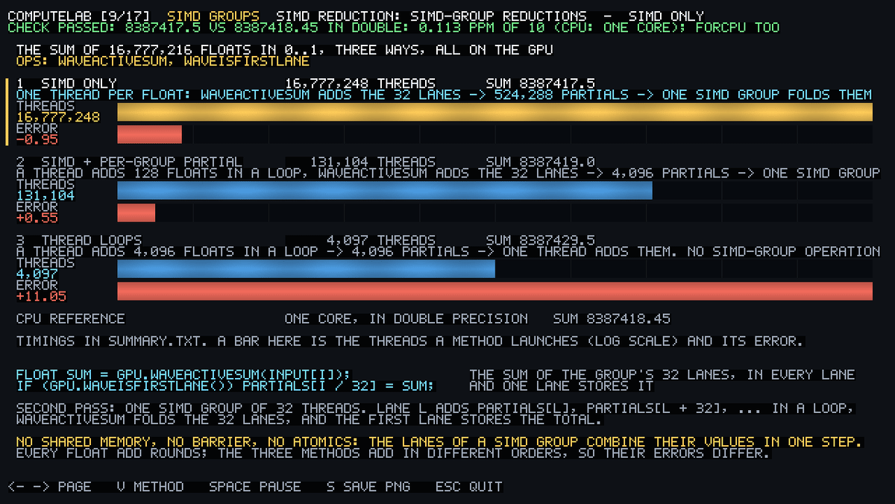

### Matrix units

Apple GPUs have hardware for small matrix products, and Metal reaches it through
`simdgroup_matrix`: an 8 × 8 matrix that the 32 lanes of a SIMD group hold *together* (two elements
each) and multiply in one step. In SharpCompute that is `WaveMatrix8x8` (`float`) and
`WaveMatrixHalf8x8` (`Half`). Nothing in the names is Apple's: the same shape exists as a
cooperative matrix in Vulkan (`KHR_cooperative_matrix`) and as WMMA fragments in CUDA.

```csharp
// One SIMD group per threadgroup computes an 8 x 8 block of c = a x b, for n x n row-major matrices.
[ThreadGroupSize(32)]
[GeneratedComputeShaderDescriptor]
public readonly partial struct MatMulBlocks(ReadOnlyBuffer<float> a, ReadOnlyBuffer<float> b, ReadWriteBuffer<float> c, int n) : IComputeShader
{
    public void Execute()
    {
        int row = ThreadGroupIds.Y * 8;                    // the same in all 32 lanes
        int column = ThreadGroupIds.X * 8;
        WaveMatrix8x8 sum = default;                       // the zero matrix

        for (int k = 0; k < n; k += 8)
        {
            WaveMatrix8x8 left = WaveMatrix8x8.Load(a, row * n + k, n);       // 8 x 8 of a, rows n apart
            WaveMatrix8x8 right = WaveMatrix8x8.Load(b, k * n + column, n);
            sum = WaveMatrix8x8.MultiplyAccumulate(left, right, sum);         // left x right + sum
        }

        sum.Store(c, row * n + column, n);
    }
}

device.For(n / 8 * 32, n / 8, new MatMulBlocks(a, b, c, n)); // a threadgroup (32 threads) per block
```

| Member | Meaning | Metal |
|---|---|---|
| `WaveMatrix8x8.Filled(value)` | every element `value` | `make_filled_simdgroup_matrix<float, 8, 8>(value)` |
| `WaveMatrix8x8.Diagonal(value)` | `value` on the diagonal, zero elsewhere (`Diagonal(1f)` is the identity) | `simdgroup_float8x8(value)` |
| `default`, `new WaveMatrix8x8()` | the zero matrix | `make_filled_simdgroup_matrix<float, 8, 8>(0.0f)` |
| `WaveMatrix8x8.Load(source, offset, stride, transpose = false)` | element (*r*, *c*) is `source[offset + r * stride + c]`; transposed, `source[offset + c * stride + r]` | `simdgroup_load` |
| `matrix.Store(destination, offset, stride, transpose = false)` | writes the same 64 elements | `simdgroup_store` |
| `WaveMatrix8x8.Multiply(a, b)` | `a × b` | `simdgroup_multiply` |
| `WaveMatrix8x8.MultiplyAccumulate(a, b, c)` | `a × b + c` | `simdgroup_multiply_accumulate` |

`WaveMatrixHalf8x8` has the same members on `Half`. What they mean, measured on an Apple M4 Pro and
pinned by the tests:

- **Load and store** take a `ReadOnlyBuffer<T>` or `ReadWriteBuffer<T>` (or a view of one), which
  is `device` memory, or a `[GroupShared]` array, which is `threadgroup` memory; a store needs one it
  can write. `T` is the matrix's element type: `float` for `WaveMatrix8x8`, `Half` for
  `WaveMatrixHalf8x8` (anything else is build error SCG0049). `stride` is the number of elements
  from one row to the next, so a matrix can be cut out of a larger one, and `transpose` reads or
  writes columns as rows.
- **Mixed precision.** The operands of `Multiply` and `MultiplyAccumulate` may each be either type,
  and the type the method is called on is the precision of the result, in every combination Metal
  allows: `WaveMatrix8x8.MultiplyAccumulate(halfA, halfB, floatSum)` multiplies half operands into a
  float accumulator, which is the useful one (half the memory traffic, no half overflow in the sum).
- **A matrix belongs to the whole SIMD group.** Every operation has to be reached by all 32 lanes,
  with the same arguments in each: compute offsets from `ThreadGroupIds`, `SimdGroupIds.Index`,
  loop counters and constants, never from `ThreadIds` or the lane index. The GPU checks nothing: a
  group with fewer lanes (a threadgroup or grid that is not a multiple of 32, lanes that returned
  early) loads and stores only the elements its lanes hold, and lanes that disagree each go their own
  way. SCG0051 warns about a `[ThreadGroupSize]` that is not a multiple of 32.
- **A matrix has no layout in memory.** It is a local, a parameter or a return value of a helper
  (`ref` and `out` included). It cannot be a buffer, `[GroupShared]` or local array element, a field of a struct
  or of the shader (SCG0048), or a `static readonly` field (SCG0050).
- **Partial tiles are the caller's job.** A matrix is loaded and stored whole. For sizes that are
  not a multiple of 8 (or of the tile a kernel works in), pad the data with zeros, which add nothing
  to any sum; ComputeLab's `WaveMatMul.Pad` and `Unpad` do that for its kernel.
- **Offsets are added term by term.** `Load(a, row * n + k, n)` becomes `a + row * n + k` in MSL:
  each term of a sum of `int`s is one pointer addition, which the GPU compiler turns into far better
  addressing than a 32-bit sum that is then widened (which measured about 15 % slower for the
  product below).
  This is the one place where signed arithmetic is not C#'s: every term wraps as usual, but their
  sum is formed in 64 bits and does not. The two differ only where the terms add up to more than an
  `int` holds, which is no valid offset in C# either: a sum past `int.MaxValue` wraps to a negative
  offset, and `ForCpu` refuses that as out of range (`ArgumentOutOfRangeException`). Only a sum that
  wraps all the way round (below `int.MinValue`, or past 2³²) gives C# an offset inside the buffer
  that the GPU does not use.
- **Results** agree with a reference within rounding: the order in which the eight terms of an
  element are added is the GPU's. Compare with a tolerance.

**On the CPU** (`ForCpu`, `ForSplit`) the lanes of a SIMD group meet at every matrix operation, as
they do for the `Wave*` operations, and the matrix is storage the group shares. The meeting checks
what the GPU does not: it throws `NotSupportedException` when the lanes are at different calls,
when they bring different arguments, or when fewer than 32 take part, and
`ArgumentOutOfRangeException` when a load or store reaches outside its buffer or array. It is for
checking a kernel at small sizes, not for bulk work.

**How fast.** `C = A × B` for random floats, by the GPU's own time for one dispatch
([`LastGpuTime`](#gpu-time-of-a-dispatch)), in TFLOP/s (2 n³ operations per product), on an Apple
M4 Pro (16-core GPU, macOS 27.2):

| Kernel | Written as | 1024 × 1024 | 2048 × 2048 |
|---|---|---:|---:|
| Naive, a thread per element | C# | 0.52 (4.15 ms) | 0.52 (33.1 ms) |
| 16 × 16 tiles in shared memory | C# | 1.07 (2.01 ms) | 1.08 (15.9 ms) |
| **Wave matrices, 2 × 4 accumulators** | **C#** | **5.08** (0.422 ms) | **5.19** (3.31 ms) |
| `simdgroup_matrix`, 2 × 4 accumulators | hand-written MSL | 5.15 (0.417 ms) | 5.27 (3.26 ms) |
| `MPSMatrixMultiplication` | Apple's kernel | 5.33 (0.403 ms) | 5.51 (3.12 ms) |

These are the SGEMM rows of the benchmarks' [native baselines](benchmarks/RESULTS.md#native-baselines-and-roofline)
(`scripts/run-benchmarks.sh --native-baselines`: medians of 5 passes of 25 dispatches, every kernel
on the same seeded random buffers). The C# kernel takes 1.013 to 1.014 times the GPU time of the
same kernel written by hand in MSL and 1.05 to 1.06 times that of MPS, and `--verify` finds its
product bit for bit that of the hand-written kernel and of MPS, and within 4 × 10⁻⁷ of a CPU
reference that sums in another order.

The kernel is `MatMulWaveMatrix` in
[`MatrixUnitsPage.cs`](samples/SharpCompute.Samples.ComputeLab/Pages/Simd/MatrixUnitsPage.cs), and
its shape is what the speed depends on:

- **Eight accumulators per SIMD group** (2 × 4 matrices, a 16 × 32 block of C). Sixteen spill out of
  the registers: the same kernel with 4 × 4 measured about seven times slower.
- **Load operands straight from the buffers.** Staging them through `[GroupShared]` memory first,
  the way the scalar tiled kernel does, made that 4 × 4 kernel slower again, by almost half.
- **Four SIMD groups per threadgroup** (128 threads, a 32 × 64 tile of C), and the loop over the
  shared dimension unrolled twice by hand.
- **Write offsets as sums**, as above.

`scripts/demo-matrixunits.sh` opens ComputeLab on the page (V switches the kernel, N the size); in
the window the bars are the machine's own, in the picture they are the rates above:


### Local arrays

A thread can have small arrays of its own: the taps of a filter, its weights, the values a sorting
network orders, a stack, a small histogram. Write them the C# way; each becomes a fixed-size array of
that thread, which the GPU keeps in registers. A 3 × 3 median filter, from ComputeLab's LocalArrays page:

```csharp
[GeneratedComputeShaderDescriptor]
public readonly partial struct MedianFilter(ReadWriteBuffer<uint> source, ReadWriteBuffer<uint> destination, int size) : IComputeShader
{
    private static void Order(ref Float3 a, ref Float3 b)  // one compare-and-swap, on three channels at once
    {
        Float3 low = Gpu.Min(a, b);
        b = Gpu.Max(a, b);
        a = low;
    }

    private static void MedianOfNine(Span<Float3> p)       // MSL: (thread float3* p, int __len_p)
    {
        Order(ref p[1], ref p[2]); Order(ref p[4], ref p[5]); Order(ref p[7], ref p[8]);
        Order(ref p[0], ref p[1]); Order(ref p[3], ref p[4]); Order(ref p[6], ref p[7]);
        // ... 19 steps in all leave the median in p[4]
    }

    public void Execute()
    {
        int x = ThreadIds.X, y = ThreadIds.Y;
        Span<Float3> window = stackalloc Float3[9];        // MSL: float3 window[9] = {};
        int n = 0;

        for (int dy = -1; dy <= 1; dy++)
        {
            for (int dx = -1; dx <= 1; dx++)
            {
                int i = (Gpu.Clamp(y + dy, 0, size - 1) * size) + Gpu.Clamp(x + dx, 0, size - 1);
                window[n] = Gpu.UnpackUnorm4x8(source[i]).XYZ;
                n++;
            }
        }

        MedianOfNine(window);
        destination[(y * size) + x] = Gpu.PackUnorm4x8(new Float4(window[4], 1f));
    }
}
```

The page's 5 × 5 Gaussian reads its weights from a constant table:

```csharp
ReadOnlySpan<int> weights =                                // MSL: const int weights[25] = { 1, 4, ... };
[
    1, 4, 6, 4, 1,
    4, 16, 24, 16, 4,
    6, 24, 36, 24, 6,
    4, 16, 24, 16, 4,
    1, 4, 6, 4, 1,
];

int w = weights[((dy + 2) * 5) + dx + 2];
```

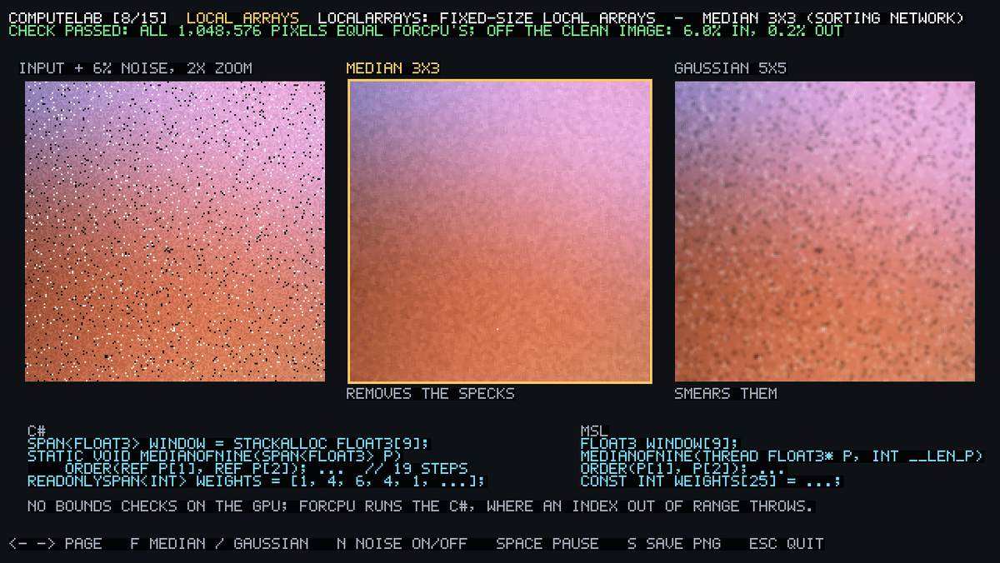

| C# | MSL |
|---|---|
| `Span<T> a = stackalloc T[N];`, `T[] a = new T[N];` | `T a[N] = {};`, zeroed as in C# |
| `stackalloc T[] { x, y, z }`, `new T[] { x, y, z }`, `T[] a = [x, y, z];`, `Span<T> a = [x, y, z];` | `T a[3] = { x, y, z };` |
| `ReadOnlySpan<T> a = [x, y, z];` | `const T a[3] = { x, y, z };` |
| `a[i]`, `a[i] += v`, `a[i]++`, `ref a[i]` | the same |
| `a.Length` | the constant `N` |
| `foreach (T v in a)`, `foreach (ref T v in a)` | `for (int __i_v = 0; __i_v < N; __i_v++) { T v = a[__i_v]; ... }`, with `thread T&` for `ref` |
| a helper's `Span<T>`, `T[]` or `ReadOnlySpan<T>` parameter | `thread T* a, int __len_a` (`thread const T*` for `ReadOnlySpan<T>`) |
| `[InlineArray(8)] struct Float8 { float _e; }`, `f[i]` | `struct Float8 { float _e[8]; };`, `f._e[i]` |

- `T` is anything a local can be: scalars, vectors, matrices (`Float3x3` too), `bool`, `Half` and your
  own structs. `N` is a compile-time constant of at least 1 (`SCG0037`); a length only known at run
  time has no equivalent, because a thread's arrays are sized when the shader is compiled.
- A C# array or span is a reference to its elements; a thread's array is the elements. The two agree
  as long as each array has one name, so a local array can be indexed, looped over and passed to a
  helper method, but not copied to another variable, reassigned, compared, returned or sliced
  (`Slice`, ranges, `^`), and the methods of `Span<T>` and arrays are not available (`SCG0039`).
  Multi-dimensional and jagged arrays are `SCG0036`: index a one-dimensional array as `[y * width + x]`.
- A helper that takes a span or an array is compiled once for every length: it receives a pointer to
  the caller's elements and the length, so what it writes reaches the caller's array, as in C#.
- An `[InlineArray(N)]` struct is a value type in C# too, so it is copied, passed and returned by
  value, has no `Length`, and crosses the CPU/GPU boundary (a captured constant, a buffer element, a
  struct field) whenever its element type can, with the same layout asserts as any struct. One of
  `bool` or `Float3x3` elements is for locals only.
- **Keep them small.** A thread keeps small arrays in registers and spills larger ones to memory. On an
  M4 Pro, a kernel that fills its array and reads it back costs about 0.09 ns per element at 1 KB per
  thread and 0.55 ns at 16 KB, and Metal refuses to create the pipeline once a thread needs 256 KB of
  stack. Above 16 KB a local array is warning `SCG0038`; use `[GroupShared]` memory or a buffer for
  data that large.
- **No bounds checks on the GPU:** an index outside the array reads or writes whatever lies there.
  `ForCpu` runs the C#, where the same index throws `IndexOutOfRangeException`, so running a shader on
  the CPU is the way to find such a bug.
- **Prefer `stackalloc`.** Under `ForCpu`, `new T[N]` in a kernel is a heap allocation per shader
  thread: correct, but slow. `stackalloc`, `ReadOnlySpan<T>` tables of constants (which C# stores as
  static data) and inline arrays allocate nothing. A `stackalloc` belongs outside loops: inside one it
  is CA2014, which this repository's analyzers treat as an error; declare the array before the loop
  and reuse it, which compiles to the same MSL.

### Sharing code between shaders

A shader is not limited to its own methods. It can call static methods of any type, generic
methods, and the members of your structs; all of it is translated to MSL from its C# source and
emitted once in every shader that uses it.

```csharp
public static class ShaderMath
{
    public const float Tau = 6.2831853f;                                  // inlined where it is used
    public static readonly Float3 SunDirection = Gpu.Normalize(new Float3(0.55f, 0.75f, -0.45f)); // an MSL constant

    public static uint Hash(uint x)
    {
        x ^= x >> 16;
        x *= 0x7FEB352Du;
        x ^= x >> 15;
        return x;
    }

    public static T Pick<T>(bool condition, T whenTrue, T whenFalse) => condition ? whenTrue : whenFalse;
}

public struct Ray
{
    public Float3 Origin;
    public Float3 Direction;

    public Ray(Float3 origin, Float3 direction)
    {
        Origin = origin;
        Direction = Gpu.Normalize(direction);
    }

    public readonly Float3 At(float distance) => Origin + (Direction * distance);
}

public struct Sphere
{
    public Float3 Center;
    public float Radius;

    public readonly float Intersect(Ray ray)
    {
        Float3 offset = ray.Origin - Center;
        float b = Gpu.Dot(offset, ray.Direction);
        float discriminant = (b * b) - (Gpu.Dot(offset, offset) - (Radius * Radius));

        return discriminant < 0f ? -1f : -b - Gpu.Sqrt(discriminant);
    }
}

public struct RandomStream(uint seed)
{
    public float Next()                       // modifies the struct it is called on
    {
        seed = ShaderMath.Hash(seed + 0x9E3779B9u);
        return (seed >> 8) * (1f / 16777216f);
    }
}

[GeneratedComputeShaderDescriptor]
public readonly partial struct Depth(ReadWriteBuffer<float> depth, ReadOnlyBuffer<Sphere> spheres, int width) : IComputeShader
{
    private float Aspect => (float)width / DispatchSize.Y;          // a computed property of the shader

    public void Execute()
    {
        RandomStream random = new((uint)((ThreadIds.Y * width) + ThreadIds.X));
        Float2 point = (ThreadIds.Normalized.XY * 2f) - 1f;
        Ray ray = new(new Float3(0f, 1f, -5f), new Float3(point.X * Aspect, -point.Y, 2f + (random.Next() * 0.01f)));
        float nearest = -1f;

        for (int i = 0; i < spheres.Length; i++)
        {
            float distance = spheres[i].Intersect(ray);                // a method, called on a buffer element
            nearest = ShaderMath.Pick(distance > 0f && (nearest < 0f || distance < nearest), distance, nearest);
        }

        depth[(ThreadIds.Y * width) + ThreadIds.X] = nearest < 0f ? 0f : ray.At(nearest).Z;
    }
}
```

| C# | MSL |
|---|---|
| A static method of any class or struct: `ShaderMath.Hash(x)`, an extension method `x.Squared()` | `static uint ShaderMath_Hash(uint x)`, named after its type so that two types can each have a `Hash` |
| A generic method: `ShaderMath.Pick(c, a, b)` | one function per set of type arguments: `ShaderMath_Pick_float`, `ShaderMath_Pick_float3` |
| A `const` or `static readonly` field of any type | a `const` is inlined; a `static readonly` field is a program-scope `constant` (`ShaderMath_SunDirection`) |
| A method or computed property of a struct: `ray.At(t)`, `body.Energy`, an indexer | a function that takes the struct first: `Ray_At(Ray __this, float distance)` |
| A method that modifies its struct: `random.Next()`, `particles[i].Step(dt)` | the struct by reference: `thread RandomStream& __this` for a local, `device Particle& __this` for a buffer element, `threadgroup` for a `[GroupShared]` element; one function per address space used |
| A constructor: `new Ray(origin, direction)`, a primary constructor, a `record struct` | a function that returns the struct (`Ray_new`): zeroed, then field initializers or `: this(...)`, then the body |
| An operator or conversion a struct declares: `a + b`, `-a`, `a += b`, `(float)a` | a function: `Complex_op_Addition(a, b)` |
| An instance method, computed property or indexer of the shader, called on `this` | a function that receives the captured state it reads as hidden parameters, as before |

- **The source has to be in the same project as the shader.** A helper is translated from its C#
  source, which a referenced assembly does not contain: calling a method of another assembly is
  build error `SCG0016`. To share a file between projects, link it into each one
  (`<Compile Include="..\Shared\*.cs" LinkBase="Shared" />`), as Glowfall and Pulsewake do with
  [`samples/SharpCompute.Samples.Shared`](samples/SharpCompute.Samples.Shared).
- **Shared code can do what the shader can**: `ThreadIds`, `DispatchSize` and the group built-ins,
  atomics on a buffer it is passed, barriers and SIMD-group operations all work in a static method of
  another type, and reach it the way they reach the shader's own helpers. What it cannot see is the
  shader's captured state: pass what it needs as arguments (buffers and textures included).
- **It runs on the CPU unchanged.** Nothing here is special to the generator, so `ForCpu` runs the
  same methods, and so can your own code and tests: `sphere.Intersect(ray)` is just C#.
- **A method that does not modify its struct takes a copy**, wherever the struct lives (a local, a
  buffer element, captured state, threadgroup memory). One that does modify it takes a reference, and
  where C# would call it on a copy (a temporary, a `readonly` field, an `in` parameter, an element of
  a `ReadOnlyBuffer`, captured state of a `readonly` shader) the MSL calls it on a copy too, so what it
  changes is discarded in both. Whether a method modifies its struct is read from its body, not from
  the `readonly` keyword, so structs need no annotations.
- **The usual rules apply**: recursion is `SCG0014`, a local function that captures is `SCG0025`, and
  `counter.Next() + counter.Next()` is `SCG0021` (a method that modifies its struct writes it, and MSL
  does not say which call comes first), as is `data[0] += Bump(0)` when `Bump` writes `data` (what a
  helper does to buffers counts at its call; see **Evaluation order** in the reference). Two more: assigning a computed property is `SCG0045` (only
  getters are translated), and a generic method called with a type MSL does not have, such as
  `double`, is `SCG0046` at the call.

`scripts/demo-computelab.sh --page shared-code` shows it live: a small path-traced scene whose two
shaders are built from one static class and four structs, with the GPU time and a `ForCpu` check
of every 8th pixel.


### Batching and async dispatch

Every `device.For` call is its own command buffer, commit and wait, which costs about 0.1 ms even for
a tiny kernel. A `ComputeContext` records several dispatches into one command buffer and runs them
together when it is disposed (or on `Execute()`), so the fixed cost is paid once:

```csharp
using (ComputeContext context = device.CreateComputeContext())
{
    context.For(width, height, new BlurHorizontal(source, temp, weights, width, radius));
    context.For(width, height, new BlurVertical(temp, output, weights, width, height, radius));
} // one commit, one wait; the vertical pass sees everything the horizontal pass wrote
```

Dispatches in a context run in recording order and each sees the writes of the ones before it (no
barriers needed), constants are captured when a dispatch is recorded, and every bound buffer and
texture stays alive until the GPU is done, even if it is disposed first. A context is for one thread
at a time; use one per thread. `ExecuteAsync()` and `await using` submit without blocking.

A renderer can keep one context and call `Execute()` every frame: the context reuses its command
lists and constants storage, so after the first frames recording a frame allocates nothing.

`ForAsync` and `ForEachAsync` commit one dispatch and return a `Task` that completes when the GPU
has finished (or faults with `MetalException`), so the CPU can work on the previous result meanwhile:

```csharp
Task rendering = device.ForAsync(width, height, new RenderFrame(frames[0], 0));

for (int k = 0; k < frameCount; k++)
{
    await rendering; // frame k is ready in frames[k % 2]

    if (k + 1 < frameCount)
    {
        rendering = device.ForAsync(width, height, new RenderFrame(frames[(k + 1) % 2], k + 1));
    }

    Consume(frames[k % 2]); // CPU work on frame k overlaps the GPU rendering frame k + 1
}
```

Work on one device runs in submission order, so dependent `ForAsync` calls can also be issued back
to back and awaited once. Measurements are in the "Batching and async" section of
[`benchmarks/RESULTS.md`](benchmarks/RESULTS.md).

### GPU time of a dispatch

A stopwatch around `device.For` times the whole round trip: encoding, the commit, the GPU's work and
waking the waiting thread. To compare two kernels, or to show what a kernel costs, ask for the GPU's
own share:

```csharp
device.For(width, height, new Blur(source, destination, radius));
TimeSpan kernel = device.LastGpuTime;          // the GPU's time for that dispatch

using ComputeContext context = device.CreateComputeContext();
context.For(width, height, new BlurHorizontal(source, temp, weights, width, radius));
context.For(width, height, new BlurVertical(temp, output, weights, width, height, radius));
context.Execute();
TimeSpan both = context.LastGpuTime;           // the GPU's time for the batch
```

Both are the time between Metal's `GPUStartTime` and `GPUEndTime` of the command buffer that ran the
work, so there is **one time per command buffer**: a synchronous `For`, `ForEach`, `ForIndirect`,
`Copy`, `Fill` or `Clear` is a command buffer of its own, and a context's batch is one for all its
dispatches. (Apple GPUs can take a timestamp between encoders but not between the dispatches of
one, so a batch is not split further; execute a kernel alone to time it alone.)

- `device.LastGpuTime` belongs to the **calling thread**: it is the time of the last synchronous
  call that thread made on the device, so threads sharing a device never read each other's
  dispatches. Read it right after the call, on the same thread. `ForAsync` and `ForEachAsync` do not
  set it; time asynchronous work through a context.
- `context.LastGpuTime` is set before `Execute()` returns and before the task of `ExecuteAsync()` or
  `EncodeInto` completes (for `EncodeInto` it is the time of the caller's whole command buffer), and
  can be read from any thread, also after the context is disposed.
- Neither allocates, and a call with nothing to do (an empty grid, a context with nothing pending)
  leaves the previous time in place.

The interval is elapsed time on the GPU, so other GPU work in between (another process, the window
server) lengthens it, and the first dispatch after an idle spell includes the GPU's ramp-up: take the
median of a few. ComputeLab's "GPU ms" readouts and the
[native baselines](benchmarks/RESULTS.md#native-baselines-and-roofline) of the benchmarks are measured
this way.

### Buffers and dispatch

**Views.** `Slice` makes a buffer over part of another one. Nothing is copied: it is the same
`MTLBuffer` bound at an offset, and it can go wherever a buffer can (a shader on the GPU, the CPU or
both, `AsSpan`, `Copy`). Index 0 is the view's first element and `Length` is its own length, in C#
and inside the shader:

```csharp
using ReadWriteBuffer<float> particles = device.AllocateReadWriteBuffer<float>(1_000_000);

device.For(250_000, new Integrate(particles.Slice(500_000, 250_000), dt)); // touches only that quarter
```

A view owns no memory: it is disposed with the buffer it came from, and a dispatch that binds it
keeps that buffer's memory alive until the GPU is done.

**Copy, fill, clear.** `Copy`, `Fill` and `Clear` run on the GPU as blits. On the device they are
one command buffer each; in a `ComputeContext` they run in recorded order with the dispatches, which
is the point: a copy sees what the pass before it wrote, without the CPU waiting in between.

```csharp
using (ComputeContext context = device.CreateComputeContext())
{
    context.Clear(counter);                        // reset an accumulator between passes
    context.For(count, new Step(current, next));
    context.Copy(next, current);                   // whole buffer; ranges and views work too
    context.Copy(next, 0, history, frame * count, count);
}

device.Copy(simulation, texture); // buffer -> texture, texture -> buffer and texture -> texture too
```

Offsets and counts are in elements; source and destination must not overlap. `Fill` takes a byte,
so only 0 is the same element for every type. Buffers are unified memory, so when nothing on the GPU
is pending a span copy is faster than `device.Copy` (0.02 ms against about 0.13 ms for 1 MB on an
M4 Pro; at 64 MB the GPU is ahead, about 0.8 ms against 1.05 ms).

**Indirect dispatch.** `ForIndirect` reads its threadgroup counts from a buffer when the dispatch
runs, so a pass recorded just before it can produce them. A compaction pass counts its survivors,
`WriteDispatchArguments` turns the count into threadgroups, and the follow-up pass runs over exactly
that many, all in one execution with nothing read back:

```csharp
using ReadWriteBuffer<DispatchArguments> arguments = device.AllocateReadWriteBuffer<DispatchArguments>(1);

using (ComputeContext context = device.CreateComputeContext())
{
    context.Clear(counter);
    context.For(count, new CompactAbove(source, survivors, counter, cutoff)); // Gpu.AtomicAdd on counter[0]
    context.WriteDispatchArguments<Shade>(counter, arguments);                // count -> threadgroups, on the GPU
    context.ForIndirect(arguments, new Shade(survivors, counter, output));
}

[ThreadGroupSize(256)]
[GeneratedComputeShaderDescriptor]
public readonly partial struct Shade(ReadWriteBuffer<uint> survivors, ReadWriteBuffer<int> counter, ReadWriteBuffer<float> output) : IComputeShader
{
    public void Execute()
    {
        if (ThreadIds.X < counter[0]) // required: see below
        {
            output[(int)survivors[ThreadIds.X]] = 1f;
        }
    }
}
```

The counts are threadgroups, not threads: Metal has no indirect dispatch of an exact grid. The
dispatch runs up to one threadgroup more than the count, and `DispatchSize` is groups × threadgroup
size, so **the shader must check its index against the count itself**, as above. A shader can also
write `DispatchArguments` like any struct (for a 2D or 3D grid, for example), and
`device.ForIndirectCpu` runs the same dispatch on the CPU. Whole threadgroups are what a shader with
`[GroupShared]` memory wants anyway, so those dispatch indirectly without a second thought.

ComputeLab's Indirect page does one job three ways on a million elements, a quarter of which survive:

| | GPU time |
|---|---|
| Compact, then `ForIndirect` over the survivors | 0.42 ms |
| Compact, then dispatch the full array (each thread checks the count) | 0.42 ms |
| No compaction: one pass in which every thread tests its own element | 0.55 ms |

The speed-up comes from compaction; indirect dispatch's gain is no CPU read-back. Threads that stop
at their bounds check cost almost nothing, so a full-array dispatch over the compacted list is as
fast, but it has to be sized for the whole array; the indirect one follows the count the GPU just
produced.

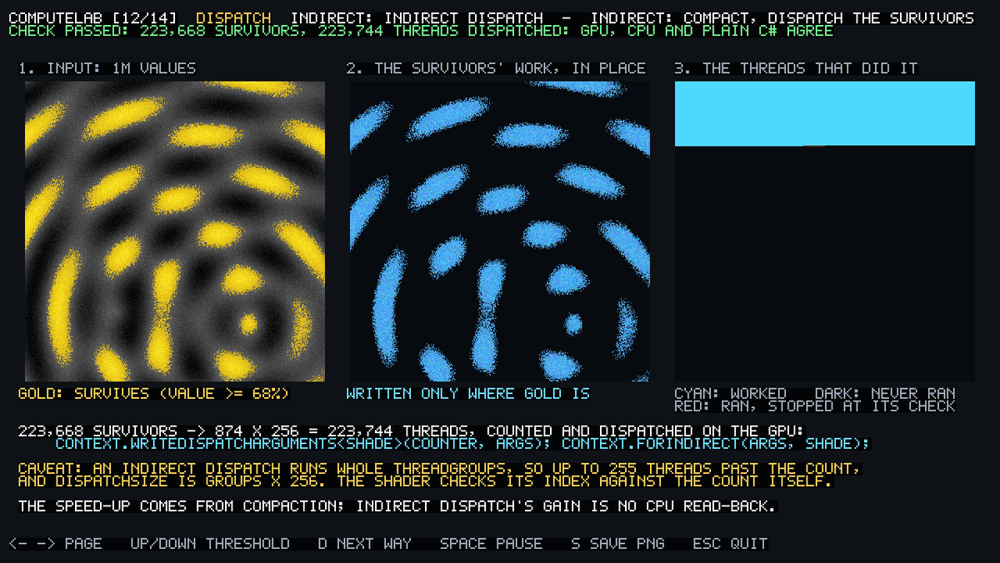

**Compile options.** Every shader is compiled with IEEE-safe math, precise math functions and
Metal's default contraction. `[ShaderOptions]` changes that for one shader:

```csharp
[ShaderOptions(FastMath = true)]     // MTLMathModeFast: faster sin/exp/pow, no NaN or infinity
[GeneratedComputeShaderDescriptor]
public readonly partial struct Glow(...) : IComputeShader { ... }

[ShaderOptions(FpContract = false)]  // a * b + c is a multiply and an add, as in C#: no fused multiply-add
[GeneratedComputeShaderDescriptor]
public readonly partial struct Orbit(...) : IComputeShader { ... }
```

Fast math makes a kernel that is mostly `sin`, `cos`, `exp` and `pow` about three times faster
(ComputeLab's FastMath page: 0.39 ms against 1.2 ms, with a 3.6e-6 error against the CPU where safe
math has 3.3e-6), but a comparison such as `x != x` is compiled away. With `FpContract = false`, arithmetic that uses only `+ - * /`
and `Gpu.Sqrt` gives the same bits on the GPU as on the CPU (subnormal results aside, which the GPU
flushes to zero); the unfused Mandelbrot kernel is 12 % slower, and saxpy is unchanged.

**Warm-up.** A shader is compiled the first time it is dispatched. `Prepare` does it ahead of time,
so the first frame doesn't stall:

```csharp
device.Prepare<Blur>();                                                  // now
await device.PrepareAsync(ShaderReference.Of<Blur>(), ShaderReference.Of<Sharpen>()); // in parallel, off this thread
device.Prepare<Blur>(PrepareOptions.IncludeSplit);                       // also the pipeline ForSplit runs on the GPU
```

The first time an application runs on a machine, the first frame of a large shader (a raymarched
scene of about 300 lines) takes 247 ms without `Prepare` and 12 ms with it, the 242 ms having moved
into `Prepare`. On later launches macOS has the compiled shader in its cache and the first frame
takes about 8 ms. `Prepare` moves the compile; [precompiling](#precompiled-shaders) removes part of it.

### Precompiled shaders

A shader becomes GPU code in two steps: its MSL is compiled to Metal's intermediate code, and the
GPU driver compiles that to machine code when the pipeline is created. Both happen the first time
the shader is used. The first step can be done when the project is built:

```xml
<PropertyGroup>
  <SharpComputePrecompileShaders>true</SharpComputePrecompileShaders>
</PropertyGroup>
<Import Project="path/to/src/SharpCompute.Build/SharpCompute.Build.targets" />
```

After the C# compiler has run, the build reads the shaders out of the assembly's metadata, compiles
each one with the Xcode Metal Toolchain (`xcrun metal`, with the options the runtime would use for
that shader, its `[ShaderOptions]` included) and links them into `<AssemblyName>.metallib`. The file
is copied to the output folder with the assembly, to the output of every project that references
it, and into `dotnet publish` (also single-file, self-contained and Native AOT, where it sits next
to the executable). At run time nothing changes in your code: a dispatch or a `Prepare` takes the
shader's kernel from the library instead of compiling its MSL.

- **It falls back by itself.** A kernel is stored under a name that includes a hash of its MSL and
  compile options, and the runtime asks for the name of the shader it has. A library from another
  build, a shader that is not in it, a missing file, a hand-written descriptor: all of those are
  compiled from source at run time, as without the property. The results are the same bits either way.
- **The build does not depend on the toolchain.** Without it (`xcodebuild -downloadComponent
  MetalToolchain` installs it) the build prints a message, produces no library and succeeds. A
  shader the offline compiler rejects is reported and left to run time.
- **It is incremental.** Only shaders whose MSL or options changed are compiled, and a build in
  which the assembly did not change does not start the tool. On an M4 Pro the 16 shaders of the
  benchmark project take 0.3 s to precompile and the 160 of the test project 2.1 s (medians of 3);
  their libraries are 106 KB and 1.0 MB.
- **`device.GetPipelineOrigin<T>()`** says where a shader's pipeline came from
  (`Precompiled`, `CompiledAtRunTime`, or `None` before its first use), for a status line or a log.
  Setting the `AppContext` switch `SharpCompute.UsePrecompiledShaders` to false before a device is
  created makes that device compile everything from source.

What it saves is the first step, on the first launch. On an M4 Pro (macOS 27.2, median of 7 fresh
processes; a first launch is a run from an application bundle macOS has never seen, so with an
empty shader cache), the first frame of a large shader at 320 × 180, and `Prepare` of thirteen
small kernels (the benchmark suite's own: saxpy, Mandelbrot, the blurs, a matrix product, an
n-body step):

| | First launch on a machine | Later launches |
|---|---|---|
| RaymarchedGarden (about 300 lines), compiled at run time | 247 ms | 8 ms |
| the same, with `Prepare` first | 242 ms in `Prepare`, then 12 ms | 3 ms in `Prepare`, then 6 ms |
| RaymarchedGarden, precompiled | 195 ms | 10 ms |
| the same, with `Prepare` first | 176 ms in `Prepare`, then 13 ms | 3 ms in `Prepare`, then 6 ms |
| `Prepare` of 13 small kernels, compiled at run time | 144 ms | 7 ms |
| `Prepare` of 13 small kernels, precompiled | 108 ms | 8 ms |

A steady frame of the large shader is 3 ms. Precompiling takes 52 ms off its first frame and a
quarter off the wait for the thirteen kernels; what remains is the GPU driver compiling for this
machine, which macOS does once and caches, and which `Prepare` moves off the first frame. On later
launches the cache already holds the result, and precompiling makes no difference.
(`SharpCompute.Benchmarks --first-frames` prints the full table.)

Every sample in this repository is built this way, and ComputeLab's FastMath page shows it:


### On the CPU, or on both

The C# of a shader is real code: `ForCpu` runs it on all CPU cores, with `ThreadIds`,
`DispatchSize` and friends returning per-thread values, and buffers read and written in place.
`ForSplit` runs the leading rows of the grid on the CPU while the GPU runs the rest, on the same
shared buffers, and returns when both are done:

```csharp
device.ForCpu(width, height, new Blur(source, destination));       // CPU only
device.ForSplit(width, height, new Blur(source, destination));     // adaptive CPU share
device.ForSplit(width, height, new Blur(source, destination), 0.25); // a quarter of the rows on the CPU
device.ForEachSplit(texture, new Gradient(time: 1.5f));            // pixel shaders too
```

Both parts see the whole grid (`ThreadIds`, `DispatchSize`, `ThreadIds.Normalized`). Results match
the GPU up to floating-point rounding; integer results are identical (conversions from float
saturate, shift counts are masked and arithmetic wraps on both, signed and unsigned). Only split
shaders whose threads write their own elements;
a shader that uses `Gpu.Atomic*` on buffer elements is never divided, while atomics on `[GroupShared]`
elements stay within one threadgroup and do not prevent a split (see [Atomics](#shader-language-reference)).
Don't expect much from the split: the CPU runs the shader's scalar C#, and the GPU slows down while
every CPU core is busy. The adaptive mode therefore only splits while that measures faster than the
GPU alone, and on the benchmarked workloads it lands between 3 % slower and 9 % faster than GPU-only
([`benchmarks/RESULTS.md`](benchmarks/RESULTS.md#cpu-execution-and-cpugpu-split)). `ForCpu` is a
correct fallback and a debugging aid rather than a fast CPU path.

Both run the shader's expressions in the same order: one whose result would depend on C#'s
left-to-right evaluation, through a local or through what it (or a helper it calls) writes to a
buffer, a `[GroupShared]` array or a texture, is build error `SCG0021` (see **Evaluation order** in
the [shader language reference](#shader-language-reference)).

### Interop with existing Metal code

An app that already renders with Metal can run SharpCompute kernels on its own resources (particles,
lighting, post-processing) without handing its renderer over. Wrap its device, and its queue so that
SharpCompute's work is ordered with the app's:

```csharp
GraphicsDevice device = GraphicsDevice.FromNative(mtlDevice, mtlCommandQueue); // both retained; Dispose releases them
```

Resources belong to the `MTLDevice`, not to a wrapper: every "same device" check compares the
underlying object. `MTLCreateSystemDefaultDevice` returns the same object every time, so when the
app renders on the default device, `GraphicsDevice.GetDefault()` is that device as well.

**Buffers and textures.** Wrapping retains the object and never copies it; it is then an ordinary
SharpCompute buffer or texture (bindable, sliceable, copyable, kept alive by pending work). The
length is `buffer.length / sizeof(T)`, and a texture must be single-sample 2D in the pixel format of
`T` with `ShaderRead` (and `ShaderWrite` for read-write) usage. Only mip level 0 is used.

```csharp
ReadWriteBuffer<Particle> particles = device.WrapNativeReadWriteBuffer<Particle>(mtlBuffer);
ReadWriteTexture2D<Rgba32> frame = device.WrapNativeReadWriteTexture2D<Rgba32>(mtlTexture);
ReadOnlyTexture2D<Rgba32> image = device.WrapNativeReadOnlyTexture2D<Rgba32>(mtlImage);
```

| Wrapped object | Shaders, `Copy`, `Fill` | CPU access (`AsSpan`, indexers, `ForCpu`) | `CopyTo`/`CopyFrom` |
|---|---|---|---|
| Buffer, shared storage | yes | yes, in place | yes |
| Buffer, private storage | yes | `NotSupportedException` (`IsCpuAccessible` is false) | `NotSupportedException` |
| Texture that is a linear view of a shared buffer | yes | yes, in place | yes |
| Other texture, shared storage | yes | `NotSupportedException` | yes, through `getBytes`/`replaceRegion` |
| Texture, private storage | yes | `NotSupportedException` | `NotSupportedException` |

Untracked resources (`MTLHazardTrackingModeUntracked`, the default inside an `MTLHeap`) are rejected:
SharpCompute orders its passes through Metal's hazard tracking.

**Into the app's command buffer.** `EncodeInto` encodes what a context recorded into a command buffer
the app created, without committing it, so SharpCompute's passes run in order with the app's own
passes in one submission. What the recorded work uses stays alive until that command buffer completes:

```csharp
nint commandBuffer = app.BeginFrame();                // the app's [queue commandBuffer]
context.For(count, new SimulateParticles(particles, time, dt));
context.EncodeInto(commandBuffer);                    // before the app's scene pass, which draws the particles
app.EncodeScene(commandBuffer);                       // the app's render pass
context.For(width, height, new Ripple(scene, frame, center, time));
Task done = context.EncodeInto(commandBuffer);        // after it; completes with the command buffer
app.EncodeOverlayAndCommit(commandBuffer);            // the app's last pass, present and commit
```

The app must end its own encoder before calling `EncodeInto` (Metal terminates the process when two
encoders are open on one command buffer); a command buffer that is already committed is rejected.
SharpCompute does not keep the command buffer alive: if the app drops it without committing it (an
error path, a skipped frame), the work never runs, everything it pinned is released when the command
buffer is deallocated, and the task faults with "The command buffer was released without being
committed".

**Native handles.** `device.NativeHandle`, `device.NativeCommandQueueHandle`, `buffer.NativeHandle`
(with `buffer.NativeByteOffset` for a view) and `texture.NativeHandle` give other Metal code
SharpCompute's objects. They are not owned by the caller: they are valid while the SharpCompute
object is alive, and code that keeps one longer retains it.

```csharp
nint mtlBuffer = view.NativeHandle;       // a view's MTLBuffer is the one that owns the memory...
nuint offset = view.NativeByteOffset;     // ...and the view starts this many bytes into it
nint mtlTexture = texture.NativeHandle;   // e.g. [renderEncoder setFragmentTexture:mtlTexture atIndex:0]
```

[`samples/SharpCompute.Samples.NativeInterop`](samples/SharpCompute.Samples.NativeInterop) is a
complete example: a host renderer written straight against Metal, with SharpCompute's particle
simulation and post-process in its command buffer. The whole frame, host passes and both
SharpCompute passes, takes about 0.5 ms of GPU time at 1280 × 720 on an Apple M4 Pro (median of five
headless runs).


### Shader language reference

What is described here is checked against the GPU by the test suite; the full list of `Gpu.*`
methods, with the MSL each maps to, is in their doc comments.

**Scalar types.** These are the scalars a shader can use. All of them can be locals, parameters and
return values of helpers (shared ones, and type arguments of generic ones), `const` and
`static readonly` fields, elements of local arrays, buffer elements, captured constants, fields of
user structs (with methods, operators and constructors on them) and elements of `[GroupShared]`
arrays, except `bool`, which has no stable layout and stays inside the shader.

| C# | MSL | Bytes | Notes |
|---|---|---|---|
| `float` | `float` | 4 | Vectors: `Float2..4` |
| `Half` | `half` | 2 | Vectors: `Half2..4` |
| `int`, `uint` | `int`, `uint` | 4 | Vectors: `Int2..4`, `UInt2..4` |
| `byte`, `sbyte` | `uchar`, `char` | 1 | MSL's `char` is signed |
| `short`, `ushort` | `short`, `ushort` | 2 | |
| `long`, `ulong` | `long`, `ulong` | 8 | Aligned to 8 bytes in buffers, structs and constants |
| `bool` | `bool` | | Locals, parameters and return values only |

`double`, `decimal`, `char`, `nint`/`nuint` and `Int128` are build errors that name the type to use
instead.

```csharp
[GeneratedComputeShaderDescriptor]
public readonly partial struct Equalise(ReadWriteBuffer<byte> image, ReadOnlyBuffer<byte> lut) : IComputeShader
{
    public void Execute() => image[ThreadIds.X] = lut[image[ThreadIds.X]];   // one byte per pixel, in place
}

using ReadWriteBuffer<byte> image = device.AllocateReadWriteBuffer(grayscalePixels);   // byte[]
device.For(image.Length, new Equalise(image, lut));
```

The integers behave as they do in unchecked C#, on the GPU as on the CPU:

- **Promotion.** `byte + byte` is an `int` in C#, and `-uint` and `int + uint` are `long`. The MSL
  carries the conversions the C# expression has (`uchar(int(a) + int(b))` for `(byte)(a + b)`), so
  a result is as wide as C# says, and a cast back to the small type wraps at its width. Compound
  assignments and `++`/`--` on a small integer truncate on every step, as in C#.
- **Shifts.** The count is masked with 31 for `int` and the smaller integers (which are `int`s by
  the time they are shifted) and with 63 for `long` and `ulong`: `1L << 65` is 2. `>>>` works on `int`
  and `long`.
- **Overflow wraps** at the width of the type, on the GPU as in C#, signed and unsigned: `int`,
  `long` and `IntN` arithmetic is exact modulo 2^n, so `int.MaxValue + 1` is `int.MinValue`,
  `a + 1 > a` is false for `int.MaxValue` and `(a * b) / b` divides the wrapped product. Signed
  overflow is undefined in MSL, and the Metal compiler optimizes on the assumption that it does not
  happen, so the generator computes a signed `+`, `-`, `*` or negation (and their compound
  assignments and `++`/`--`) in the unsigned type of the same width and converts back:
  `a * b + c` on `int`s is `int(uint(a) * uint(b) + uint(c))`. That costs no instructions (signed and
  unsigned arithmetic are the same machine operations), and program-scope constants wrap the same way.
- **Negating an integer vector** (`-v` on an `IntN`, and the operators that amount to it: `0 - v`,
  `v * -1`, `v / -1`, `v *= -1`, also on a `UIntN`) is emitted as a prelude helper, `__ms_neg(v)`,
  which negates each lane on its own. Apple's Metal compiler miscompiles the vector operator: when
  one lane of the negation is never read and the same vector is subtracted in a chain elsewhere
  (`t += c; t *= 3; t -= v`), the chain silently loses that lane. A constant that negates only some
  lanes does the same when the other lanes are the unread ones, so `new Int3(0, 5, 0) - v` is
  emitted as `C + __ms_neg(v)` and `v * new Int3(1, -1, 1)` as `__ms_mul(v, C)`, a helper that
  multiplies lane by lane. The compound forms (`v *= -1`, `v /= -1`, `v *= new Int3(1, -1, 1)`)
  assign the helper's result, which names the target twice: on a target with side effects
  (`data[Next()] *= -1`) that is an error (`SCG0012`), so put the index in a local first. Vectors
  of floats and halves, and all scalars, are not affected and keep their operators. See
  [Limitations](#limitations) for the negations the generator cannot see.
- **Division by zero** does not trap: where C# throws `DivideByZeroException`, the GPU carries on
  with an unspecified value (on an Apple M4 Pro, `x / 0` is 0 and `x % 0` is `x` for 64-bit operands).
  `long.MinValue / -1`, which overflows in C#, gives `long.MinValue`. Don't depend on either.
- **Float to integer** conversions truncate, give 0 for NaN and saturate at the bounds of the target
  type, exactly as .NET does: `(byte)300f` is 255, `(sbyte)-129f` is -128, `(ulong)-1f` is 0,
  `(long)1e30f` is `long.MaxValue`. MSL's own `long(x)` wraps instead for a float beyond the range of
  a `long` (2^63 becomes `long.MinValue`), so that one conversion goes through a prelude helper that
  clamps first; all the others are plain MSL casts. Integer to float rounds to nearest even.
- **Literals** keep their C# type: `(byte)5` is `uchar(5)`, `5L` is `5L`, `ulong.MaxValue` is
  `18446744073709551615UL`.
- **Layout.** A `byte` is aligned to 1, a `short` to 2 and a `long` to 8, in C# and in MSL alike, so
  `struct { byte Tag; long Key; }` is 16 bytes on both sides. A constants block that holds a 64-bit
  integer is mirrored field by field at explicit offsets; as for every struct, the generated MSL
  asserts each size and offset (`static_assert`), so a disagreement fails the build of the pipeline
  instead of corrupting data. A user struct packed below the alignment of its fields
  (`Pack = 4` around a `long`) is build error `SCG0009`: MSL cannot under-align a scalar.
- **Speed.** Bytes and shorts cost what `uint`s cost. 64-bit add, shift, xor and multiply take about
  twice the time of their 32-bit counterparts on an Apple M4 Pro; 64-bit division and remainder are
  about 75 times slower than 32-bit (the GPU has no 64-bit divider), so keep `/` and `%` on `long`
  out of inner loops.

`Gpu.Abs`, `Min`, `Max`, `Clamp`, `CountBits`, `LeadingZeroCount`, `TrailingZeroCount` and
`ReverseBits` have an overload for each of these integer types (see **Bits** below), and
`Math.Min/Max/Clamp/Abs` work on them too. As with `Math.Min`, C# finds `Gpu.Min(b, 5)` ambiguous
between the `byte` and the `int` overload: write `Gpu.Min(b, (byte)5)`.

`scripts/demo-computelab.sh --page small-and-wide-integers` equalises an 8-bit image in place and
hashes every pixel in 64 bits, checked against the CPU:


**Vector and matrix types.** Locals, parameters and return values use the native MSL type. The
*boundary* type is the one in buffers, captured fields, struct fields and `[GroupShared]` arrays,
where the layout has to be the C# one; every shader that uses one asserts its size and offsets
(`static_assert`), so a layout that drifted is a compile error, not corrupt data.

| C# | MSL | At the boundary | Bytes (alignment) |
|---|---|---|---|
| `Float2`, `Float3`, `Float4` | `float2`, `float3`, `float4` | `packed_float2/3/4` | 8, 12, 16 (4) |
| `Half2`, `Half3`, `Half4` | `half2`, `half3`, `half4` | `packed_half2/3/4` | 4, 6, 8 (2) |
| `Int2..4`, `UInt2..4` | `int2/3/4`, `uint2/3/4` | `packed_int2/3/4`, `packed_uint2/3/4` | 8, 12, 16 (4) |
| `Bool2`, `Bool3`, `Bool4` | `bool2`, `bool3`, `bool4` | not allowed: locals only | |
| `Float2x2`, `Float3x3` | `float2x2`, `float3x3` | not allowed: locals only | |
| `Float4x4` | `float4x4` | four `packed_float4` columns | 64 (4) |

Vectors convert to each other explicitly, `(Int3)v`, as MSL's `int3(v)` does: float and half to
integer truncate and saturate (NaN gives 0), float to half rounds to the nearest half. Comparing
two vectors gives a [bool vector](#bool-vectors); the half vectors are described under
[Half precision](#half-precision).

**Atomics.** When many threads write the same buffer element, a plain `counts[bin] += 1` loses
updates. The `Gpu.Atomic*` methods take the element by `ref` and return the value it had *before*
the operation:

```csharp
[GeneratedComputeShaderDescriptor]
public readonly partial struct LuminanceHistogram(ReadWriteBuffer<uint> image, ReadWriteBuffer<int> counts) : IComputeShader
{
    public void Execute()
    {
        uint pixel = image[ThreadIds.X]; // packed RGBA, see PackUnorm4x8 below
        uint luminance = (((pixel & 255u) * 54u) + (((pixel >> 8) & 255u) * 183u) + (((pixel >> 16) & 255u) * 19u)) >> 8;

        Gpu.AtomicAdd(ref counts[(int)luminance], 1);
    }
}

using ReadWriteBuffer<int> counts = device.AllocateReadWriteBuffer<int>(256); // zeroed
device.For(image.Length, new LuminanceHistogram(image, counts));
```

ComputeLab's Histogram page runs this shader every frame on an animated image:


| C# (`int` and `uint`) | MSL |
|---|---|
| `AtomicAdd`, `AtomicSub`, `AtomicMin`, `AtomicMax`, `AtomicAnd`, `AtomicOr`, `AtomicXor` | `metal::atomic_fetch_*_explicit` |
| `AtomicExchange(ref location, value)` | `metal::atomic_exchange_explicit` |
| `AtomicCompareExchange(ref location, comparand, value)` | a strong compare-and-swap (a loop over MSL's weak one); returns the original, so it succeeded when that equals `comparand` |
| `AtomicAdd(ref float, float)` | `metal::atomic_fetch_add_explicit` on `atomic<float>` for a buffer element; a compare-and-swap loop over the element's bits for a `[GroupShared]` element |
| `AtomicMin(ref ulong, ulong)`, `AtomicMax(ref ulong, ulong)` | `metal::atomic_min_explicit`, `metal::atomic_max_explicit` on `atomic_ulong`: buffer elements only, and they return nothing |

- The location must be an element of a `ReadWriteBuffer<int>`, `<uint>` or `<float>` captured by
  the shader (`ref buffer[i]`), or an element of a `[GroupShared]` array of `int`, `uint` or `float`
  (`ref tile[i]`, see below). A local, a `ReadOnlyBuffer` element or a field of a struct element is
  build error `SCG0034`. A texture pixel has no address, so it cannot be a location either; a
  shader that captures textures can use atomics on its buffers as usual.
- 64-bit: MSL 3.2 has exactly two 64-bit atomics, the minimum and the maximum of a `ulong` buffer
  element, and they do not return the previous value. `Gpu.AtomicMin(ref keys[0], key)` with a key
  that packs a priority above an index picks a winner and says who it was. Any other atomic on a
  `long`, `ulong`, `byte`, `sbyte`, `short` or `ushort` element (and the 64-bit pair on a
  `[GroupShared]` element) is build error `SCG0047`, which says what MSL lacks.
- The only ordering is relaxed (all MSL has): each operation is atomic by itself, nothing more. Don't
  also read or write the same element non-atomically in the same dispatch; read the results on the
  CPU afterwards, or in a later dispatch.
- On the CPU the same methods are `Interlocked` operations (compare-and-swap loops for min, max, xor
  and the float add), because `ForCpu` runs shader threads on every core. Final values match the
  GPU's. The values *returned* to individual threads depend on scheduling on both: n adds of 1
  return a permutation of 0..n-1, not a fixed assignment. That is why compacting with
  `output[Gpu.AtomicAdd(ref counter[0], 1)] = i` gives the right elements in an unspecified order.
  The float add applies every add exactly once, but float addition is not associative, so its sum
  can depend on the order unless the partial sums are exact.
- The guarantee holds among the threads of one dispatch on one device, not between a GPU dispatch
  and CPU code running at the same time: the GPU's atomics and the CPU's `Interlocked` operations
  do not exclude each other on shared memory, so `ForAsync` next to `ForCpu` on the same buffer
  loses updates. For the same reason `ForSplit` never divides a shader that uses atomics on buffer
  elements: a `cpuFraction` strictly between 0 and 1 throws `NotSupportedException`, and the
  adaptive mode runs the whole grid on the GPU and reports it in `SplitDispatchInfo.SingleDeviceOnly`.
  A shader whose only atomics are on `[GroupShared]` elements is split like any other: a threadgroup
  runs entirely on one device, so its atomics never meet the other device's.

**Atomics on threadgroup memory.** The same methods take an element of a `[GroupShared]` array of
`int`, `uint` or `float` (`threadgroup metal::atomic_int*` in MSL, also inside helpers). Only the threads of
one threadgroup can reach such an element, so the contention is a threadgroup's worth of threads
instead of the whole dispatch. A privatised histogram counts per group and merges once per bin per
group:

```csharp
[ThreadGroupSize(256)]
[GeneratedComputeShaderDescriptor]
public readonly partial struct PrivatisedHistogram(ReadWriteBuffer<uint> image, ReadWriteBuffer<int> counts) : IComputeShader
{
    [GroupShared]
    private static readonly int[] local = new int[256];

    public void Execute()
    {
        int bin = GroupIds.Index;       // thread n of a group clears and merges bin n

        local[bin] = 0;                 // threadgroup memory starts out undefined
        Gpu.GroupMemoryBarrierWithGroupSync();

        uint pixel = image[ThreadIds.X];
        uint luminance = (((pixel & 255u) * 54u) + (((pixel >> 8) & 255u) * 183u) + (((pixel >> 16) & 255u) * 19u)) >> 8;
        Gpu.AtomicAdd(ref local[(int)luminance], 1);   // 256 threads contend, not a million

        Gpu.GroupMemoryBarrierWithGroupSync();
        Gpu.AtomicAdd(ref counts[bin], local[bin]);    // one buffer atomic per bin per group
    }
}

device.For(image.Length / 256 * 256, new PrivatisedHistogram(image, counts)); // whole threadgroups
```

- Keep plain reads and writes of an element apart from the atomics on it with a barrier, as above:
  clear, barrier, atomics, barrier, read.
- `Gpu.AtomicAdd(ref float, float)` works on a `[GroupShared] float[]` element as it does on a
  buffer. MSL 3.2 has no atomic `float` in threadgroup memory, so there it is a compare-and-swap
  loop over the element's bits (a prelude helper): every add is applied exactly once and returns
  the value before it, and as everywhere the sum of floats that do not add exactly depends on the
  order the threads ran in.
- On the CPU the threads of a threadgroup run concurrently, so these are real `Interlocked`
  operations there as well, and the results match the GPU's.
- They combine with SIMD-group operations: each SIMD group can reduce its lanes with
  `Gpu.WaveActiveSum` and then make one atomic add per SIMD group to a `[GroupShared]` total,
  instead of one per thread.
- The shader above also has an atomic on a buffer (the merge), so `ForSplit` keeps it on one device.
  One that only writes each group's result to that group's own elements can be split.
- On an M4 Pro, for a 1024 × 1024 image, the privatised version takes about half the GPU time of
  the global one with 256 bins and between a quarter and a fifth with 4 bins;
  `scripts/demo-computelab.sh` shows both live:


#### Bool vectors

Comparing two vectors compares their components, and the answer is a `Bool2`, `Bool3` or `Bool4`
(`bool2/3/4`), as in MSL and HLSL:

```csharp
Bool3 bright = color > threshold;                          // <, <=, >, >=; with a vector or with a scalar
Float3 kept = Gpu.Select(bright, color, new Float3(0f));   // per component: bright ? color : 0
Bool3 usable = bright & !Gpu.IsNaN(color);                 // &, |, ^ and ! are componentwise too
if (Gpu.Any(usable)) { ... }                               // Any and All reduce to one bool
Bool3 same = Gpu.Equal(a, b);                              // and Gpu.NotEqual
```

| C# | MSL | Notes |
|---|---|---|
| `a < b`, `a <= b`, `a > b`, `a >= b` on `Float2..4`, `Half2..4`, `Int2..4`, `UInt2..4` | the same operators | Either side may be a scalar. False for a component where either side is NaN |
| `Gpu.Equal(a, b)`, `Gpu.NotEqual(a, b)` | `(a == b)`, `(a != b)` | Methods, not operators: a C# `==` has to return `bool` for `if (a == b)`, `Equals` and pattern matching to keep working, and MSL's returns a bool vector. `b` may be a scalar |
| `mask & mask`, `\|`, `^`, `!mask` | the same operators | There is no `&&` or `\|\|`: every component is always evaluated, so there is nothing to short-circuit |
| `Gpu.Any(mask)`, `Gpu.All(mask)` | `metal::any`, `metal::all` | One `bool`. `if (a < b)` on vectors does not compile: say which of the two is meant |
| `Gpu.Select(mask, whenTrue, whenFalse)` | `metal::select(whenFalse, whenTrue, mask)` | A componentwise `mask ? whenTrue : whenFalse`, for every vector type. The argument order is HLSL's; MSL's is the reverse, which the generator emits. Both values are evaluated, and the chosen components are copied bit for bit |
| `Gpu.IsNaN(v)`, `Gpu.IsInfinity(v)`, `Gpu.IsFinite(v)` | `metal::isnan`, `metal::isinf`, `metal::isfinite` | `Float2..4` and `Half2..4`; a bool vector |

A bool vector lives in locals, parameters and return values only, like `bool` itself: MSL has no
packed bool vector, so in a buffer, a captured field, a struct field or a `[GroupShared]` array it
is a build error. Store a mask as integers, `Gpu.Select(mask, new Int3(1), new Int3(0))`. Everything
in the table is exact, and identical on the GPU and the CPU.

#### Half precision

`Half2`, `Half3` and `Half4` are MSL's `half2`, `half3` and `half4`, with the surface of the float
vectors: constructors, every swizzle, `+ - * / %`, the comparisons, conversions to and from the
float and integer vectors, every `Gpu.*` function the float vectors have (`Gpu.Sqrt`, `Lerp`,
`Dot`, `Normalize`, `Sin`, `Pow`, `Radians` and the rest), and the
[SIMD-group operations](#simd-group-operations). A half has 11 significant bits, about 3 decimal
digits, and reaches from 6e-8 to 65504. A half vector is half the bytes of a float vector wherever
it is stored: a `Half3` in a buffer, a constant, a struct field or a `[GroupShared]` array is the
6 bytes of a `packed_half3`, aligned to 2.

```csharp
[GeneratedComputeShaderDescriptor]
public readonly partial struct Tone(ReadWriteBuffer<Half4> pixels, Half3 gain) : IComputeShader
{
    private static readonly Half3 Luma = (Half3)new Float3(0.299f, 0.587f, 0.114f);

    public void Execute()
    {
        Half4 pixel = pixels[ThreadIds.X];
        Half3 color = pixel.XYZ * gain;
        Half level = Gpu.Dot(color, Luma);

        pixels[ThreadIds.X] = new Half4(Gpu.Select(color > (Half)1f, new Half3(level), color), pixel.W);
    }
}
```

C# has no half literal, and neither a `float` nor an integer constant converts to `System.Half`
implicitly: write `(Half)0.5f` and `(Half)2`, keep constants in `static readonly` fields, or
convert a whole vector, `(Half3)new Float3(...)`.

**What it computes** was measured on an Apple M4 Pro (every function of one argument over all
65,536 halves, the others over 262,144 operand sets) and is what `ForCpu` reproduces:

- `+ - * /`, negation and every conversion are IEEE half operations, rounded once to the nearest
  half (ties to even), and identical on the GPU and the CPU bit for bit. That includes subnormals:
  the GPU flushes float subnormals to zero, but not half ones.
- The GPU fuses `a * b + c` into one half fused multiply-add, as it does for floats. With
  `[ShaderOptions(FpContract = false)]` it does not, and half arithmetic then gives the same bits
  on both sides throughout.
- Bit for bit as well: `Abs`, `Min`, `Max`, `Clamp`, `Saturate`, `Sign`, `Floor`, `Ceil`, `Round`,
  `Trunc`, `Fract`, `Fmod`, `Sqrt`, `Rsqrt`, `Fma`, `Lerp`, `Step`, `Smoothstep`, `CopySign`, `Dot`,
  `Cross`, `Length`, `Distance`, `Normalize` and `Reflect` (except which zero `Min`, `Max` and
  `Clamp` return for zeros of both signs).
- The transcendental functions (`Pow`, `Exp*`, `Log*`, trigonometric and hyperbolic) agree within
  one half ULP. The GPU's `tan` and `atan` are that one ULP off for 3.5 % and 5.7 % of all halves,
  the others for at most 7 of the 65,536.
- Three things differ from the float overloads, because the GPU treats halves differently:
  `Length`, `Distance` and `Normalize` are not rescaled, so they overflow to infinity for a length
  above about 255.9 (its square does not fit) and `Normalize` of a zero vector is NaN; a zero
  remainder from `%` and `Fmod` is `+0` also for a negative dividend; and `Sin`, `Tan` and `Asin`
  of `-0` are `+0`.
- `Gpu.Radians` and `Gpu.Degrees` of a half are one half multiplication by the constant rounded
  to half (0.017456055 and 57.28125), bit for bit on both sides and within about one half ULP of
  the exact product.
- The SIMD-group operations take a `Half` and half vectors like they take floats
  (`Gpu.WaveActiveSum`, the scans, the shuffles, the quad operations and the rest). The exchanges,
  minima and maxima are bit for bit; a sum or a product is too when its partial results are all
  halves, and otherwise shows the order of the lanes, which is the GPU's own (the CPU's is lane
  order): sums of 32 values of magnitude up to 4 came out up to 3/64 apart, products up to 4 half
  ULP. An exclusive scan of sums starts from `-0`, as it does for floats.

A few functions take a scalar `Half`: `Gpu.Radians`, `Gpu.Degrees`, the SIMD-group operations, and
the bit casts `Gpu.AsUShort(h)`, `Gpu.AsShort(h)` and `Gpu.AsHalf(bits)` (MSL's `as_type`, also
written `BitConverter.HalfToUInt16Bits`, `HalfToInt16Bits`, `UInt16BitsToHalf` and
`Int16BitsToHalf`), which keep the bits of every number, `-0` and subnormals included, and keep a
NaN a NaN. Where a float or int overload exists as well, that one is preferred, so
`Gpu.Radians(90)` and a SIMD-group operation on a `byte` mean what they meant before. The other
math functions take half vectors only.

**What it buys** depends on what limits the kernel. Each kernel below was written once on `Float4`
and once on `Half4` (`SharpCompute.Benchmarks --half-precision`; Apple M4 Pro, GPU time from commit
to completion, the median of 31 dispatches with the kernels taking turns, the middle of three runs):

| Kernel | `Float4` | `Half4` | `Half4` is |
|---|---:|---:|---:|
| Streaming pass, `y = x * 0.5 + y` over 16M elements (memory-bound: 512 MB against 256 MB) | 4.01 ms | 2.29 ms | 1.75× as fast |
| Blur of 289 taps per pixel, 1024 × 1024 | 2.74 ms | 1.92 ms | 1.4× as fast |
| The same blur, reading halves and summing in `float` | | 2.07 ms | 1.3× as fast |
| Arithmetic only: 64 rounds of a folding map per thread, 2048 × 2048 | 3.33 ms | 3.06 ms | 1.09× as fast |

Half the bytes is where the time goes: a pass that is bound by memory bandwidth is close to twice
as fast, and one that is all arithmetic gains under 10 %. The blur is in between, and less steady:
its `Float4` time was 2.1 ms, 2.7 ms and 3.0 ms in the three runs where the `Half4` time stayed at
1.9 ms, so its gain was between 1.1× and 1.6×. Reading halves and computing in floats
(`(Float4)image[i]`) keeps most of that gain and gives up none of the accuracy until the result is
stored.

What it costs is the 11 bits. ComputeLab's *Half precision* page runs that blur both ways on the
same image, whose 8-bit channels a half holds exactly, and compares each with the blur in `double`:
with 289 taps the largest error of the half blur is 8.3e-3 of the range and the mean 8.9e-4 (4.0e-3
with 81 taps), against 3.0e-8 for the float blur. The running sum is what does it: it grows to
several thousand, where halves are 4 apart. The page's kernels are compiled with contraction off,
and the check is that both match `ForCpu` bit for bit:


**Bits.** All bit-exact between the GPU and the CPU, including NaN payloads, signed zeros and
subnormals.

| C# | MSL | Notes |
|---|---|---|
| `Gpu.AsFloat(int/uint)`, `Gpu.AsInt(float)`, `Gpu.AsUInt(float)`, and `Float2..4`/`Int2..4`/`UInt2..4` overloads | `as_type<T>` | Reinterprets the 32 bits. Also `BitConverter.SingleToInt32Bits`, `Int32BitsToSingle`, `SingleToUInt32Bits`, `UInt32BitsToSingle` |
| `Gpu.AsHalf(ushort/short)`, `Gpu.AsUShort(Half)`, `Gpu.AsShort(Half)` | `as_type<T>` | Reinterprets the 16 bits of a half. Also `BitConverter.UInt16BitsToHalf`, `Int16BitsToHalf`, `HalfToUInt16Bits`, `HalfToInt16Bits` |
| `Gpu.CountBits` | `metal::popcount` | Every integer type, and the `int` and `uint` vectors; the result has the argument's type |
| `Gpu.LeadingZeroCount`, `Gpu.TrailingZeroCount` | `metal::clz`, `metal::ctz` | The width of the type for a zero argument: 32 for an `int`, 8 for a `byte`, 64 for a `long`. `LeadingZeroCount((byte)1)` is 7 |
| `Gpu.ReverseBits` | `metal::reverse_bits` | Within the width of the type: bit 0 becomes bit 31, 7, 15 or 63 |
| `Gpu.RotateLeft`, `Gpu.RotateRight` | `metal::rotate` | Every integer type; the count is an `int`, taken modulo the width, as in .NET |
| `BitOperations.PopCount`, `LeadingZeroCount`, `TrailingZeroCount` | the same, cast to `int` | The `uint` and `ulong` (and `int` and `long` for `TrailingZeroCount`) overloads |
| `BitOperations.RotateLeft`, `RotateRight` | `metal::rotate` | `uint` and `ulong`; the count is taken modulo 32 or 64, as in C# |

**Float helpers.** `Gpu.Fma` (also `MathF.FusedMultiplyAdd`) and `Gpu.CopySign` are bit-exact;
`Gpu.IsNaN`, `Gpu.IsInfinity` and `Gpu.IsFinite` take a `float` and return a `bool`, or a float or
half vector and return a [bool vector](#bool-vectors); `Gpu.Log10` and
`Gpu.Exp10` agree within a few ULP, like the other transcendentals. `Fma`, `CopySign`, `Log10` and
`Exp10` have `Float2..4` overloads.

**unorm8 packing.** There are no vectors of bytes, so keep 8-bit *colors* in a buffer as one `uint`
per pixel (a single 8-bit channel is simply a `ReadWriteBuffer<byte>`):
`Gpu.PackUnorm4x8(Float4)` (`metal::pack_float_to_unorm4x8`) and `Gpu.UnpackUnorm4x8(uint)`
(`metal::unpack_unorm4x8_to_float`). `X` goes to the low byte, which is the layout of an `Rgba32` in
memory. Packing clamps to [0, 1] (NaN gives 0) and rounds the exact product with 255 to the nearest
integer, exactly what writing a float to an `RGBA8Unorm` texture does; unpacking is `byte / 255f`.
Both match the GPU bit for bit, at every rounding midpoint.

**Matrices.** `Float2x2`, `Float3x3` and `Float4x4` are built from **rows**, as in HLSL and
`System.Numerics`: `Gpu.Mul(v, m)` is a row vector times a matrix (`Vector4.Transform(v, m)`),
`Gpu.Mul(m, v)` a matrix times a column vector, `Gpu.Mul(a, b)` the matrix product (`a * b` for
`Matrix4x4`). MSL matrices are built from columns, so the MSL value is the transpose and `Mul`
swaps its operands to compensate; you never transpose by hand. `Gpu.Transpose` and
`Gpu.Determinant` exist for all three sizes, plus `+`, `-` and `*`, `/` by a scalar.
`Float4x4` can also be captured as a constant, stored in buffers and used as a struct field: it is 16
floats with no padding on both sides, in the memory layout of `Matrix4x4`. `Float2x2` and `Float3x3`
are for locals only, because MSL pads them.

**Evaluation order.** C# evaluates an expression left to right. MSL leaves the order of two
operands that modify and read the same variable undefined, and it evaluates the value of an
assignment before its target. Where that could change the result, the build fails with `SCG0021`
rather than run something else on the GPU. Besides locals, parameters and `this`, the check tracks
the memory of the shader: with `Bump(slot)` an instance helper that does `data[slot] += 1` and
returns 10,

| Expression | C# (and `ForCpu`) | GPU |
|---|---|---|
| `data[0] += Bump(0)`, from 100 | 110 | 111 |
| `data[data[8]] = Bump(8)`, with `data[8]` = 1 | writes `data[1]` | writes `data[2]` |
| `data[24] += data[24] = 5`, from 100 | 105 | 10 |
| `data[data[32]] += Bump(32)`, with `data[32]` = 40 | updates `data[40]` | updates `data[41]` |

so all four are `SCG0021`, and the message shows the split: `var t = Bump(0); data[0] += t;`.

- **Each resource is one variable**: a captured buffer (or buffer view) or texture, a
  `[GroupShared]` array, a buffer or texture parameter of a helper. Reading any element reads it
  and writing any element writes it, whatever the indices: two elements of one resource are taken
  to be possibly the same one. The location of a `Gpu.Atomic*` call is written, and so is a buffer
  element that a method modifying its struct is called on (`cells[i].Grow()`). A wave matrix's
  `Load` reads its source and `Store` writes its destination. A texture local is
  the texture it was initialized from; one that is assigned again may be any texture of its type.
- **Helpers count at the call**: what a helper reads and writes, and what the helpers it calls do
  (static helpers of any type, struct methods, properties and operators, instance helpers of the
  shader), with the buffers and textures passed as arguments in place of its parameters.
- **Operands and arguments too**: MSL does not say in which order it evaluates the operands of an
  operator or the arguments of a call, so `data[i] + Bump(i)`, `Bump(0) + Bump(1)` and
  `Pair(data[i], Bump(i))` are `SCG0021` as well; evaluate the call into a local first.
- **Still fine**: `data[i] = data[i] + 1`, `data[i] += x`, `a[i] += b[i]` on two resources,
  `data[0] = Bump(0)` and `data[i] = data[j] = 0` (the store comes last in both languages), a
  call's own arguments (`Gpu.AtomicAdd(ref data[0], data[1])`: the call runs after them), and the
  branches of `?:`, `&&` and `||`, which are evaluated in order.
- **Two resources are never compared.** The same buffer bound under two names (captured twice, or
  through overlapping views) is the same memory, which this check cannot see: it is a question of
  how the shader is bound, not of how an expression is written.

## Building and testing

```sh
dotnet build SharpCompute.slnx
dotnet test SharpCompute.slnx
```

The samples, the tests and the benchmarks precompile their shaders when the Xcode Metal Toolchain
is installed, and compile them at run time when it is not; the tests that need a precompiled
library are then skipped. `-p:SharpComputePrecompileShaders=false` builds and tests everything
without precompiled shaders.

The vector, matrix and intrinsic sources are generated by `tools/gen_vectors.py`
(`python3 -I tools/gen_vectors.py --check` verifies they're up to date).

A new or changed demo regenerates its screenshots and their thumbnails with
`scripts/make-screenshots.sh <demo>` (and its animation, if it has one, with
`scripts/make-gifs.sh <name>`), and a new one is added to the [Demos](#demos) grid: a new ComputeLab
page is a cell of [ComputeLab pages](#computelab-pages), a new demo a cell of the grid and a
`demo_<name>` function in the script. The grids show the thumbnails in `docs/screenshots/thumbs/`,
each linking to its full image. The tests check that every image the README shows exists, has alt
text, is opaque and stays within its limit: 400,000 bytes for a screenshot, 100,000 for a thumbnail
and 2,000,000 for a GIF (the limits in `scripts/_common.sh`).

## Limitations

- Apple Silicon and macOS 15+ only, for now.
- On the CPU, SIMD-group operations need uniform control flow: `ForCpu` refuses lanes that arrive at
  different operations, and cannot tell lanes apart that reach one call site along different paths
  (a loop iteration some lanes skip, a helper called from two branches). The GPU handles both.
- Wave matrices are 8 × 8 and `float` or `Half`, the one size and the two element types Metal's
  matrix units have. A matrix needs all 32 lanes of its SIMD group and the same arguments in each;
  the GPU does not check that, `ForCpu` refuses anything else. Sizes that are not a multiple of 8
  (of the kernel's tile) are the caller's to pad. The terms of a load's or store's offset are summed
  without wrapping on the GPU; where C# would wrap the sum, the CPU reports the offset as out of
  range (see [Matrix units](#matrix-units)).
- Atomics work on elements of `int`, `uint` and (add only) `float`, in buffers and in
  `[GroupShared]` arrays, and (minimum and maximum only) on `ulong` buffer elements; not on struct
  fields, and not on `long` or the 8- and 16-bit integers, which have no atomics in MSL.
- Local arrays have a compile-time length and one name: they cannot be sliced, copied to another
  variable or returned (pass them to a helper instead), and multi-dimensional and jagged arrays are
  not supported.
- Shared shader code must be C# source in the shader's own project: methods of referenced
  assemblies are not translated. Of a struct's members, methods, getters, operators, conversions and
  constructors are translated; property setters with a body, object initializers (`new T { ... }`),
  `with` expressions, user-defined `++`/`--`, generic structs and interface calls are not. A
  by-reference (`ref`/`out`) argument has to be a local or a parameter, not a buffer element.
- Textures are 2D with one mip level (a wrapped mipmapped texture uses level 0); samplers are the
  six fixed ones.
- `SharpCompute.Imaging` loads the first image of a file (not the other frames of a GIF or HEIC
  sequence) and saves one image. ImageIO does not report a file cut off inside its pixel data, so
  such a file loads with the missing part zero. An oriented image with translucent pixels goes through
  ImageIO's premultiplied thumbnail path and can lose a little precision in those pixels.
- Wrapped Metal resources must use tracked hazard tracking, and `EncodeInto` cannot detect an
  encoder the app left open on its command buffer.
- The 8-, 16- and 64-bit integers are scalars only: there are no vectors of them, the SIMD-group
  operations take `float`, `int`, `uint` and `Half`, and a `static readonly` initializer can use their
  operators and literals but not call an intrinsic on them.
- `checked` arithmetic throws `OverflowException` with `ForCpu` but wraps on the GPU, which has no
  exceptions.
- A Metal compiler bug drops a lane of integer vector arithmetic: when an integer vector is negated,
  a lane of the negation is never read, and the same vector is subtracted in an add/subtract/multiply
  chain elsewhere, that chain loses the lane on the GPU (not with `ForCpu`). The generator avoids
  it for every negation it can see (`-v`, `0 - v`, `v * -1`, `v / -1`, and a constant with some
  lanes of 0 or -1; see [Overflow wraps](#shader-language-reference) and the bullet after it). A
  negation it cannot see is still exposed until Apple fixes the compiler: `~v + 1`, `v - 2 * v` and
  other arithmetic that only amounts to a negation. Write those as `-v`.
- Half precision: the math functions of `Gpu.*` take half *vectors*; for a scalar `Half`, convert
  to `float` or put it in a vector (only `Radians`, `Degrees`, the SIMD-group operations and the
  bit casts take a scalar `Half`). The bits of a half reinterpret as `ushort` and `short`, which are
  scalars: a vector form of the bit casts waits for 16-bit integer vectors (`Short2..4`,
  `UShort2..4`). A `static readonly` half or bool value can be initialized with constructors, casts
  and operators, but not with a function call (`SCG0024`): the compile-time evaluation only does
  32-bit arithmetic.
- GPU math follows Apple GPU behaviour, which flushes subnormal floats (not halves) to zero and fuses
  multiply-adds (`[ShaderOptions(FpContract = false)]` turns the fusing off for one shader).
  Transcendental functions agree with the CPU to within a few ULP.
- An indirect dispatch runs whole threadgroups, so `DispatchSize` is a multiple of the threadgroup
  size and the shader has to check its index against the real count.
- A precompiled library holds Metal's intermediate code, not machine code: the GPU driver still
  compiles each shader the first time it is used on a machine (more than three quarters of that first
  use for a large shader). Building the library needs the Xcode Metal Toolchain on the build machine.

## Roadmap

- **Vulkan backend** (Windows, Linux, Android; macOS through MoltenVK), then **OpenGL 4.3**
  (Windows, Linux; macOS caps OpenGL at 4.1, which has no compute shaders). The shader authoring
  API stays the same; each backend adds its own shading-language emitter and runtime.
- NuGet packages.

## Contributing and security

Contributions are welcome: see [CONTRIBUTING.md](CONTRIBUTING.md) for the build, test and pull
request workflow, and [SUPPORT.md](SUPPORT.md) for where to ask questions. Everyone taking part
follows the [Code of Conduct](CODE_OF_CONDUCT.md). Report vulnerabilities privately, as described
in [SECURITY.md](SECURITY.md), not in public issues.

## License

[MIT](LICENSE), except the Shadertoy shader ports in `samples/SharpCompute.Samples.Shaders`
(CC BY-NC-SA 3.0, see its NOTICE). Inspired by ComputeSharp (MIT, © Sergio Pedri), whose sample
ports the gallery adapts.
