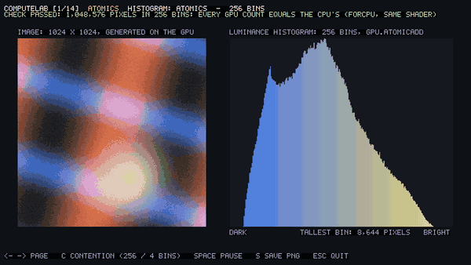
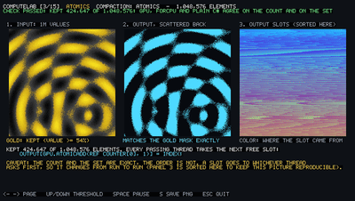
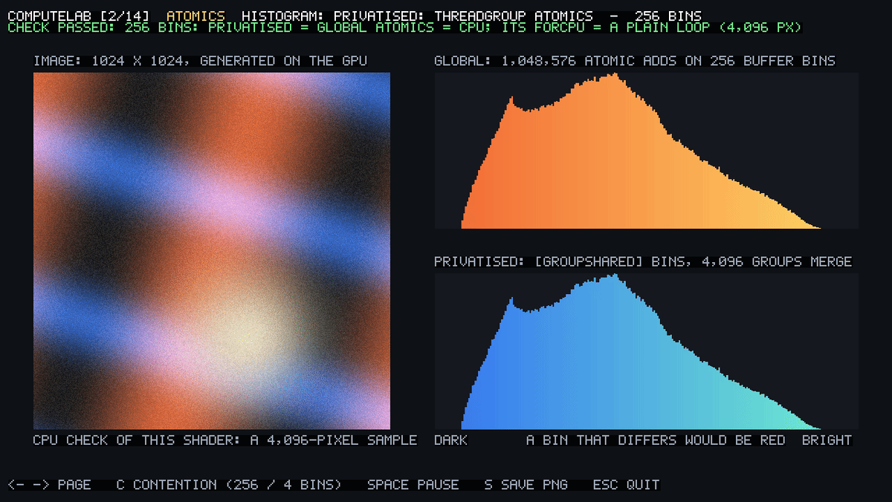

# Atomics

When many threads write the same buffer element, a plain `counts[bin] += 1` loses updates. The
`Gpu.Atomic*` methods take the element by `ref` and return the value it had *before* the operation.
They are what histograms, counters and stream compaction are built from.

- [Example: a histogram](#example-a-histogram)
- [The methods](#the-methods)
- [Rules](#rules)
- [On the CPU, and between devices](#on-the-cpu-and-between-devices)
- [Atomics on threadgroup memory](#atomics-on-threadgroup-memory)

## Example: a histogram

```csharp
[GeneratedComputeShaderDescriptor]
public readonly partial struct LuminanceHistogram(ReadWriteBuffer<uint> image, ReadWriteBuffer<int> counts) : IComputeShader
{
    public void Execute()
    {
        uint pixel = image[ThreadIds.X]; // packed RGBA, see PackUnorm4x8 below
        uint luminance = (((pixel & 255u) * 54u) + (((pixel >> 8) & 255u) * 183u) + (((pixel >> 16) & 255u) * 19u)) >> 8;

        Gpu.AtomicAdd(ref counts[(int)luminance], 1);
    }
}

using ReadWriteBuffer<int> counts = device.AllocateReadWriteBuffer<int>(256); // zeroed
device.For(image.Length, new LuminanceHistogram(image, counts));
```

The packed pixel format is [unorm8 packing](shader-language.md#unorm8-packing). ComputeLab's
Histogram page runs this shader every frame on an animated image:



## The methods

| C# (`int` and `uint`) | MSL |
|---|---|
| `AtomicAdd`, `AtomicSub`, `AtomicMin`, `AtomicMax`, `AtomicAnd`, `AtomicOr`, `AtomicXor` | `metal::atomic_fetch_*_explicit` |
| `AtomicExchange(ref location, value)` | `metal::atomic_exchange_explicit` |
| `AtomicCompareExchange(ref location, comparand, value)` | a strong compare-and-swap (a loop over MSL's weak one); returns the original, so it succeeded when that equals `comparand` |
| `AtomicAdd(ref float, float)` | `metal::atomic_fetch_add_explicit` on `atomic<float>` for a buffer element; a compare-and-swap loop over the element's bits for a `[GroupShared]` element |
| `AtomicMin(ref ulong, ulong)`, `AtomicMax(ref ulong, ulong)` | `metal::atomic_min_explicit`, `metal::atomic_max_explicit` on `atomic_ulong`: buffer elements only, and they return nothing |

## Rules

- **The location** must be an element of a `ReadWriteBuffer<int>`, `<uint>` or `<float>` captured by
  the shader (`ref buffer[i]`), or an element of a `[GroupShared]` array of `int`, `uint` or `float`
  (`ref tile[i]`, see [below](#atomics-on-threadgroup-memory)). A local, a `ReadOnlyBuffer` element
  or a field of a struct element is build error `SCG0034`. A texture pixel has no address, so it
  cannot be a location either; a shader that captures textures can use atomics on its buffers as
  usual.
- **64-bit.** MSL 3.2 has exactly two 64-bit atomics, the minimum and the maximum of a `ulong` buffer
  element, and they do not return the previous value. `Gpu.AtomicMin(ref keys[0], key)` with a key
  that packs a priority above an index picks a winner and says who it was. Any other atomic on a
  `long`, `ulong`, `byte`, `sbyte`, `short` or `ushort` element (and the 64-bit pair on a
  `[GroupShared]` element) is build error `SCG0047`, which says what MSL lacks.
- **Ordering is relaxed**, which is all MSL has: each operation is atomic by itself, nothing more.
  Don't also read or write the same element non-atomically in the same dispatch. Read the results on
  the CPU afterwards, or in a later dispatch.

## On the CPU, and between devices

- On the CPU the same methods are `Interlocked` operations (compare-and-swap loops for min, max, xor
  and the float add), because `ForCpu` runs shader threads on every core. Final values match the
  GPU's, so `ForCpu` gives the same answer.
- The values *returned* to individual threads depend on scheduling, on both. n adds of 1 return a
  permutation of 0..n-1, not a fixed assignment. That is why compacting with
  `output[Gpu.AtomicAdd(ref counter[0], 1)] = i` gives the right elements in an unspecified order.
- The float add applies every add exactly once, but float addition is not associative, so its sum can
  depend on the order unless the partial sums are exact.
- The guarantee holds among the threads of one dispatch on one device, not between a GPU dispatch and
  CPU code running at the same time. The GPU's atomics and the CPU's `Interlocked` operations do not
  exclude each other on shared memory, so `ForAsync` next to `ForCpu` on the same buffer loses
  updates.
- For the same reason `ForSplit` never divides a shader that uses atomics on buffer elements. A
  `cpuFraction` strictly between 0 and 1 throws `NotSupportedException`, and the adaptive mode runs
  the whole grid on the GPU and reports it in `SplitDispatchInfo.SingleDeviceOnly`.
- A shader whose only atomics are on `[GroupShared]` elements is split like any other: a threadgroup
  runs entirely on one device, so its atomics never meet the other device's.

ComputeLab's Compaction page compacts a million values through an atomic counter and shows their
output slots in scheduling order:

[](screenshots/computelab-compaction.png)

## Atomics on threadgroup memory

The same methods take an element of a `[GroupShared]` array of `int`, `uint` or `float`
(`threadgroup metal::atomic_int*` in MSL, also inside helpers). Only the threads of one threadgroup
can reach such an element, so the contention is a threadgroup's worth of threads instead of the
whole dispatch. A privatised histogram counts per group and merges once per bin per group:

```csharp
[ThreadGroupSize(256)]
[GeneratedComputeShaderDescriptor]
public readonly partial struct PrivatisedHistogram(ReadWriteBuffer<uint> image, ReadWriteBuffer<int> counts) : IComputeShader
{
    [GroupShared]
    private static readonly int[] local = new int[256];

    public void Execute()
    {
        int bin = GroupIds.Index;       // thread n of a group clears and merges bin n

        local[bin] = 0;                 // threadgroup memory starts out undefined
        Gpu.GroupMemoryBarrierWithGroupSync();

        uint pixel = image[ThreadIds.X];
        uint luminance = (((pixel & 255u) * 54u) + (((pixel >> 8) & 255u) * 183u) + (((pixel >> 16) & 255u) * 19u)) >> 8;
        Gpu.AtomicAdd(ref local[(int)luminance], 1);   // 256 threads contend, not a million

        Gpu.GroupMemoryBarrierWithGroupSync();
        Gpu.AtomicAdd(ref counts[bin], local[bin]);    // one buffer atomic per bin per group
    }
}

device.For(image.Length / 256 * 256, new PrivatisedHistogram(image, counts)); // whole threadgroups
```

- **Keep plain reads and writes of an element apart from the atomics on it with a barrier**, as
  above: clear, barrier, atomics, barrier, read.
- **The float add.** `Gpu.AtomicAdd(ref float, float)` works on a `[GroupShared] float[]` element as
  it does on a buffer. MSL 3.2 has no atomic `float` in threadgroup memory, so there it is a
  compare-and-swap loop over the element's bits (a prelude helper). Every add is applied exactly once
  and returns the value before it, and as everywhere, the sum of floats that do not add exactly
  depends on the order the threads ran in.
- **On the CPU** the threads of a threadgroup run concurrently, so these are real `Interlocked`
  operations there as well, and the results match the GPU's.
- **With SIMD-group operations.** Each SIMD group can reduce its lanes with `Gpu.WaveActiveSum` and
  then make one atomic add per SIMD group to a `[GroupShared]` total, instead of one per thread.
- **Splitting.** The shader above also has an atomic on a buffer (the merge), so `ForSplit` keeps it
  on one device. One that only writes each group's result to that group's own elements can be split.
- **Speed.** On an M4 Pro, for a 1024 × 1024 image, the privatised version takes about half the GPU
  time of the global one with 256 bins, and between a quarter and a fifth with 4 bins.
  `scripts/demo-computelab.sh` shows both live:


