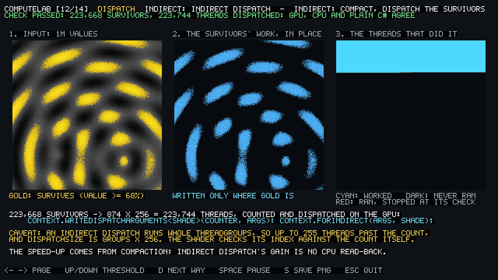

# Dispatch: batching, async and indirect

How work gets to the GPU: one dispatch at a time, many in one `ComputeContext`, asynchronously, or
with a thread count the GPU computed itself.

- [One dispatch](#one-dispatch)
- [Batching with a ComputeContext](#batching-with-a-computecontext)
- [Async dispatch](#async-dispatch)
- [Indirect dispatch](#indirect-dispatch)
- [Warm-up](#warm-up)

## One dispatch

`device.For(x, y, z, shader)` runs a compute shader over a grid, and `device.ForEach(texture, shader)`
runs a pixel shader over a texture (see [Getting started](getting-started.md)). Each such call is its
own command buffer, commit and wait, which costs about 0.1 ms even for a tiny kernel.

## Batching with a ComputeContext

A `ComputeContext` records several dispatches into one command buffer and runs them together when it
is disposed (or on `Execute()`), so the fixed cost is paid once:

```csharp
using (ComputeContext context = device.CreateComputeContext())
{
    context.For(width, height, new BlurHorizontal(source, temp, weights, width, radius));
    context.For(width, height, new BlurVertical(temp, output, weights, width, height, radius));
} // one commit, one wait; the vertical pass sees everything the horizontal pass wrote
```

- Dispatches in a context run in recording order, and each sees the writes of the ones before it.
  No barriers are needed.
- Constants are captured when a dispatch is recorded.
- Every bound buffer and texture stays alive until the GPU is done, even if it is disposed first.
- A context is for one thread at a time; use one per thread.
- `ExecuteAsync()` and `await using` submit without blocking.
- A renderer can keep one context and call `Execute()` every frame. The context reuses its command
  lists and constants storage, so after the first frames, recording a frame allocates nothing.

[`Copy`, `Fill` and `Clear`](resources.md#copy-fill-and-clear) are recorded in a context the same
way, in order with the dispatches.

## Async dispatch

`ForAsync` and `ForEachAsync` commit one dispatch and return a `Task` that completes when the GPU has
finished (or faults with `MetalException`), so the CPU can work on the previous result meanwhile:

```csharp
Task rendering = device.ForAsync(width, height, new RenderFrame(frames[0], 0));

for (int k = 0; k < frameCount; k++)
{
    await rendering; // frame k is ready in frames[k % 2]

    if (k + 1 < frameCount)
    {
        rendering = device.ForAsync(width, height, new RenderFrame(frames[(k + 1) % 2], k + 1));
    }

    Consume(frames[k % 2]); // CPU work on frame k overlaps the GPU rendering frame k + 1
}
```

Work on one device runs in submission order, so dependent `ForAsync` calls can also be issued back to
back and awaited once. `scripts/demo-pipeline.sh` runs this double-buffered pattern and prints its
sync and async throughput. Measurements are in the "Batching and async" section of
[`benchmarks/RESULTS.md`](../benchmarks/RESULTS.md#batching-and-async), and
[Unified memory](unified-memory.md#4-batch-small-dispatches) explains when batching and overlap pay
off.

## Indirect dispatch

`ForIndirect` reads its threadgroup counts from a buffer when the dispatch runs, so a pass recorded
just before it can produce them. Here a compaction pass counts its survivors,
`WriteDispatchArguments` turns the count into threadgroups, and the follow-up pass runs over exactly
that many, all in one execution with nothing read back:

```csharp
using ReadWriteBuffer<DispatchArguments> arguments = device.AllocateReadWriteBuffer<DispatchArguments>(1);

using (ComputeContext context = device.CreateComputeContext())
{
    context.Clear(counter);
    context.For(count, new CompactAbove(source, survivors, counter, cutoff)); // Gpu.AtomicAdd on counter[0]
    context.WriteDispatchArguments<Shade>(counter, arguments);                // count -> threadgroups, on the GPU
    context.ForIndirect(arguments, new Shade(survivors, counter, output));
}

[ThreadGroupSize(256)]
[GeneratedComputeShaderDescriptor]
public readonly partial struct Shade(ReadWriteBuffer<uint> survivors, ReadWriteBuffer<int> counter, ReadWriteBuffer<float> output) : IComputeShader
{
    public void Execute()
    {
        if (ThreadIds.X < counter[0]) // required: see below
        {
            output[(int)survivors[ThreadIds.X]] = 1f;
        }
    }
}
```

**The shader must check its index against the count itself**, as above. The counts are threadgroups,
not threads: Metal has no indirect dispatch of an exact grid. The dispatch runs up to one threadgroup
more than the count, and `DispatchSize` is groups × threadgroup size.

- A shader can also write `DispatchArguments` like any struct (for a 2D or 3D grid, for example).
- `device.ForIndirectCpu` runs the same dispatch on the CPU.
- Whole threadgroups are what a shader with [`[GroupShared]` memory](shared-memory.md) wants anyway,
  so those dispatch indirectly without a second thought.

ComputeLab's Indirect page does one job three ways on a million elements, a quarter of which survive:

| | GPU time |
|---|---|
| Compact, then `ForIndirect` over the survivors | 0.42 ms |
| Compact, then dispatch the full array (each thread checks the count) | 0.42 ms |
| No compaction: one pass in which every thread tests its own element | 0.55 ms |

The speed-up comes from compaction. Indirect dispatch's gain is that nothing is read back on the CPU.
Threads that stop at their bounds check cost almost nothing, so a full-array dispatch over the
compacted list is as fast, but it has to be sized for the whole array; the indirect one follows the
count the GPU just produced.



## Warm-up

A shader is compiled the first time it is dispatched. `device.Prepare<T>()` compiles it ahead of
time, so the first frame doesn't stall, and precompiling at build time removes part of that work.
Both are on [Precompiled shaders](precompiled-shaders.md).
