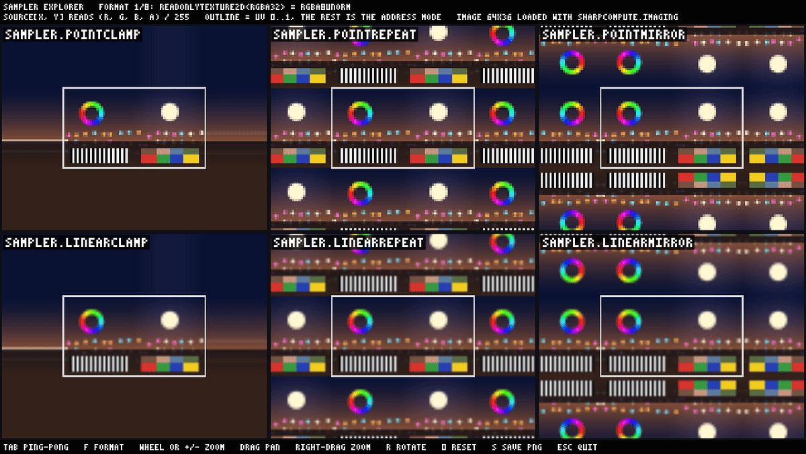

# Loading and saving images

`SharpCompute.Imaging` loads images into textures through macOS ImageIO: PNG, JPEG, HEIC and the
other formats ImageIO reads. It also saves textures as PNG, JPEG or HEIC. It is a separate library,
so the runtime itself links nothing but Metal.

ImageIO decodes, and vImage writes the converted pixels straight into the new texture's shared
memory with its row pitch: no intermediate array, and no upload.

- [Example](#example)
- [Pixel types](#pixel-types)
- [Behaviour](#behaviour)
- [Limitations](#limitations)
- [Speed](#speed)

## Example

Reference `src/SharpCompute.Imaging/SharpCompute.Imaging.csproj` (see
[Getting started](getting-started.md#add-sharpcompute-to-a-project)), then:

```csharp
using SharpCompute.Imaging;

[GeneratedComputeShaderDescriptor]
public readonly partial struct Vignette(ReadOnlyTexture2D<Rgba32> photo) : IComputeShader<Float4>
{
    public Float4 Execute()
    {
        Float2 uv = ThreadIds.Normalized.XY;
        float edge = Gpu.Length(uv - 0.5f);
        return new Float4(photo.Sample(Sampler.LinearClamp, uv).XYZ * Gpu.Saturate(1.25f - (2f * edge * edge)), 1f);
    }
}

// sRGB bytes, as stored; any T below works, from a path, a byte span or a stream.
using ReadOnlyTexture2D<Rgba32> photo = ImageLoader.LoadTexture2D<Rgba32>(device, "photo.heic");
using ReadWriteTexture2D<Rgba32> result = device.AllocateReadWriteTexture2D<Rgba32>(photo.Width, photo.Height);

device.ForEach(result, new Vignette(photo));              // a pixel shader that samples the photo
ImageSaver.Save(result, "vignette.jpg", jpegQuality: 85); // encoded from the texture's memory

ImageInfo info = ImageLoader.GetInfo("photo.heic");       // size, color model, alpha, orientation: no decoding
```

## Pixel types

The element type decides what the pixels are converted to, from whatever color space the file is in:

| `T` | Holds | Shaders read |
|---|---|---|
| `Rgba32` | sRGB bytes | `byte / 255`, still sRGB-encoded |
| `Rgba32Srgb` | the same bytes | linear (the GPU decodes sRGB) |
| `R8` | gray, 2.2 gamma (luminance of a color image) | `(gray / 255, 0, 0, 1)` |
| `Rgba16Float`, `Float4` | linear extended sRGB (wide-gamut and HDR colors outside 0..1); 16-bit files keep their precision | linear light |

## Behaviour

- **Alpha is straight**, not premultiplied, in every type, as PNG stores it. A PNG saved and loaded
  again comes back bit for bit, translucent pixels included.
- **The EXIF orientation is applied**, so a camera's portrait photo loads upright.
- `LoadReadWriteTexture2D` loads into a texture that shaders also write.
- **Saving** takes the format from the extension (`.png`, `.jpg`, `.heic`) or an `ImageFormat`. A
  float texture is saved as a 16-bit sRGB PNG.
- **Errors.** A missing file, data ImageIO can't read, and an image larger than 16384 pixels (the
  texture limit) each throw a clear exception.

## Limitations

- It loads the first image of a file (not the other frames of a GIF or HEIC sequence) and saves one
  image.
- ImageIO does not report a file cut off inside its pixel data, so such a file loads with the missing
  part zero.
- An oriented image with translucent pixels goes through ImageIO's premultiplied thumbnail path and
  can lose a little precision in those pixels.

## Speed

On an Apple M4 Pro, a 3840 × 2160 image decodes into an `Rgba32` texture in 27 ms from a JPEG and
50 ms from a PNG, and saves in 24 ms as a JPEG and 169 ms as a PNG (medians of three runs of the
ImageProcessing sample).

The ImageProcessing demo (`scripts/demo-imgproc.sh`) loads its input and saves its output this way.
`--image` puts your own picture into the Textures demo's sampler explorer
(`scripts/demo-textures.sh --image photo.jpg`):



[`docs/unified-memory.md`](unified-memory.md#2-do-the-format-conversion-on-the-gpu) shows what the
zero-copy decode-convert-encode path saves.
