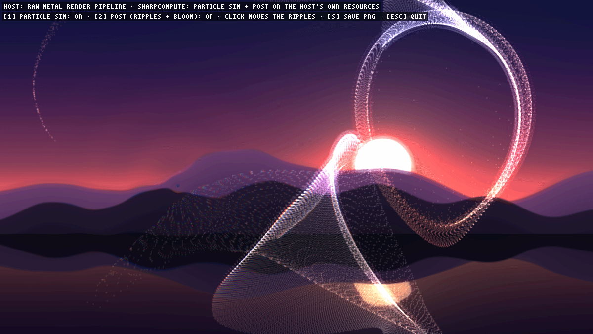

# Interop with existing Metal code

An app that already renders with Metal can run SharpCompute kernels on its own resources (particles,
lighting, post-processing) without handing its renderer over.

- [Wrapping the device](#wrapping-the-device)
- [Wrapping buffers and textures](#wrapping-buffers-and-textures)
- [Encoding into the app's command buffer](#encoding-into-the-apps-command-buffer)
- [Native handles](#native-handles)
- [Example app](#example-app)

## Wrapping the device

Wrap the app's device, and its queue so that SharpCompute's work is ordered with the app's:

```csharp
GraphicsDevice device = GraphicsDevice.FromNative(mtlDevice, mtlCommandQueue); // both retained; Dispose releases them
```

Resources belong to the `MTLDevice`, not to a wrapper: every "same device" check compares the
underlying object. `MTLCreateSystemDefaultDevice` returns the same object every time, so when the app
renders on the default device, `GraphicsDevice.GetDefault()` is that device as well.

## Wrapping buffers and textures

Wrapping retains the object and never copies it. It is then an ordinary SharpCompute buffer or
texture: bindable, sliceable, copyable, and kept alive by pending work.

```csharp
ReadWriteBuffer<Particle> particles = device.WrapNativeReadWriteBuffer<Particle>(mtlBuffer);
ReadWriteTexture2D<Rgba32> frame = device.WrapNativeReadWriteTexture2D<Rgba32>(mtlTexture);
ReadOnlyTexture2D<Rgba32> image = device.WrapNativeReadOnlyTexture2D<Rgba32>(mtlImage);
```

- A buffer's length is `buffer.length / sizeof(T)`.
- A texture must be single-sample 2D, in the pixel format of `T`, with `ShaderRead` usage (and
  `ShaderWrite` for read-write). Only mip level 0 is used.
- Private storage is accepted. What a wrapped object supports depends on its storage:

| Wrapped object | Shaders, `Copy`, `Fill` | CPU access (`AsSpan`, indexers, `ForCpu`) | `CopyTo`/`CopyFrom` |
|---|---|---|---|
| Buffer, shared storage | yes | yes, in place | yes |
| Buffer, private storage | yes | `NotSupportedException` (`IsCpuAccessible` is false) | `NotSupportedException` |
| Texture that is a linear view of a shared buffer | yes | yes, in place | yes |
| Other texture, shared storage | yes | `NotSupportedException` | yes, through `getBytes`/`replaceRegion` |
| Texture, private storage | yes | `NotSupportedException` | `NotSupportedException` |

Untracked resources (`MTLHazardTrackingModeUntracked`, the default inside an `MTLHeap`) are
rejected: SharpCompute orders its passes through Metal's hazard tracking.

## Encoding into the app's command buffer

`EncodeInto` encodes what a context recorded into a command buffer the app created, without
committing it. SharpCompute's passes then run in order with the app's own passes, in one submission.
What the recorded work uses stays alive until that command buffer completes:

```csharp
nint commandBuffer = app.BeginFrame();                // the app's [queue commandBuffer]
context.For(count, new SimulateParticles(particles, time, dt));
context.EncodeInto(commandBuffer);                    // before the app's scene pass, which draws the particles
app.EncodeScene(commandBuffer);                       // the app's render pass
context.For(width, height, new Ripple(scene, frame, center, time));
Task done = context.EncodeInto(commandBuffer);        // after it; completes with the command buffer
app.EncodeOverlayAndCommit(commandBuffer);            // the app's last pass, present and commit
```

- **End your own encoder first.** The app must end its encoder before calling `EncodeInto`: Metal
  terminates the process when two encoders are open on one command buffer, and `EncodeInto` cannot
  detect an encoder the app left open.
- A command buffer that is already committed is rejected.
- **SharpCompute does not keep the command buffer alive.** If the app drops it without committing it
  (an error path, a skipped frame), the work never runs, everything it pinned is released when the
  command buffer is deallocated, and the task faults with "The command buffer was released without
  being committed".

## Native handles

`device.NativeHandle`, `device.NativeCommandQueueHandle`, `buffer.NativeHandle` (with
`buffer.NativeByteOffset` for a view) and `texture.NativeHandle` give other Metal code SharpCompute's
objects. They are not owned by the caller: they are valid while the SharpCompute object is alive, and
code that keeps one longer retains it.

```csharp
nint mtlBuffer = view.NativeHandle;       // a view's MTLBuffer is the one that owns the memory...
nuint offset = view.NativeByteOffset;     // ...and the view starts this many bytes into it
nint mtlTexture = texture.NativeHandle;   // e.g. [renderEncoder setFragmentTexture:mtlTexture atIndex:0]
```

## Example app

[`samples/SharpCompute.Samples.NativeInterop`](../samples/SharpCompute.Samples.NativeInterop) is a
complete example: a host renderer written straight against Metal, with SharpCompute's particle
simulation and post-process in its command buffer. The whole frame, host passes and both SharpCompute
passes, takes about 0.5 ms of GPU time at 1280 × 720 on an Apple M4 Pro (median of five headless
runs). Run it with `scripts/demo-nativeinterop.sh`.


