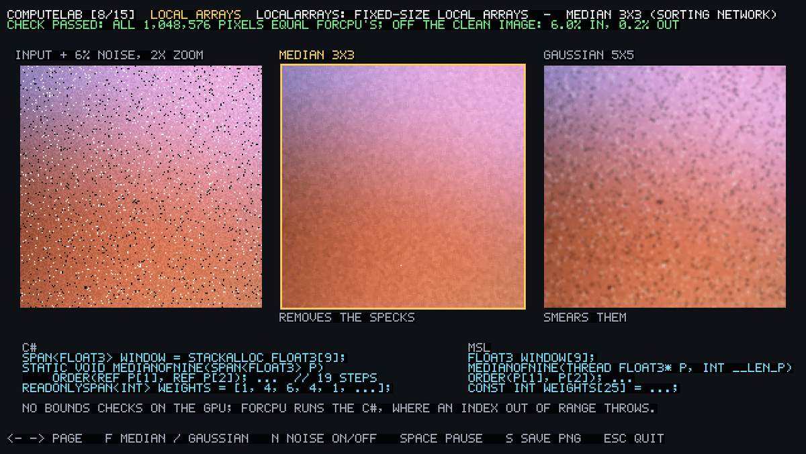

# Local arrays

A thread can have small arrays of its own: the taps of a filter, its weights, the values a sorting
network orders, a stack, a small histogram. Write them the C# way (`Span<float> taps = stackalloc float[9];`,
`float[] w = new float[9];`, `ReadOnlySpan<int> weights = [1, 4, 6, 4, 1];` or an `[InlineArray(N)]`
struct). Each becomes a fixed-size array of that thread, which the GPU keeps in registers. Index
them, loop over them with `foreach`, and pass them to helpers.

- [Example: a median filter](#example-a-median-filter)
- [C# and MSL](#c-and-msl)
- [Rules](#rules)

## Example: a median filter

A 3 × 3 median filter, from ComputeLab's LocalArrays page:

```csharp
[GeneratedComputeShaderDescriptor]
public readonly partial struct MedianFilter(ReadWriteBuffer<uint> source, ReadWriteBuffer<uint> destination, int size) : IComputeShader
{
    private static void Order(ref Float3 a, ref Float3 b)  // one compare-and-swap, on three channels at once
    {
        Float3 low = Gpu.Min(a, b);
        b = Gpu.Max(a, b);
        a = low;
    }

    private static void MedianOfNine(Span<Float3> p)       // MSL: (thread float3* p, int __len_p)
    {
        Order(ref p[1], ref p[2]); Order(ref p[4], ref p[5]); Order(ref p[7], ref p[8]);
        Order(ref p[0], ref p[1]); Order(ref p[3], ref p[4]); Order(ref p[6], ref p[7]);
        // ... 19 steps in all leave the median in p[4]
    }

    public void Execute()
    {
        int x = ThreadIds.X, y = ThreadIds.Y;
        Span<Float3> window = stackalloc Float3[9];        // MSL: float3 window[9] = {};
        int n = 0;

        for (int dy = -1; dy <= 1; dy++)
        {
            for (int dx = -1; dx <= 1; dx++)
            {
                int i = (Gpu.Clamp(y + dy, 0, size - 1) * size) + Gpu.Clamp(x + dx, 0, size - 1);
                window[n] = Gpu.UnpackUnorm4x8(source[i]).XYZ;
                n++;
            }
        }

        MedianOfNine(window);
        destination[(y * size) + x] = Gpu.PackUnorm4x8(new Float4(window[4], 1f));
    }
}
```

The page's 5 × 5 Gaussian reads its weights from a constant table:

```csharp
ReadOnlySpan<int> weights =                                // MSL: const int weights[25] = { 1, 4, ... };
[
    1, 4, 6, 4, 1,
    4, 16, 24, 16, 4,
    6, 24, 36, 24, 6,
    4, 16, 24, 16, 4,
    1, 4, 6, 4, 1,
];

int w = weights[((dy + 2) * 5) + dx + 2];
```



## C# and MSL

| C# | MSL |
|---|---|
| `Span<T> a = stackalloc T[N];`, `T[] a = new T[N];` | `T a[N] = {};`, zeroed as in C# |
| `stackalloc T[] { x, y, z }`, `new T[] { x, y, z }`, `T[] a = [x, y, z];`, `Span<T> a = [x, y, z];` | `T a[3] = { x, y, z };` |
| `ReadOnlySpan<T> a = [x, y, z];` | `const T a[3] = { x, y, z };` |
| `a[i]`, `a[i] += v`, `a[i]++`, `ref a[i]` | the same |
| `a.Length` | the constant `N` |
| `foreach (T v in a)`, `foreach (ref T v in a)` | `for (int __i_v = 0; __i_v < N; __i_v++) { T v = a[__i_v]; ... }`, with `thread T&` for `ref` |
| a helper's `Span<T>`, `T[]` or `ReadOnlySpan<T>` parameter | `thread T* a, int __len_a` (`thread const T*` for `ReadOnlySpan<T>`) |
| `[InlineArray(8)] struct Float8 { float _e; }`, `f[i]` | `struct Float8 { float _e[8]; };`, `f._e[i]` |

## Rules

- **Element types.** `T` is anything a local can be: scalars, vectors, matrices (`Float3x3` too),
  `bool`, `Half` and your own structs.
- **The length is a compile-time constant** of at least 1 (`SCG0037`). A length only known at run
  time has no equivalent, because a thread's arrays are sized when the shader is compiled.
- **One name per array.** A C# array or span is a reference to its elements; a thread's array *is*
  the elements. The two agree as long as each array has one name. So a local array can be indexed,
  looped over and passed to a helper method, but not:
  - copied to another variable, reassigned, compared or returned,
  - sliced (`Slice`, ranges, `^`).

  The methods of `Span<T>` and arrays are not available either (`SCG0039`). Multi-dimensional and
  jagged arrays are `SCG0036`: index a one-dimensional array as `[y * width + x]`.
- **Helpers.** A helper that takes a span or an array is compiled once for every length. It receives
  a pointer to the caller's elements and the length, so what it writes reaches the caller's array, as
  in C#.
- **Inline arrays.** An `[InlineArray(N)]` struct is a value type in C# too, so it is copied, passed
  and returned by value, and has no `Length`. It crosses the CPU/GPU boundary (a captured constant, a
  buffer element, a struct field) whenever its element type can, with the same layout asserts as any
  struct. One of `bool` or `Float3x3` elements is for locals only.
- **Keep them small.** A thread keeps small arrays in registers and spills larger ones to memory. On
  an M4 Pro, a kernel that fills its array and reads it back costs about 0.09 ns per element at 1 KB
  per thread and 0.55 ns at 16 KB. Metal refuses to create the pipeline once a thread needs 256 KB of
  stack. Above 16 KB a local array is warning `SCG0038`; use [`[GroupShared]` memory](shared-memory.md)
  or a buffer for data that large.
- **No bounds checks on the GPU.** An index outside the array reads or writes whatever lies there.
  `ForCpu` runs the C#, where the same index throws `IndexOutOfRangeException`, so running a shader on
  the CPU is the way to find such a bug.
- **Prefer `stackalloc`.** Under `ForCpu`, `new T[N]` in a kernel is a heap allocation per shader
  thread: correct, but slow. `stackalloc`, `ReadOnlySpan<T>` tables of constants (which C# stores as
  static data) and inline arrays allocate nothing.
- **A `stackalloc` belongs outside loops.** Inside one it is CA2014, which this repository's
  analyzers treat as an error. Declare the array before the loop and reuse it, which compiles to the
  same MSL.
