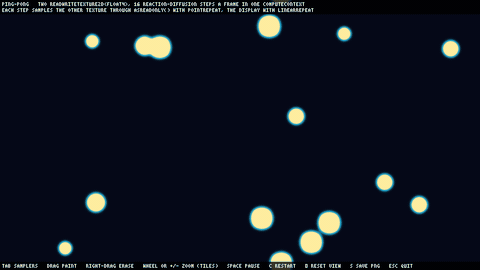
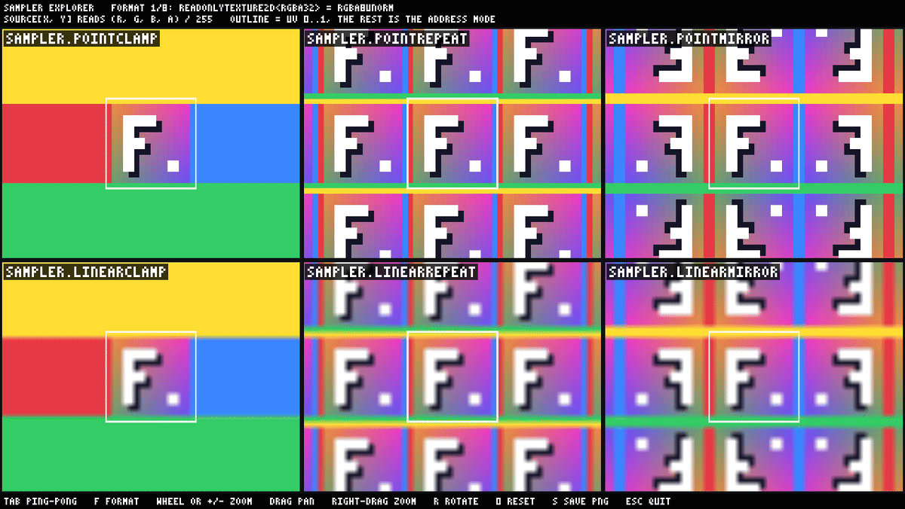

# Resources: buffers and textures

What a shader reads and writes: buffers, views of buffers, and 2D textures with their samplers, plus
the GPU copies between them.

- [Buffers](#buffers)
  - [Zero-copy data paths](#zero-copy-data-paths)
  - [Views](#views)
  - [Overlapping bindings](#overlapping-bindings)
  - [Copy, fill and clear](#copy-fill-and-clear)
  - [Using memory safely](#using-memory-safely)
- [Textures](#textures)
  - [Pixel formats](#pixel-formats)
  - [Samplers](#samplers)
  - [Sampling what a pass wrote](#sampling-what-a-pass-wrote)
  - [Textures on the CPU](#textures-on-the-cpu)

## Buffers

`ReadOnlyBuffer<T>` and `ReadWriteBuffer<T>` hold any unmanaged element type a shader can use (see
[Shader language](shader-language.md#scalar-types)). Buffers live in unified memory: the bytes the GPU
reads are the bytes `AsSpan()` gives you, so `AsSpan()` and the indexers read GPU results directly,
with no download. [Unified memory](unified-memory.md) explains when that saves time and when it
doesn't.

### Zero-copy data paths

The CPU and the GPU share the same memory, so skip the copies:

```csharp
// Write input straight into GPU memory, e.g. decode or read a file into it.
using ReadWriteBuffer<uint> pixels = device.AllocateReadWriteBuffer<uint>(width * height);
DecodeInto(MemoryMarshal.AsBytes(pixels.AsSpan()));

// A file of raw floats, read by the GPU from the page cache: no ReadAllBytes, no upload.
using ReadOnlyBuffer<float> samples = device.MapReadOnlyBuffer<float>("samples.f32");

// Memory you already own, if it starts on a page boundary (GraphicsDevice.PageSize).
void* memory = NativeMemory.AlignedAlloc(byteCount, (nuint)GraphicsDevice.PageSize);
using ReadWriteBuffer<float> wrapped = device.WrapReadWriteBuffer<float>((nint)memory, count, () => NativeMemory.AlignedFree(memory));
```

- `MapReadOnlyBuffer` puts a file on the GPU without reading it into memory first.
- `WrapReadWriteBuffer` makes a buffer over page-aligned memory you already own.
- The lifetime rules that come with these are in
  [Unified memory](unified-memory.md#choosing-an-api).

### Views

`buffer.Slice(start, length)` makes a buffer over part of another one. Nothing is copied: it is the same `MTLBuffer` bound
at an offset, and it can go wherever a buffer can (a shader on the GPU, the CPU or both, `AsSpan`,
`Copy`). Index 0 is the view's first element and `Length` is its own length, in C# and inside the
shader:

```csharp
using ReadWriteBuffer<float> particles = device.AllocateReadWriteBuffer<float>(1_000_000);

device.For(250_000, new Integrate(particles.Slice(500_000, 250_000), dt)); // touches only that quarter
```

A view owns no memory. It is disposed with the buffer it came from, and a dispatch that binds it
keeps that buffer's memory alive until the GPU is done.

### Overlapping bindings

A shader names each buffer it captures as memory of its own, and Metal compiles it that way: a value
read through one capture is kept across a write through another. So one buffer passed as two
captures, where the shader writes one and reads the other, computes something else on the GPU than
its C# says. Measured on an M4 Pro: `a[i] = b[i] + 1` twice and then `o[i] = b[i]`, with one buffer
as `a` and `b`, leaves 1 and reads 0, where the CPU gives 2 and 2.

SharpCompute checks the bindings when a dispatch is recorded and throws an `ArgumentException`
rather than run it, on every path (`For`, `ForCpu`, `ForSplit`, `ForAsync`, a `ComputeContext`):

| Two bindings of one dispatch | The shader writes neither | The shader writes one of them |
|---|---|---|
| The same buffer captured twice | allowed | `ArgumentException` |
| Overlapping views (`Slice`) of one buffer | allowed | `ArgumentException` |
| Buffers that wrap the same or overlapping memory (`WrapReadWriteBuffer`, `WrapNative...`) | allowed | `ArgumentException` |
| A texture and the buffer its pixels are stored in (a wrapped linear texture) | allowed | `ArgumentException` |
| The same texture twice, or with its `AsReadOnly()` view | allowed | `ArgumentException` |
| Different buffers, disjoint views, an empty view | allowed | allowed |

- **"Writes" is what the shader's code does**, not the type of the capture. The generator works out
  which captures `Execute` and its helpers store to, so a `ReadWriteBuffer<T>` that is only read can
  be passed twice (`new Blend(layer, layer, ...)`). A wave matrix's `Store` is a store to its
  destination and its `Load` a read of its source.
- **A hand-written descriptor** says it with `writer.SetBuffer(index, buffer, written: false)`;
  without that, a read-write buffer or texture counts as written.
- **Cost.** The check compares address ranges and allocates nothing in the steady state: recording
  a dispatch with six buffers into a `ComputeContext` takes about 52 ns with it and 43 ns without,
  on an M4 Pro, which a recorded and executed dispatch (about 1.55 µs) does not show.
- **To update a buffer from its own contents**, capture it once (`data[i] = f(data[i])`), or write to
  a second buffer and swap the two (or `Copy` the result back).

Textures follow the same rule: see [Sampling what a pass wrote](#sampling-what-a-pass-wrote).

### Copy, fill and clear

`Copy`, `Fill` and `Clear` run on the GPU as blits. On the device they are one command buffer each.
In a [`ComputeContext`](dispatch.md#batching-with-a-computecontext) they run in recorded order with
the dispatches, which is the point: a copy sees what the pass before it wrote, without the CPU
waiting in between.

```csharp
using (ComputeContext context = device.CreateComputeContext())
{
    context.Clear(counter);                        // reset an accumulator between passes
    context.For(count, new Step(current, next));
    context.Copy(next, current);                   // whole buffer; ranges and views work too
    context.Copy(next, 0, history, frame * count, count);
}

device.Copy(simulation, texture); // buffer -> texture, texture -> buffer and texture -> texture too
```

- Offsets and counts are in elements.
- Source and destination must not overlap.
- `Fill` takes a byte, so only 0 is the same element for every type.
- **Any range works**, also of 1-, 2- or 3-byte elements at odd offsets. Metal documents its buffer
  blits to need byte offsets and sizes that are multiples of 4 on macOS, so the aligned part of such
  a range goes to the blit and the rest (up to 3 bytes at each end, or all of it when the two offsets
  differ modulo 4) is copied or filled by a small compute kernel in the same command buffer, in the
  same place in the order. Unaligned ends cost nothing measurable; a range the kernel copies whole
  takes about 1.2 ms for 16 MB on an M4 Pro, against 0.4 ms for a blit.
- Buffers are unified memory, so when nothing on the GPU is pending, a span copy is faster than
  `device.Copy`: 0.02 ms against about 0.13 ms for 1 MB on an M4 Pro. At 64 MB the GPU is ahead,
  about 0.8 ms against 1.05 ms.

### Using memory safely

Shared memory is not shared access. Don't read or write a buffer from the CPU while a dispatch that
writes it is in flight: wait for `For` to return, for the context to execute, or for the `ForAsync`
task to complete. See [Unified memory](unified-memory.md#using-the-same-memory-at-the-same-time).

## Textures

Shaders capture textures like buffers.

- A `ReadOnlyTexture2D<T>` is read with `texture[x, y]` (or an `Int2`) and sampled with
  `texture.Sample(sampler, uv)`.
- A `ReadWriteTexture2D<T>` is read and written with its indexer.
- Every pixel is a `Float4` in the shader, whatever `T` is. `Width` and `Height` work too.
- A thread that writes a pixel and reads it back gets what it wrote, as in C# (the generator emits
  the `fence()` Metal needs for that).
- Textures are zero-copy like buffers: `CopyFrom`, `CopyTo` and `ToArray` go straight to the shared
  memory.
- Textures are 2D with one mip level. A wrapped mipmapped texture uses level 0 (see
  [Interop](interop.md)).

To load a texture from a PNG, JPEG or HEIC file, or save one, see [Loading and saving images](imaging.md).

### Pixel formats

| `T` | Metal format | A shader reads | `ReadWriteTexture2D` |
|---|---|---|---|
| `Rgba32` | `RGBA8Unorm` | `(r, g, b, a) / 255` | yes |
| `Rgba32Srgb` | `RGBA8Unorm_sRGB` | linear `r, g, b`; `a / 255` | no |
| `R8` | `R8Unorm` | `(r / 255, 0, 0, 1)` | yes |
| `Rg16` | `RG8Unorm` | `(r / 255, g / 255, 0, 1)` | no |
| `Half` | `R16Float` | `(r, 0, 0, 1)` | yes |
| `Rgba16Float` | `RGBA16Float` | `(r, g, b, a)` | yes |
| `float` | `R32Float` | `(r, 0, 0, 1)` | yes |
| `Float4` | `RGBA32Float` | `(r, g, b, a)` | yes |

An `Rgba16Float` pixel is four halves in the layout of a `Half4`, and converts to and from one
implicitly. Whole arrays reinterpret for free (`MemoryMarshal.Cast<Half4, Rgba16Float>(colors)` for
`CopyFrom`, and back after `ToArray`). In a shader, `(Half4)texture[x, y]` and
`texture[x, y] = (Float4)color` are exact for that format, so a `Half4` goes through such a texture
bit for bit.

### Samplers

Samplers are the six static properties of `Sampler`, passed directly to `Sample`: `PointClamp`,
`PointRepeat`, `PointMirror`, `LinearClamp`, `LinearRepeat` and `LinearMirror`.

- Coordinates are normalized, with pixel centers at `(x + 0.5) / Width`.
- Each sampler a shader uses is compiled into it, so there is nothing to allocate or bind.
- Anything else in the sampler argument is `SCG0030`.

### Sampling what a pass wrote

Metal can't sample a texture that the same shader may write, so a read-write texture has no `Sample`
(`SCG0033`). To sample what one pass wrote, bind `AsReadOnly()` in the next pass. It is a view of the
same texture, not a copy:

```csharp
[GeneratedComputeShaderDescriptor]
public readonly partial struct Diffuse(ReadWriteTexture2D<float> source, ReadWriteTexture2D<float> target) : IComputeShader
{
    public void Execute()
    {
        int x = ThreadIds.X;
        int y = ThreadIds.Y;
        float sum = source[Gpu.Max(x - 1, 0), y].X + source[Gpu.Min(x + 1, source.Width - 1), y].X
                  + source[x, Gpu.Max(y - 1, 0)].X + source[x, Gpu.Min(y + 1, source.Height - 1)].X;

        target[x, y] = new Float4(sum * 0.25f);
    }
}

[GeneratedComputeShaderDescriptor]
public readonly partial struct ShowHeat(ReadOnlyTexture2D<float> heat) : IComputeShader<Float4>
{
    public Float4 Execute()
    {
        float value = heat.Sample(Sampler.LinearClamp, ThreadIds.Normalized.XY).X;
        return new Float4(value, 0f, 1f - value, 1f);
    }
}

using ReadWriteTexture2D<float> a = device.AllocateReadWriteTexture2D<float>(initialHeat, 256, 256);
using ReadWriteTexture2D<float> b = device.AllocateReadWriteTexture2D<float>(256, 256);
using ReadOnlyTexture2D<float> result = a.AsReadOnly();
using ReadWriteTexture2D<Rgba32> frame = device.AllocateReadWriteTexture2D<Rgba32>(1280, 720);

using (ComputeContext context = device.CreateComputeContext())
{
    for (int i = 0; i < 16; i++)
    {
        context.For(256, 256, new Diffuse(a, b)); // ping
        context.For(256, 256, new Diffuse(b, a)); // pong
    }

    context.ForEach(frame, new ShowHeat(result)); // samples what the last pass wrote
}
```

The view is the same pixels, so it must not be bound to a dispatch that writes them. A dispatch
whose shader writes a texture can bind that texture only once: captured twice, or together with its
`AsReadOnly()` view (or as the output of a `ForEach` whose shader also captures it), the two are
separate textures to the GPU, and a read through one does not see what was written through the
other. Such a dispatch is refused with an `ArgumentException` when it is recorded, on the GPU and
the CPU alike, instead of returning stale pixels; ping-pong between two textures, as above, is the
pattern that works. A texture bound twice and only read is fine. See
[Overlapping bindings](#overlapping-bindings).

`scripts/demo-textures.sh` shows all of this live: the six samplers side by side on any of the eight
formats (on your own picture with `--image photo.jpg`), and a simulation that ping-pongs between two
textures while you paint into it:





### Textures on the CPU

Shaders with textures run on the CPU too (`ForCpu`, `ForSplit`), with the same reads, writes and
address modes. The CPU is exact where the GPU (measured on an M4 Pro) is not quite:

- **Bilinear filtering.** The GPU rounds its weights to 1/256, so a bilinear sample written to an
  8-bit format can differ by one step between `ForCpu` and the GPU.
- **sRGB decoding.** The GPU decodes to 12 bits.
- **Point sampling** picks the same pixel with Clamp, for coordinates in [0, 1) and for power-of-two
  sizes. With Repeat or Mirror outside [0, 1) on other sizes, a coordinate within float rounding of a
  pixel boundary can pick the neighbouring pixel on the GPU.
