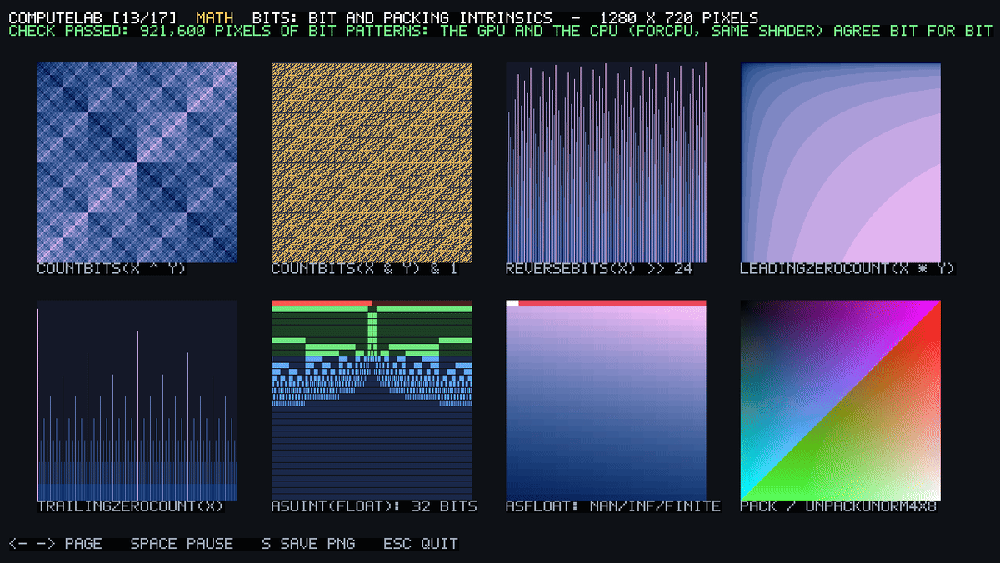

# Shader language

The C# a shader is written in, and the MSL it becomes. Everything described here is checked against
the GPU by the test suite. The full list of `Gpu.*` methods, with the MSL each one maps to, is in
their doc comments.

- [Scalar types](#scalar-types)
- [Integers](#integers)
- [Vectors and matrices](#vectors-and-matrices)
- [Bool vectors](#bool-vectors)
- [Matrices](#matrices)
- [Bits](#bits)
- [Float helpers](#float-helpers)
- [unorm8 packing](#unorm8-packing)
- [Compile options](#compile-options)
- [Evaluation order](#evaluation-order)
- [Extension members](#extension-members)

Related pages: [Half precision](half-precision.md), [Local arrays](local-arrays.md),
[Sharing code between shaders](shared-code.md), [Atomics](atomics.md).

## Scalar types

All of these can be:

- locals, parameters and return values of helpers (shared ones too, and type arguments of generic
  ones),
- `const` and `static readonly` fields,
- elements of local arrays and of `[GroupShared]` arrays,
- buffer elements, captured constants, and fields of your structs (with methods, operators and
  constructors on them).

The exception is `bool`, which has no stable layout and stays inside the shader.

| C# | MSL | Bytes | Notes |
|---|---|---|---|
| `float` | `float` | 4 | Vectors: `Float2..4` |
| `Half` | `half` | 2 | Vectors: `Half2..4` |
| `int`, `uint` | `int`, `uint` | 4 | Vectors: `Int2..4`, `UInt2..4` |
| `byte`, `sbyte` | `uchar`, `char` | 1 | MSL's `char` is signed |
| `short`, `ushort` | `short`, `ushort` | 2 | |
| `long`, `ulong` | `long`, `ulong` | 8 | Aligned to 8 bytes in buffers, structs and constants |
| `bool` | `bool` | | Locals, parameters and return values only |

`double`, `decimal`, `char`, `nint`/`nuint` and `Int128` are build errors that name the type to use
instead.

A `ReadWriteBuffer<byte>` is one byte per element:

```csharp
[GeneratedComputeShaderDescriptor]
public readonly partial struct Equalise(ReadWriteBuffer<byte> image, ReadOnlyBuffer<byte> lut) : IComputeShader
{
    public void Execute() => image[ThreadIds.X] = lut[image[ThreadIds.X]];   // one byte per pixel, in place
}

using ReadWriteBuffer<byte> image = device.AllocateReadWriteBuffer(grayscalePixels);   // byte[]
device.For(image.Length, new Equalise(image, lut));
```

## Integers

The integers behave as they do in unchecked C#, on the GPU as on the CPU (`checked` arithmetic is
build error `SCG0052`).

- **Promotion.** `byte + byte` is an `int` in C#, and `-uint` and `int + uint` are `long`. The MSL
  carries the conversions the C# expression has (`uchar(int(a) + int(b))` for `(byte)(a + b)`), so a
  result is as wide as C# says, and a cast back to the small type wraps at its width. Compound
  assignments and `++`/`--` on a small integer truncate on every step, as in C#.
- **Shifts.** The count is masked with 31 for `int` and the smaller integers (which are `int`s by
  the time they are shifted), and with 63 for `long` and `ulong`: `1L << 65` is 2. `>>>` works on
  `int` and `long`.
- **Overflow wraps** at the width of the type, signed and unsigned. `int`, `long` and `IntN`
  arithmetic is exact modulo 2^n, so `int.MaxValue + 1` is `int.MinValue`, `a + 1 > a` is false for
  `int.MaxValue`, and `(a * b) / b` divides the wrapped product.

  Signed overflow is undefined in MSL, and the Metal compiler optimizes on the assumption that it
  does not happen. So the generator computes a signed `+`, `-`, `*` or negation (and their compound
  assignments and `++`/`--`) in the unsigned type of the same width and converts back: `a * b + c`
  on `int`s is `int(uint(a) * uint(b) + uint(c))`. That costs no instructions, because signed and
  unsigned arithmetic are the same machine operations. Program-scope constants wrap the same way.
- **Sums, differences and negations of integer vectors** (`a + b`, `a - b` and `-v` on an `IntN`
  or `UIntN`, and their compound assignments) are emitted as helpers that compute each lane on its
  own: `__ms_add(a, b)`, `__ms_sub(a, b)`, `__ms_neg(v)`. Apple's Metal compiler miscompiles the
  vector operators (reported as FB25732151): when a vector is negated, one lane of the negation is
  never read and the same vector is subtracted in a chain elsewhere (`t += c; t *= 3; t -= v`),
  the chain silently loses that lane. The negation need not be written as one. The compiler
  derives it from `~v + 1`, `v - 2 * v`, `v - (v << 1)`, and from `v * s` once it knows that `s`
  is -1, so no list of shapes covers it. But a lane is only ever lost from a chain of *vector*
  sums and differences, and with each lane computed as a scalar there is no such chain. Each lane
  wraps as it does in C#. The operators that are a negation by a constant (`0 - v`, `v * -1`,
  `v / -1`) are `__ms_neg(v)` too, and `v * new Int3(1, -1, 1)` is `__ms_mul(v, C)`, a helper that
  multiplies lane by lane; other products, the shifts and the bitwise operators keep their
  operators. On three integer-vector kernels (a `UInt3` hash, an `Int3` integrator, an `Int4` box
  filter; 2048 x 2048 threads, Apple M4 Pro) the helpers cost no GPU time: the medians are equal to
  within 0.1%.

  A compound `v += w` assigns the helper's result, `v = __ms_add(v, w)`. Where the target or the
  value has side effects (`data[Next()] += w`), the target can only be named once, and a helper
  takes it by reference: `__ms_add_to(data[Next()], w)`. Two forms have no such helper and are an
  error (`SCG0012`) on a target with side effects, so put the index in a local first: the compound
  negations (`data[Next()] *= -1`, `/= -1`, `*= new Int3(1, -1, 1)`), and `+=` or `-=` on
  components of the target (`data[Next()].XY += w`). Vectors of floats and halves, and all
  scalars, are not affected and keep their operators.
- **Division by zero** does not trap. Where C# throws `DivideByZeroException`, the GPU carries on:
  `x / 0` is `x` and `x % 0` is 0. `long.MinValue / -1`, which overflows in C#, gives
  `long.MinValue`. Don't depend on either.
- **Division and bit counts go through helpers** that work around bugs in Apple's GPU compiler
  (reported to Apple), which compiles correct MSL into wrong results:
  - It dropped a guard against division by zero: with `t = l == C ? 0 : Math.Abs(l)`,
    `t == 0 ? 0 : x % t` divided by `Abs(C)`, and `t` itself was not 0. It moves the division
    ahead of the guard and then takes the divisor to be nonzero. So an integer `/` or `%` by
    anything but a nonzero constant divides by `__ms_nonzero(t)`, which is `t`, or 1 for 0, and
    gives the compiler nothing to assume. On an Apple M4 Pro that costs 2% of a 32-bit unsigned
    division, 5% of a signed one and 1% of a 64-bit one, in a kernel that does nothing but divide.
  - It divided a constant dividend of 2^32 - 128 or more (one that rounds to 2^32 as a float)
    wrongly: `4294967295u / x` was 3579139454 for `x = 3`, and so was a `long` division it narrows
    to 32 bits (`4294967295L % y`, with `y` a widened `uint`). Such a constant, written in the
    division or a `const`, `static readonly` or constant vector, is divided by
    `__ms_div_near_max(c, x)`, which divides `c - x` instead. A constant the generator cannot see,
    one that only reaches the division through a local or a helper's parameter, is still divided
    wrongly: write it in the division.
  - It counted the bits of a sign-extended 16-bit value as if it were zero-extended
    (`Gpu.LeadingZeroCount((uint)(short)i)` was 16 for a negative short, and so was the clz of
    `(x << 16) >> 16`), and counted the junk above the 16 bits of a `short` it computed in a wider
    register (`Gpu.CountBits(b ? s : t)` of the short -2 was 31). So `Gpu.CountBits` and
    `BitOperations.PopCount` are `__ms_popcount`, a 32-bit popcount of the zero-extended value for
    the 8- and 16-bit integers and the popcount of `reverse_bits(x)` for the others; and the 32-
    and 64-bit `Gpu.LeadingZeroCount` and `BitOperations.LeadingZeroCount` are `__ms_clz`, which is
    0 for a negative value. That is one instruction more a count.

  A shader carries only the helpers it calls.
- **`checked` arithmetic** (a `checked(...)` expression, a `checked { }` block or a project built
  with `CheckForOverflowUnderflow`) is build error `SCG0052`: it throws `OverflowException` in C#
  and with `ForCpu`, and the GPU has no exceptions. Write it `unchecked`, which wraps on both.
  `checked(...)` and `checked { }` are reported on each operation in them; the project-wide switch
  is reported once per shader, on its declaration, with the number of checked operations and the
  first of them.
- **Float to integer** conversions saturate exactly as C# does (.NET 9 and later), for `float` and
  `Half`, scalars and vectors, at every width: they truncate, give 0 for NaN and the target's
  `MinValue` or `MaxValue` for a value beyond its range. `(byte)300f` is 255, `(sbyte)-129f` is
  -128, `(ulong)-1f` is 0, `(int)float.PositiveInfinity` is `int.MaxValue`, `(long)1e30f` is
  `long.MaxValue`. MSL leaves such a conversion undefined out of range, and the Metal compiler
  folds on that ground wherever it can see or bound the operand, so the generator never emits the
  plain cast: `(int)x` is `__ms_sat_int(x)`, a helper that replaces NaN by 0 and clamps in the
  float domain before it converts (to the largest float below 2^31, with a select for the values
  from 2^31 up, since `(float)int.MaxValue` is 2^31). A shader carries only the helpers it calls.
  A conversion C# folds is the constant C# folded it to, and one in a `static readonly`
  initializer is written out as a constant expression. On an Apple M4 Pro the clamps cost nothing
  measurable in kernels that pack colours and 2.6% of the GPU time of a noise kernel that converts
  eight times per pixel. With `[ShaderOptions(FastMath = true)]` the compiler may assume there is
  no NaN and no infinity, so the result for those two is unspecified; finite values still
  saturate. Integer to float rounds to nearest even.
- **Literals** keep their C# type: `(byte)5` is `uchar(5)`, `5L` is `5L`, `ulong.MaxValue` is
  `18446744073709551615UL`.
- **Layout.** A `byte` is aligned to 1, a `short` to 2 and a `long` to 8, in C# and in MSL alike, so
  `struct { byte Tag; long Key; }` is 16 bytes on both sides. A constants block that holds a 64-bit
  integer is mirrored field by field at explicit offsets. As for every struct, the generated MSL
  asserts each size and offset (`static_assert`), so a disagreement fails the build of the pipeline
  instead of corrupting data. A user struct packed below the alignment of its fields (`Pack = 4`
  around a `long`) is build error `SCG0009`: MSL cannot under-align a scalar.
- **Speed.** Bytes and shorts cost what `uint`s cost. On an Apple M4 Pro, 64-bit add, shift, xor and
  multiply take about twice the time of their 32-bit counterparts. 64-bit division and remainder are
  about 75 times slower than 32-bit (the GPU has no 64-bit divider), so keep `/` and `%` on `long`
  out of inner loops.
- **Scalars only.** There are no vectors of the 8-, 16- and 64-bit integers, and a `static readonly`
  initializer can use their operators and literals but not call an intrinsic on them.

`Gpu.Abs`, `Min`, `Max`, `Clamp`, `CountBits`, `LeadingZeroCount`, `TrailingZeroCount` and
`ReverseBits` have an overload for each integer type (see [Bits](#bits)), and
`Math.Min/Max/Clamp/Abs` work on them too (see
[Semantics and conformance](cpu-execution.md#semantics-and-conformance) for what they return where
.NET throws). As with `Math.Min`, C# finds `Gpu.Min(b, 5)` ambiguous
between the `byte` and the `int` overload: write `Gpu.Min(b, (byte)5)`.

`scripts/demo-computelab.sh --page small-and-wide-integers` equalises an 8-bit image in place and
hashes every pixel in 64 bits, checked against the CPU:


## Vectors and matrices

Locals, parameters and return values use the native MSL type. The *boundary* type is the one used
in buffers, captured fields, struct fields and `[GroupShared]` arrays, where the layout has to be the
C# one. Every shader that uses a boundary type asserts its size and offsets (`static_assert`), so a
layout that drifted is a compile error, not corrupt data.

| C# | MSL | At the boundary | Bytes (alignment) |
|---|---|---|---|
| `Float2`, `Float3`, `Float4` | `float2`, `float3`, `float4` | `packed_float2/3/4` | 8, 12, 16 (4) |
| `Half2`, `Half3`, `Half4` | `half2`, `half3`, `half4` | `packed_half2/3/4` | 4, 6, 8 (2) |
| `Int2..4`, `UInt2..4` | `int2/3/4`, `uint2/3/4` | `packed_int2/3/4`, `packed_uint2/3/4` | 8, 12, 16 (4) |
| `Bool2`, `Bool3`, `Bool4` | `bool2`, `bool3`, `bool4` | not allowed: locals only | |
| `Float2x2`, `Float3x3` | `float2x2`, `float3x3` | not allowed: locals only | |
| `Float4x4` | `float4x4` | four `packed_float4` columns | 64 (4) |

Vectors convert to each other explicitly, `(Int3)v`, as MSL's `int3(v)` does. Float and half to
integer truncate and saturate per lane as in C# (NaN gives 0), through the same helpers as the
[scalars](#integers); float to half rounds to the nearest half. Comparing two
vectors gives a [bool vector](#bool-vectors). The half vectors have a page of their own:
[Half precision](half-precision.md).

## Bool vectors

Comparing two vectors compares their components, and the answer is a `Bool2`, `Bool3` or `Bool4`
(`bool2/3/4`), as in MSL and HLSL:

```csharp
Bool3 bright = color > threshold;                          // <, <=, >, >=; with a vector or with a scalar
Float3 kept = Gpu.Select(bright, color, new Float3(0f));   // per component: bright ? color : 0
Bool3 usable = bright & !Gpu.IsNaN(color);                 // &, |, ^ and ! are componentwise too
if (Gpu.Any(usable)) { ... }                               // Any and All reduce to one bool
Bool3 same = Gpu.Equal(a, b);                              // and Gpu.NotEqual
```

| C# | MSL | Notes |
|---|---|---|
| `a < b`, `a <= b`, `a > b`, `a >= b` on `Float2..4`, `Half2..4`, `Int2..4`, `UInt2..4` | the same operators | Either side may be a scalar. False for a component where either side is NaN |
| `Gpu.Equal(a, b)`, `Gpu.NotEqual(a, b)` | `(a == b)`, `(a != b)` | Methods, not operators: a C# `==` has to return `bool` for `if (a == b)`, `Equals` and pattern matching to keep working, and MSL's returns a bool vector. `b` may be a scalar |
| `mask & mask`, `\|`, `^`, `!mask` | the same operators | There is no `&&` or `\|\|`: every component is always evaluated, so there is nothing to short-circuit |
| `Gpu.Any(mask)`, `Gpu.All(mask)` | `metal::any`, `metal::all` | One `bool`. `if (a < b)` on vectors does not compile: say which of the two is meant |
| `Gpu.Select(mask, whenTrue, whenFalse)` | `metal::select(whenFalse, whenTrue, mask)` | A componentwise `mask ? whenTrue : whenFalse`, for every vector type. The argument order is HLSL's; MSL's is the reverse, which the generator emits. Both values are evaluated, and the chosen components are copied bit for bit |
| `Gpu.IsNaN(v)`, `Gpu.IsInfinity(v)`, `Gpu.IsFinite(v)` | `metal::isnan`, `metal::isinf`, `metal::isfinite` | `Float2..4` and `Half2..4`; a bool vector |

A bool vector lives in locals, parameters and return values only, like `bool` itself. MSL has no
packed bool vector, so in a buffer, a captured field, a struct field or a `[GroupShared]` array it is
a build error. Store a mask as integers: `Gpu.Select(mask, new Int3(1), new Int3(0))`. Everything in
the table is exact, and identical on the GPU and the CPU.

## Matrices

`Float2x2`, `Float3x3` and `Float4x4` are built from **rows**, as in HLSL and `System.Numerics`:

- `Gpu.Mul(v, m)` is a row vector times a matrix (`Vector4.Transform(v, m)`).
- `Gpu.Mul(m, v)` is a matrix times a column vector.
- `Gpu.Mul(a, b)` is the matrix product (`a * b` for `Matrix4x4`).

MSL matrices are built from columns, so the MSL value is the transpose and `Mul` swaps its operands
to compensate. You never transpose by hand. `Gpu.Transpose` and `Gpu.Determinant` exist for all three
sizes, plus `+`, `-`, and `*` and `/` by a scalar.

`Float4x4` can also be captured as a constant, stored in buffers and used as a struct field: it is 16
floats with no padding on both sides, in the memory layout of `Matrix4x4`. `Float2x2` and `Float3x3`
are for locals only, because MSL pads them.

## Bits

All bit-exact between the GPU and the CPU, including NaN payloads, signed zeros and subnormals.

| C# | MSL | Notes |
|---|---|---|
| `Gpu.AsFloat(int/uint)`, `Gpu.AsInt(float)`, `Gpu.AsUInt(float)`, and `Float2..4`/`Int2..4`/`UInt2..4` overloads | `as_type<T>` | Reinterprets the 32 bits. Also `BitConverter.SingleToInt32Bits`, `Int32BitsToSingle`, `SingleToUInt32Bits`, `UInt32BitsToSingle` |
| `Gpu.AsHalf(ushort/short)`, `Gpu.AsUShort(Half)`, `Gpu.AsShort(Half)` | `as_type<T>` | Reinterprets the 16 bits of a half. Also `BitConverter.UInt16BitsToHalf`, `Int16BitsToHalf`, `HalfToUInt16Bits`, `HalfToInt16Bits` |
| `Gpu.CountBits` | `metal::popcount` | Every integer type, and the `int` and `uint` vectors; the result has the argument's type |
| `Gpu.LeadingZeroCount`, `Gpu.TrailingZeroCount` | `metal::clz`, `metal::ctz` | The width of the type for a zero argument: 32 for an `int`, 8 for a `byte`, 64 for a `long`. `LeadingZeroCount((byte)1)` is 7 |
| `Gpu.ReverseBits` | `metal::reverse_bits` | Within the width of the type: bit 0 becomes bit 31, 7, 15 or 63 |
| `Gpu.RotateLeft`, `Gpu.RotateRight` | `metal::rotate` | Every integer type; the count is an `int`, taken modulo the width, as in .NET |
| `BitOperations.PopCount`, `LeadingZeroCount`, `TrailingZeroCount` | the same, cast to `int` | The `uint` and `ulong` (and `int` and `long` for `TrailingZeroCount`) overloads |
| `BitOperations.RotateLeft`, `RotateRight` | `metal::rotate` | `uint` and `ulong`; the count is taken modulo 32 or 64, as in C# |

ComputeLab's Bits page draws popcount, bit reversal, leading and trailing zeros, float bits and
unorm8 packing as patterns (`scripts/demo-computelab.sh --page bits`):



## Float helpers

- `Gpu.Fma` (also `MathF.FusedMultiplyAdd`) and `Gpu.CopySign` are bit-exact.
- `Gpu.IsNaN`, `Gpu.IsInfinity` and `Gpu.IsFinite` take a `float` and return a `bool`, or take a
  float or half vector and return a [bool vector](#bool-vectors).
- `Gpu.Log10` and `Gpu.Exp10` agree within a few ULP, like the other transcendentals.
- `Fma`, `CopySign`, `Log10` and `Exp10` have `Float2..4` overloads.

GPU math follows Apple GPU behaviour: most float operations flush subnormal floats (not halves) to
zero (see [Subnormals](#subnormals) for which), and multiply-adds are fused unless a shader turns that
off with [`FpContract = false`](#compile-options).

## Subnormals

An Apple GPU flushes float subnormals (magnitudes below 2^-126, about 1.18e-38) to a zero of the same
sign in most operations, also under safe math. Half subnormals are never flushed: half arithmetic
keeps them bit for bit (see [Half precision](half-precision.md#what-it-computes)). `ForCpu` keeps
float subnormals everywhere, so the two differ only where an operand or a result is subnormal.

What each operation does, measured on an Apple M4 Pro and pinned by
[`SubnormalFlushTests`](../tests/SharpCompute.Tests/SubnormalFlushTests.cs) against plain C#:

| Operation | Subnormal operand | Subnormal result | Notes |
|---|---|---|---|
| Buffer load and store, `Gpu.AsFloat`, `Gpu.AsInt`, `Gpu.AsUInt`, the `BitConverter` casts | kept | kept | The bits pass through unchanged |
| `-x`, `Gpu.Abs`, `Gpu.CopySign`, `c ? x : y` | kept | kept | Sign and selection only |
| `+`, `-`, `*`, `/`, `Gpu.Fma`, a fused `a * b + c` | flushed | flushed | Tininess is decided before rounding: a product, quotient or fma that rounds up to ±2^-126 from below gives ±0 |
| `<`, `<=`, `==`, `!=` and the other comparisons | flushed | | `1e-45f == 0f` is true |
| `Gpu.Min`, `Gpu.Max`, `Gpu.Clamp` | compared flushed | | Return one of the operands unflushed. When both flush to the same zero, `Min` and `Max` return `y` |
| `MathF.Min`, `MathF.Max` (and `Math`, `float`) | compared flushed | | Return one of the operands unflushed. When both flush to the same zero, `Min` returns `x` if its sign bit is set and `y` otherwise, `Max` returns `x` if the sign bit of `y` is set and `y` otherwise |
| `x % y` | see notes | flushed | A dividend smaller in magnitude than the divisor is returned as it is, subnormal or not. A subnormal divisor gives NaN. Otherwise the remainder of the flushed operands, with a subnormal remainder flushed |
| `Gpu.Floor`, `Gpu.Ceil`, `Gpu.Fract`, `Gpu.Sign`, `Gpu.Sqrt`, `Gpu.Rsqrt` | flushed | | `Floor(-1e-45f)` is `-0`, `Ceil(1e-45f)` is 0, `Rsqrt` of a subnormal is +∞ |
| `Gpu.Trunc`, `Gpu.Round`, conversions to integers | either | | The result is the same zero either way |
| `(Half)x`, `(float)h`, `(float)n` | either | | A float subnormal is below the half range (±0 either way). A half subnormal is a normal float, converted exactly. An integer is never subnormal |
| `Gpu.Sin`, `Gpu.Tan`, `Gpu.Asin`, `Gpu.Sinh`, `Gpu.Tanh` | kept | kept | A subnormal `x` is returned as it is |
| `Gpu.Atan`, `Gpu.Log`, `Gpu.Log2`, `Gpu.Log10` | flushed | | `Log` of a subnormal is -∞, `Atan` of one is a zero |
| `Gpu.Exp`, `Gpu.Exp2`, `Gpu.Exp10` | flushed | flushed | `Exp(-100f)` is 0 |
| `Gpu.Pow` | flushed | flushed | Except `Pow(x, 1)`, which returns `x` as it is |
| `Gpu.Atan2` | flushed | flushed | A result below the smallest normal is `+0`, whatever its sign |
| `Gpu.Cos`, `Gpu.Cosh`, `Gpu.Acos` | either | | The result for a subnormal is the result for zero |

The `MathF` and `Math` forms of these functions compile to the same Metal functions as their `Gpu`
forms. The [conformance suite](cpu-execution.md#semantics-and-conformance) compares the GPU with
`ForCpu` up to this flushing.

## unorm8 packing

There are no vectors of bytes, so keep 8-bit *colors* in a buffer as one `uint` per pixel (a single
8-bit channel is simply a `ReadWriteBuffer<byte>`):

- `Gpu.PackUnorm4x8(Float4)` is `metal::pack_float_to_unorm4x8`.
- `Gpu.UnpackUnorm4x8(uint)` is `metal::unpack_unorm4x8_to_float`.

`X` goes to the low byte, which is the layout of an `Rgba32` in memory. Packing clamps to [0, 1] (NaN
gives 0) and rounds the exact product with 255 to the nearest integer, exactly what writing a float
to an `RGBA8Unorm` texture does. Unpacking is `byte / 255f`. Both match the GPU bit for bit, at every
rounding midpoint.

## Compile options

Every shader is compiled with IEEE-safe math, precise math functions and Metal's default
contraction. `[ShaderOptions]` changes that for one shader:

```csharp
[ShaderOptions(FastMath = true)]     // MTLMathModeFast: faster sin/exp/pow, no NaN or infinity
[GeneratedComputeShaderDescriptor]
public readonly partial struct Glow(...) : IComputeShader { ... }

[ShaderOptions(FpContract = false)]  // a * b + c is a multiply and an add, as in C#: no fused multiply-add
[GeneratedComputeShaderDescriptor]
public readonly partial struct Orbit(...) : IComputeShader { ... }
```

- **Fast math** makes a kernel that is mostly `sin`, `cos`, `exp` and `pow` about three times faster.
  On ComputeLab's FastMath page it takes 0.39 ms against 1.2 ms, with a 3.6e-6 error against the CPU
  where safe math has 3.3e-6. But a comparison such as `x != x` is compiled away, and the
  conversion of a NaN or an infinity to an integer is unspecified (finite values still saturate).
- **`FpContract = false`**: arithmetic that uses only `+ - * /` and `Gpu.Sqrt` then gives the same
  bits on the GPU as on the CPU (subnormal results aside, which the GPU flushes to zero, and the
  half division by a constant and `Sqrt` of a converted half in
  [Limitations](limitations.md#shader-language)). The unfused
  Mandelbrot kernel is 12 % slower, and saxpy is unchanged.


## Evaluation order

C# evaluates an expression left to right. MSL leaves the order of two
operands that modify and read the same variable undefined, and it evaluates the value of an
assignment before its target. Where that could change the result, the build fails with `SCG0021`
rather than run something else on the GPU. Besides locals, parameters and `this`, the check tracks
the memory of the shader: with `Bump(slot)` an instance helper that does `data[slot] += 1` and
returns 10,

| Expression | C# (and `ForCpu`) | GPU |
|---|---|---|
| `data[0] += Bump(0)`, from 100 | 110 | 111 |
| `data[data[8]] = Bump(8)`, with `data[8]` = 1 | writes `data[1]` | writes `data[2]` |
| `data[24] += data[24] = 5`, from 100 | 105 | 10 |
| `data[data[32]] += Bump(32)`, with `data[32]` = 40 | updates `data[40]` | updates `data[41]` |

so all four are `SCG0021`, and the message shows the split: `var t = Bump(0); data[0] += t;`.

- **Each resource is one variable**: a captured buffer (or buffer view) or texture, a
  `[GroupShared]` array, a buffer or texture parameter of a helper. Reading any element reads it
  and writing any element writes it, whatever the indices: two elements of one resource are taken
  to be possibly the same one. The location of a `Gpu.Atomic*` call is written, and so is a buffer
  element that a method modifying its struct is called on (`cells[i].Grow()`). A wave matrix's
  `Load` reads its source and `Store` writes its destination. A texture local is
  the texture it was initialized from; one that is assigned again may be any texture of its type.
- **Helpers count at the call**: what a helper reads and writes, and what the helpers it calls do
  (static helpers of any type, struct methods, properties and operators, instance helpers of the
  shader), with the buffers and textures passed as arguments in place of its parameters.
- **Operands and arguments too**: MSL does not say in which order it evaluates the operands of an
  operator or the arguments of a call, so `data[i] + Bump(i)`, `Bump(0) + Bump(1)` and
  `Pair(data[i], Bump(i))` are `SCG0021` as well; evaluate the call into a local first.
- **Still fine**: `data[i] = data[i] + 1`, `data[i] += x`, `a[i] += b[i]` on two resources,
  `data[0] = Bump(0)` and `data[i] = data[j] = 0` (the store comes last in both languages), a
  call's own arguments (`Gpu.AtomicAdd(ref data[0], data[1])`: the call runs after them), and the
  branches of `?:`, `&&` and `||`, which are evaluated in order.
- **Two resources are never compared.** The same buffer bound under two names (captured twice, or
  through overlapping views) is the same memory, which this check cannot see: it is a question of
  how the shader is bound, not of how an expression is written.

## Extension members

C# 14 `extension(...)` blocks work in shaders for their static members: a static extension property
or method (`Float3.Unit`, `Float3.Ramp(x)`) and an extension operator (`a ^ b` on a vector, `a + b`
on a struct of your own) become functions, like any [shared helper](shared-code.md). Instance
extension properties and indexers (`v.LengthSquared`, `buffer[p]` through an extension indexer) are
not supported yet and are build error `SCG0017`, on every receiver: buffers, textures, vectors,
matrices, local arrays and structs. Instance extension methods are `SCG0016`. Write them as static
methods that take the receiver, or as classic `this` extension methods (`x.Squared()`).
