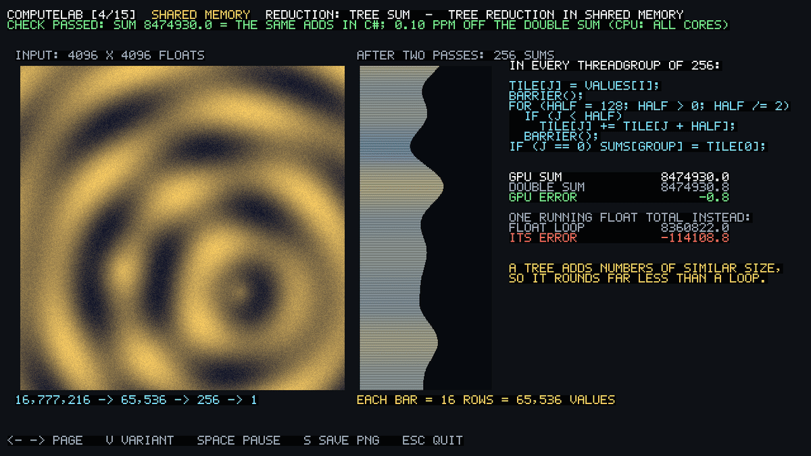
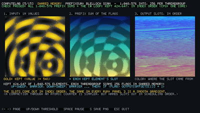
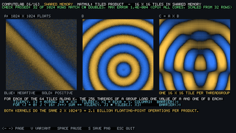
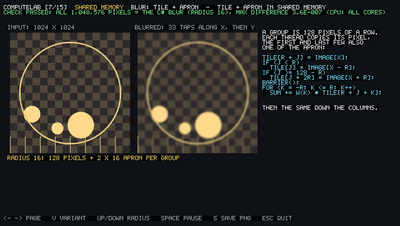

# Threadgroup shared memory and barriers

The GPU runs a grid in threadgroups (`[ThreadGroupSize]`, 256 threads by default for a 1D grid). A
`[GroupShared]` array (`[GroupShared] static readonly float[] tile = new float[256];`) is memory that
the threads of one group share. A barrier is the point where
they all wait for each other, so that what one thread wrote before it, another can read after it.
Together they turn independent threads into a team: this is what reductions, prefix sums and tiled
algorithms are built from.

- [Example: summing 256 values](#example-summing-256-values)
- [C# and MSL](#c-and-msl)
- [Rules](#rules)
- [On the CPU](#on-the-cpu)
- [Demo](#demo)

## Example: summing 256 values

This shader sums 256 values in eight steps:

```csharp
[ThreadGroupSize(256)]
[GeneratedComputeShaderDescriptor]
public readonly partial struct SumBlocks(ReadOnlyBuffer<float> input, ReadWriteBuffer<float> sums, int count) : IComputeShader
{
    [GroupShared]
    private static readonly float[] tile = new float[256];

    public void Execute()
    {
        int i = ThreadIds.X;
        int local = GroupIds.X;

        tile[local] = i < count ? input[i] : 0f;       // every thread loads one value
        Gpu.GroupMemoryBarrierWithGroupSync();

        for (int half = 128; half > 0; half >>= 1)
        {
            if (local < half)
            {
                tile[local] += tile[local + half];     // the lower half adds the upper half
            }

            Gpu.GroupMemoryBarrierWithGroupSync();     // outside the if: every thread calls it
        }

        if (local == 0)
        {
            sums[ThreadGroupIds.X] = tile[0];
        }
    }
}

device.For((count + 255) / 256 * 256, new SumBlocks(input, sums, count)); // whole threadgroups
```

## C# and MSL

| C# | MSL |
|---|---|
| `[GroupShared] static readonly T[] name = new T[N];` | `threadgroup T name[N];` in the kernel; helpers that use it receive `threadgroup T* name` |
| `name[i]`, `name.Length` | `name[i]`, the constant `N` |
| `Gpu.GroupMemoryBarrierWithGroupSync()` | `threadgroup_barrier(mem_flags::mem_threadgroup)` |
| `Gpu.DeviceMemoryBarrierWithGroupSync()` | `threadgroup_barrier(mem_flags::mem_device)` (plus `mem_texture` when the shader has a read-write texture) |
| `Gpu.AllMemoryBarrierWithGroupSync()` | `threadgroup_barrier` with all of those flags |
| `GroupSize.X/Y/Z/XY/XYZ`, `GroupSize.Count` | `threads_per_threadgroup`, and the product of its components |
| `GroupIds.Index` | `thread_index_in_threadgroup` |
| `ThreadGroupCount.X/Y/Z/XY/XYZ` | `threadgroups_per_grid` |

## Rules

- **Element type and length.** `T` is anything a buffer can hold (scalars, vectors, `Float4x4`, your
  own structs), and `N` is a compile-time constant. The field belongs to the shader struct that uses
  it.
- **Size limit.** The arrays a shader uses may total 32,768 bytes, the threadgroup memory of an Apple
  GPU (`SCG0043` beyond that).
- **Give the shader an explicit `[ThreadGroupSize]`**: its arrays are sized for it. Without one, the
  runtime picks the size per dispatch, and an array too short for that size is indexed out of bounds,
  silently, on the GPU. So using an array of fewer than 1,024 elements in such a shader is warning
  `SCG0044`.
- **Threadgroup memory starts out undefined**, on the GPU and on the CPU. A thread may only read what
  a thread of its own group wrote, with a barrier in between.
- **Every thread of a group must call the same barriers.** A barrier inside an `if` or a loop that
  only some threads of the group enter, or after a `return` only some take, is undefined on the GPU,
  and the generator cannot detect it. Put conditions around the work, as in the example.
- **Partial groups.** A grid that is not a multiple of the threadgroup size ends in partial groups,
  where `GroupSize` reports the threads the group really has. The simple way out is the one in the
  example: dispatch whole groups and let the threads past the end of the data load a neutral value.
- **Atomics.** Threads of a group can also update one `int` or `uint` element (or add to a `float` one)
  at the same time, without a barrier between them, with `Gpu.Atomic*(ref tile[i], ...)`. See
  [Atomics on threadgroup memory](atomics.md#atomics-on-threadgroup-memory).

## On the CPU

With `ForCpu` and `ForSplit`, such a shader runs with one dedicated thread per thread of a
threadgroup (at most 1,024), meeting at every barrier, one group after another. That computes what
the GPU computes and is good for checking and debugging a shader. But it costs microseconds per
thread per barrier: thousands of times slower than the GPU. Shaders without shared memory or
barriers are not affected. See [CPU execution](cpu-execution.md).

## Demo

ComputeLab's shared-memory pages run a reduction, a prefix sum, a tiled matrix product and a tiled
blur built this way, each checked against plain C#. `scripts/demo-groupshared.sh` opens the lab on
them. The reduction page, with the kernel above:



| Prefix sum | Tiled matrix product | Tiled blur |
|---|---|---|
| [](screenshots/computelab-prefixsum.png) | [](screenshots/computelab-matmul.png) | [](screenshots/computelab-blur.png) |
