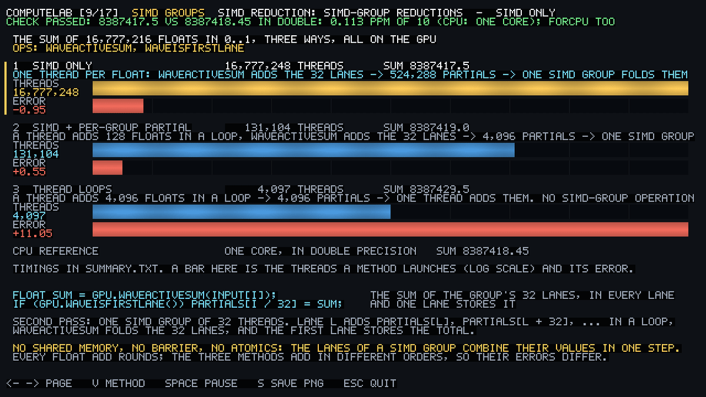
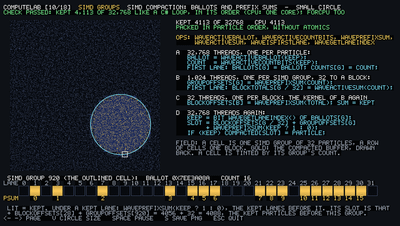
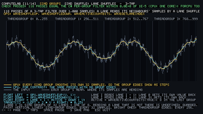

# SIMD-group operations

An Apple GPU executes a threadgroup 32 threads at a time, in *SIMD groups* whose threads ("lanes")
run together. The `Gpu.Wave*` methods let the lanes of one group combine or exchange values in a
single step, without threadgroup memory, barriers or atomics. The `Gpu.Quad*` methods do the same
among the four lanes of a quad. The names and meanings are those of HLSL's wave and quad intrinsics;
they map to Metal's `simd_*` and `quad_*` functions. A SIMD group can also multiply 8 × 8 matrices
on the GPU's matrix units: see [Matrix units](matrix-units.md).

- [Example: a sum per SIMD group](#example-a-sum-per-simd-group)
- [The methods](#the-methods)
- [What they mean](#what-they-mean)
- [On the CPU](#on-the-cpu)
- [Demo](#demo)

## Example: a sum per SIMD group

```csharp
[GeneratedComputeShaderDescriptor]
public readonly partial struct SumGroups(ReadOnlyBuffer<float> input, ReadWriteBuffer<float> partials) : IComputeShader
{
    public void Execute()
    {
        int i = ThreadIds.X;

        if (i >= input.Length)
        {
            return;                              // a lane that returned takes no part in what follows
        }

        float sum = Gpu.WaveActiveSum(input[i]); // the sum over the group's lanes, in every lane

        if (Gpu.WaveIsFirstLane())
        {
            partials[i / 32] = sum;              // one lane stores it: nothing to synchronize
        }
    }
}

device.For(count, new SumGroups(input, partials)); // 32 elements become one; repeat on the partials
```

## The methods

| | Methods of `Gpu` | Metal |
|---|---|---|
| Lanes | `WaveGetLaneIndex()`, `WaveGetLaneCount()`, `WaveIsFirstLane()`, and the built-ins `SimdGroupIds.Index`, `SimdGroupIds.Count` | `thread_index_in_simdgroup`, `threads_per_simdgroup`, `simd_is_first`, `simdgroup_index_in_threadgroup`, `simdgroups_per_threadgroup` |
| Votes | `WaveActiveAnyTrue(b)`, `WaveActiveAllTrue(b)`, `WaveActiveBallot(b)` (a `uint`, bit *i* = lane *i*), `WaveActiveCountBits(b)`, `WavePrefixCountBits(b)`, `WaveActiveAllEqual(v)` | `simd_any`, `simd_all`, `simd_ballot`, `simd_sum` and `simd_prefix_exclusive_sum` of 0/1, `simd_all(v == simd_broadcast_first(v))` |
| Reductions | `WaveActiveSum`, `WaveActiveProduct`, `WaveActiveMin`, `WaveActiveMax`; for integers also `WaveActiveBitAnd`, `WaveActiveBitOr`, `WaveActiveBitXor` | `simd_sum`, `simd_product`, `simd_min`, `simd_max`, `simd_and`, `simd_or`, `simd_xor` |
| Scans | `WavePrefixSum`, `WavePrefixProduct` (exclusive, as in HLSL), `WaveInclusivePrefixSum`, `WaveInclusivePrefixProduct` | `simd_prefix_exclusive_sum`/`_product`, `simd_prefix_inclusive_sum`/`_product` |
| Exchange | `WaveReadLaneAt(v, lane)`, `WaveReadLaneFirst(v)`, `WaveShuffleUp(v, delta)`, `WaveShuffleDown(v, delta)`, `WaveShuffleXor(v, mask)`, `WaveRotateUp(v, delta)`, `WaveRotateDown(v, delta)`, `WaveShuffleUpAndFill(v, fill, delta)`, `WaveShuffleDownAndFill(v, fill, delta)` | `simd_shuffle`, `simd_broadcast_first`, `simd_shuffle_up`/`_down`/`_xor`, `simd_shuffle_rotate_up`/`_down`, `simd_shuffle_and_fill_up`/`_down` |
| Quads | `QuadActiveAnyTrue(b)`, `QuadActiveAllTrue(b)`, `QuadActiveBallot(b)`; `QuadActiveSum`, `Product`, `Min`, `Max`, `BitAnd`, `BitOr`, `BitXor`; `QuadPrefixSum`, `QuadPrefixProduct`, `QuadInclusivePrefixSum`, `QuadInclusivePrefixProduct`; `QuadReadAcrossX(v)`, `QuadReadAcrossY(v)`, `QuadReadAcrossDiagonal(v)`, `QuadReadLaneAt(v, lane)` | `quad_any`, `quad_all`, `quad_ballot`; `quad_sum` … `quad_xor`; `quad_prefix_*`; `quad_shuffle_xor` with 1, 2, 3; `quad_shuffle` |

Values are `float`, `int`, `uint`, `Half` and their 2- to 4-component vectors (componentwise; the
bitwise reductions take the integers only). The 8-, 16- and 64-bit integers are not supported. The
operations work in compute and pixel shaders and in helper methods. Half values are covered in
[Half precision](half-precision.md#what-it-computes).

## What they mean

Measured on an Apple M4 Pro and pinned by the tests:

- **How groups are formed.** The threads of a threadgroup are numbered row by row (`GroupIds.Index`:
  `(z * sizeY + y) * sizeX + x`, with the real size of a threadgroup cut off at the edge of the
  grid). Lane `index % 32` of SIMD group `index / 32` is thread `index`. A threadgroup of 256 has 8
  groups; in a 16 × 16 one each group is two rows; 12 × 12 gives four full groups and one of 16
  lanes. Metal does not document this layout.
- **Which lanes take part.** Only *active* lanes: the ones executing this very call. A lane that
  returned earlier, a lane in the other branch of an `if`, and the lanes a partial group does not
  have (a grid or threadgroup that is not a multiple of 32) contribute nothing. A scan numbers the
  active lanes without gaps, and `WaveIsFirstLane` is the lowest active lane.
- **What an exclusive scan gives the first active lane.** 1 for a product and 0 for a sum. For floats
  and halves that 0 is `-0`, the identity of IEEE addition (`-0 + x` is `x` for every `x`), on the
  GPU and on the CPU. It compares equal to 0; the sign shows in `1 / x`, `Gpu.CopySign` and the bits.
- **Shuffles at the edges.** `WaveShuffleUp(v, delta)` gives lane *i* the value of lane *i − delta*;
  the lowest `delta` lanes get their own value back. `WaveShuffleDown` mirrors that at the top of a
  full group. The `...AndFill` forms hand those lanes a fill instead, the `fill` argument of the lane
  32 further on (so pass the same fill everywhere to shift in a constant). The rotations wrap around
  the 32 lanes.
- **Reading a lane that is not active** (the shuffles and rotations, `WaveReadLaneAt`, the quad
  reads) is undefined in Metal; Apple GPUs return 0. That includes the top of a partial group for
  `WaveShuffleDown`, so guard it: `lane + delta < Gpu.WaveActiveCountBits(true) ? shuffled : own`.
- **`WaveActiveBallot` returns a `uint`**, not HLSL's `uint4`: a SIMD group has 32 lanes on every
  Apple GPU. A dispatch checks the compiled kernel's width and refuses a wider GPU rather than drop
  votes.
- **`WaveActiveAllEqual` answers for the whole value**, also for a vector (HLSL answers per
  component).
- **Quads** are four consecutive lanes (`x = lane & 1`, `y = (lane >> 1) & 1`): 2 × 2 blocks of the
  grid in a threadgroup that is 2 threads wide, four threads in a row otherwise.
- **Float reductions** combine the lanes in an order of the GPU's choosing; compare with a tolerance.
  Integer results are exact and wrap.
- **With atomics.** Each SIMD group can reduce its lanes with `Gpu.WaveActiveSum` and then make one
  atomic add per SIMD group to a `[GroupShared]` total, instead of one per thread. See
  [Atomics](atomics.md#atomics-on-threadgroup-memory).

## On the CPU

With `ForCpu`, `ForIndirectCpu` and `ForSplit`, the lanes of a SIMD group run on threads of their
own, 32 at a time, and meet at every operation. A lane waits until every lane of its group that has
not returned from `Execute` is at the same call. The result is then computed from what they brought,
in lane order (and reading a lane that takes no part gives 0, as on Apple GPUs).

A shader that also uses threadgroup memory or barriers runs whole threadgroups instead, and
`ForSplit` cuts between threadgroups, so a SIMD group is never divided between the devices.

This reproduces the GPU when the lanes that are still running make the same SIMD-group calls in the
same order: calls at the top level of `Execute` after any early returns, and calls in loops and
branches that every lane takes alike. It costs about a quarter of a millisecond per operation and
SIMD group, so it is for checking and debugging a shader, not for bulk work.

- **Divergent control flow that shows is refused.** If the lanes of a group arrive at different calls
  (one branch of an `if` calls an operation and the other does not, or calls another), or some wait
  at an operation while others wait at a barrier, the dispatch throws `NotSupportedException`
  ("SIMD-group operation in divergent control flow is not supported on the CPU; it is supported on
  the GPU"). It does not hang, and it does not guess.
- **Limitation: divergence that does not show.** Lanes that reach the *same* call site along
  different paths meet as if control flow were uniform, and the result then includes lanes the GPU
  would have kept apart. That is the case for a call in a loop when lanes are in different iterations
  (a lane skipped an iteration, or its loop ran longer), and for a helper method that contains the
  call and is called from both branches of an `if`. `ForCpu` cannot detect this; such shaders are
  right on the GPU and should be checked there.
- **One call per line.** Every operation ends in two parameters the compiler fills in, `callerFile`
  and `callerLine` (leave them out). With the operation, they are the call site the lanes have to
  agree on, so keep two calls of the same operation on separate lines (`SCG0035` warns otherwise).

## Demo

ComputeLab's SIMD-group pages show three uses live (`scripts/demo-simdgroups.sh` opens the lab on
them): a reduction race over 16M floats, a stream compaction built from ballots and prefix sums, and
a signal smoothed with shuffles. The reduction, `WaveActiveSum` as above against a loop per thread:



| Compaction with ballots and prefix sums | Smoothing with shuffles |
|---|---|
| [](screenshots/computelab-simd-compaction.png) | [](screenshots/computelab-simd-shuffle.png) |
